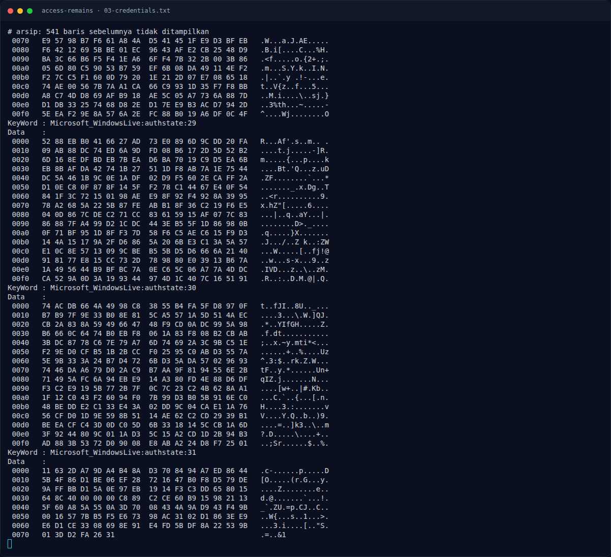

# Access Remains — Pemulihan Artefak

[← Overview](24-access-remains.md) · [Index](index.md)

> **Langkah 7/11 — Pemulihan Artefak.** Script reproduksi: assets/access-remains/solveaccess.sh.
>
> **Titik penting:** python3 /usr/share/doc/python3-impacket/examples/dpapi.py masterkey \ · python3 /usr/share/doc/python3-impacket/examples/dpapi.py credential \
>
> **Berikutnya:** [Alur 8 Sub-Challenge Q&A (verified)](24-access-remains-08-alur-8-sub-challenge-q-a-verified.md)

### 3.1 Strategi

1. `secretsdump` dari SAM/SYSTEM/SECURITY.
2. Crack NTLM user `aria`/`ariaf`.
3. Decrypt DPAPI masterkey dengan password `ariaf`.
4. Decrypt Credential Manager → password vault.
5. Buka `Kumiko.zip`.
6. Baca `note.txt`, temukan gambar yang “remember”, ekstrak teks.

### 3.2 Script/command

Script reproduksi: `assets/access-remains/solve_access.sh`.

```bash
impacket-secretsdump -sam SAM -system SYSTEM -security SECURITY local

python3 /usr/share/doc/python3-impacket/examples/dpapi.py masterkey \
  -file bb24f650-d046-439c-a88b-ab8f89ba61a4 \
  -sid S-1-5-21-3304503823-3980900213-1333018566-1005 \
  -password 'ariafe006'

python3 /usr/share/doc/python3-impacket/examples/dpapi.py credential \
  -file B0294E9651990C1435CA6300E4BB2378 \
  -key 0x2cbc5b2e483dae00c5593617eb517b8cabec639f354ca8f75b4296e82f3c8d2e83f2ce9a6ae64e3f1f849098f985b2d64e74e81affd37021392b7ba7b4635b55

7z x -y -p'KumikoOumae2107!@' Kumiko.zip
```

### 3.3 Output

```text
aria  : 250a19ea48a88bbc7532f08ecb072844 -> aria
ariaf : f545ff727c989c387b9d1be6db74ea1c -> ariafe006

Target   : LegacyGeneric:target=AccessRemains:WaifuVault
Username : ariaf@access-remains.local
Password : KumikoOumae2107!@

Kumiko.zip -> 5 JPG + note.txt
note.txt   -> "Find the one that remembers."
kumiko03.jpg -> {3E2D6090E7EEB47D5
                 38FC27AC2789C02}
```

### Evidence langkah ini



*Terminal evidence — `03-credentials.txt` (arsip transkrip sesi solve).*

**Berkas mentah langkah ini:**

- [`03-credentials.txt`](assets/access-remains/03-credentials.txt)
