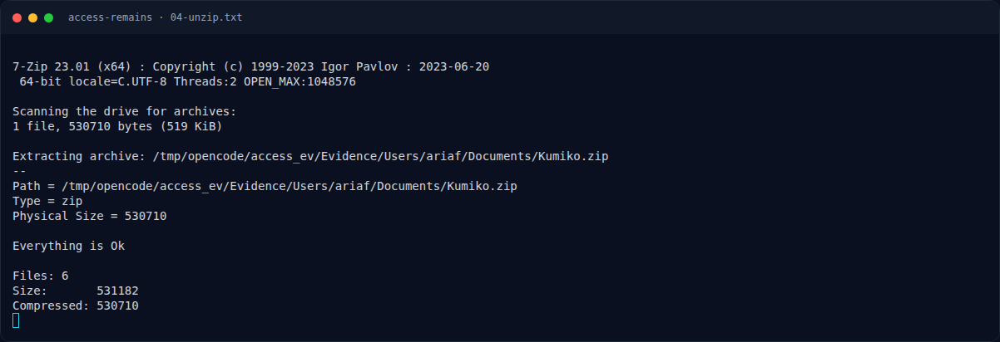

# Access Remains — Alur 8 Sub-Challenge Q&A (verified)

[← Overview](24-access-remains.md) · [Index](index.md)

Platform Access Remains memakai 8 pertanyaan berantai. Teks di bawah adalah
teks asli dari `get_sub_challenges`; semua jawaban sudah diverifikasi
`true` sampai `completed: true`.

| # | Pertanyaan (asli) | Jawaban | Bukti |
|---|---|---|---|
| 1 | Apa username Windows yang terkait dengan profil yang dikumpulkan? | `ariaf` | `Users/ariaf/`, secretsdump |
| 2 | Berapa RID dari user Windows tersebut? | `1005` | secretsdump |
| 3 | Apa NTLM hash yang terkait dengan user tersebut? | `f545ff727c989c387b9d1be6db74ea1c` | secretsdump |
| 4 | Apa password Windows milik user tersebut? | `ariafe006` | NTLM crack |
| 5 | Apa SID yang terkait dengan user Windows tersebut? | `S-1-5-21-3304503823-3980900213-1333018566-1005` | path DPAPI Protect |
| 6 | Apa GUID masterkey yang menjadi preferred masterkey milik user? | `bb24f650-d046-439c-a88b-ab8f89ba61a4` | file masterkey |
| 7 | Apa password yang digunakan untuk membuka archive Kumiko.zip? | `KumikoOumae2107!@` | Credential Manager |
| 8 | Setelah archive berhasil dibuka dan isinya diperiksa, apa flag akhirnya? (Format: hex32) | `3E2D6090E7EEB47D538FC27AC2789C02` | overlay `kumiko03.jpg` |

Setelah Q8 benar, `get_sub_challenges` mengembalikan:

```json
{"completed": true,
 "flag": "NFX{The_Real_Access_Was_Kumiko_All_Along}"}
```

### Evidence langkah ini



*Terminal evidence — `04-unzip.txt` (arsip transkrip sesi solve).*
