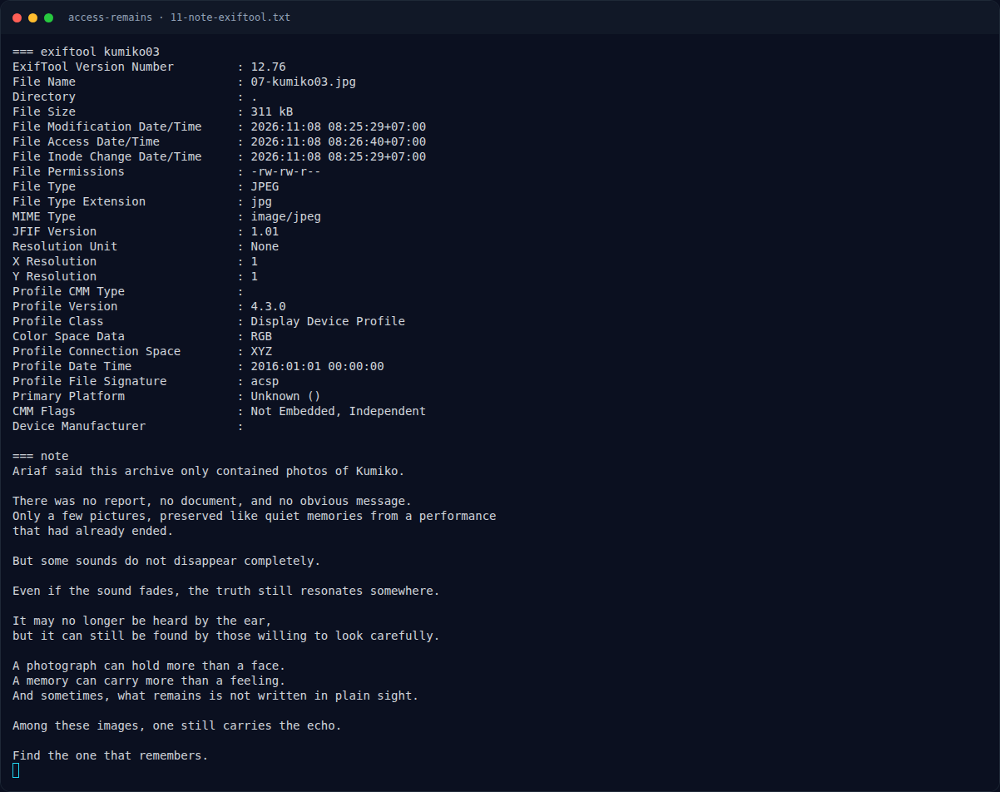
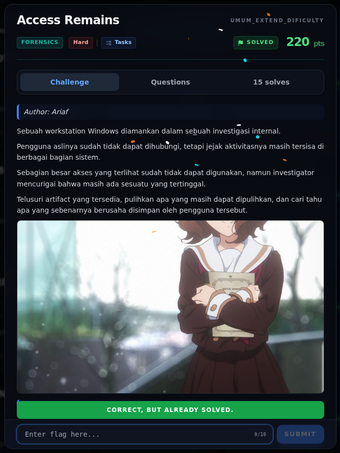

# Access Remains — Flag & Verifikasi

[← Overview](24-access-remains.md) · [Index](index.md)

> **Langkah 9/11 — Flag.** Flag
>
> **Titik penting:** NFX{The_Real_Access_Was_Kumiko_All_Along}
>
> **Berikutnya:** [Bukti / Evidence](24-access-remains-10-bukti-evidence.md)

> **Asal flag.** Flag diperoleh dari langkah exploit/solver yang terdokumentasi, lalu disubmit ke platform.  

> **Flag:** `NFX{The_Real_Access_Was_Kumiko_All_Along}`
> **Status:** `VERIFIED`

```text
NFX{The_Real_Access_Was_Kumiko_All_Along}
```

Verifikasi/status:

```text
Sumber : get_sub_challenges (completed=true)
Q8     : 3E2D6090E7EEB47D538FC27AC2789C02  (hex32 overlay)
Flag   : NFX{The_Real_Access_Was_Kumiko_All_Along}
Status : verified platform
```

### Terminal evidence (real)



*Terminal evidence (real).*

> **Bukti:** terminal evidence (real).

## Validasi platform (real)



*Screenshot asli dari platform NFX CTF 2026. Platform menjawab
`CORRECT, BUT ALREADY SOLVED.` untuk flag ini.*
