# Access Remains — Evidence / Bukti

13 screenshot11 transkrip / script

[← Overview](24-access-remains.md) · [Index](index.md)

> **Langkah 10/11 — Bukti / Evidence.** Bukti / Evidence
>
> **Titik penting:** arsip screenshot dan transkrip
>
> **Berikutnya:** [Referensi](24-access-remains-11-referensi.md)

## Arsip Evidence

> Semua file berasal dari `assets/access-remains/`. Screenshot platform dan terminal adalah bukti asli dari sesi solve; transkrip mentah tetap ditautkan di bagian bawah.

### Platform

<figure><a href="assets/access-remains/00-challenge-platform.png" target="_blank" rel="noopener">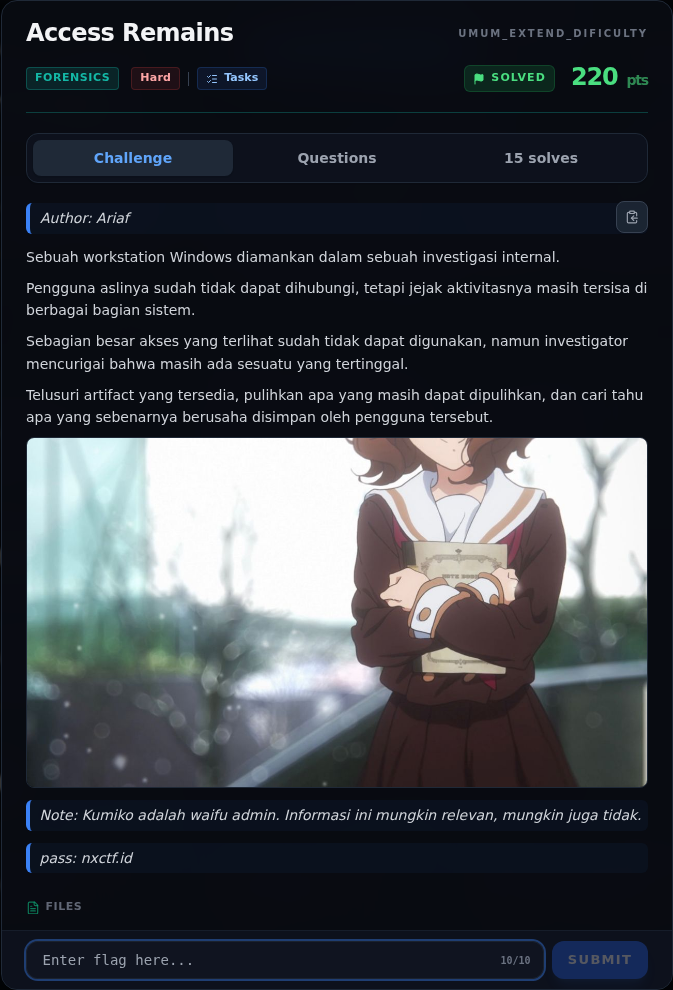</a><figcaption>00-challenge-platform.png</figcaption></figure>

*Challenge brief asli di platform NFX CTF 2026.*

<figure><a href="assets/access-remains/00b-submit-platform.png" target="_blank" rel="noopener">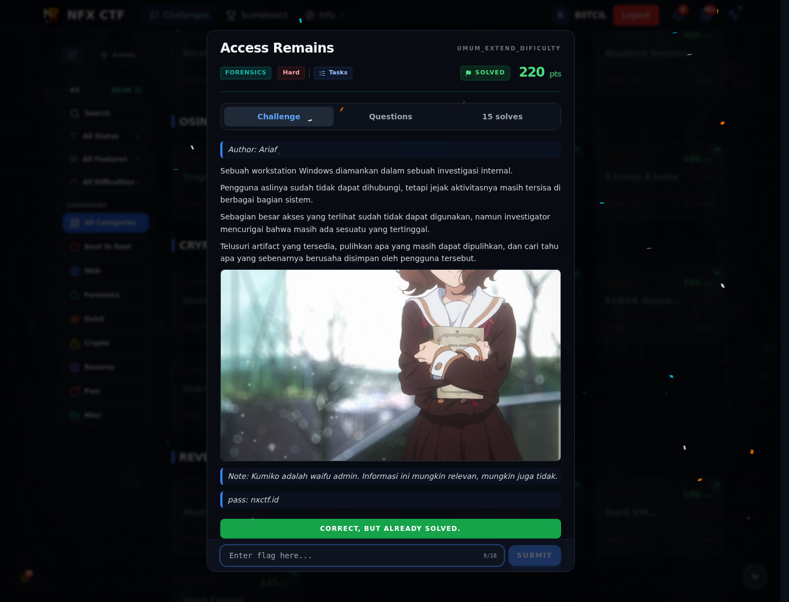</a><figcaption>00b-submit-platform.png</figcaption></figure>

*Submit flag di platform: `CORRECT, BUT ALREADY SOLVED.`*

### Terminal (arsip sesi)

<figure><a href="assets/access-remains/term-00-file-tree.png" target="_blank" rel="noopener">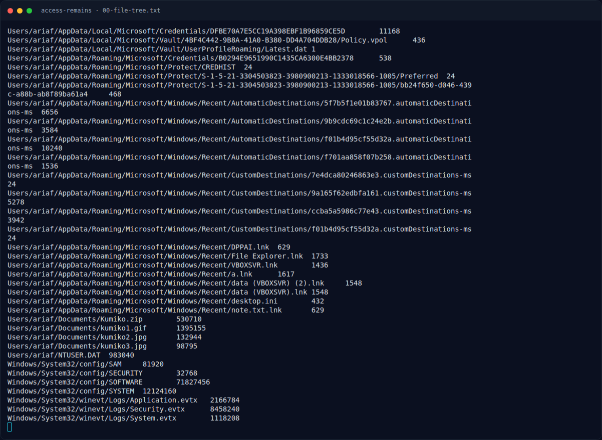</a><figcaption>term-00-file-tree.png</figcaption></figure>

*Terminal evidence — `00-file-tree.txt` (arsip transkrip sesi solve).*

<figure><a href="assets/access-remains/term-01-secretsdump.png" target="_blank" rel="noopener">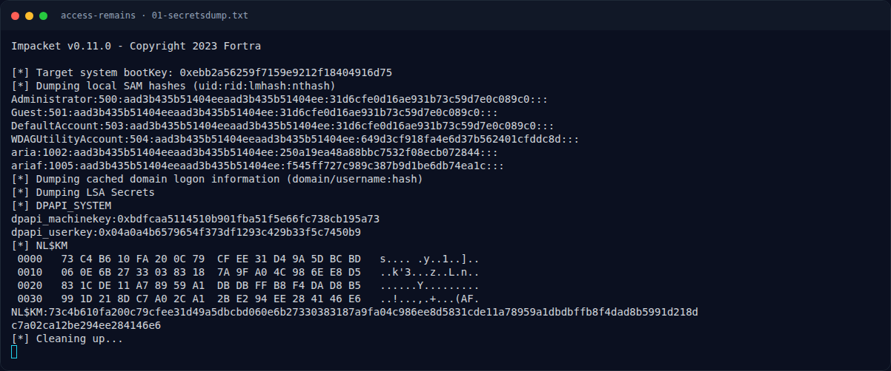</a><figcaption>term-01-secretsdump.png</figcaption></figure>

*Terminal evidence — `01-secretsdump.txt` (arsip transkrip sesi solve).*

<figure><a href="assets/access-remains/term-02-masterkey.png" target="_blank" rel="noopener">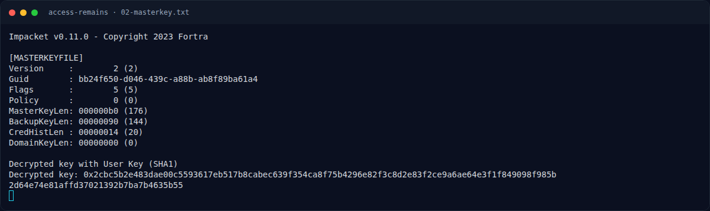</a><figcaption>term-02-masterkey.png</figcaption></figure>

*Terminal evidence — `02-masterkey.txt` (arsip transkrip sesi solve).*

<figure><a href="assets/access-remains/term-03-credentials.png" target="_blank" rel="noopener">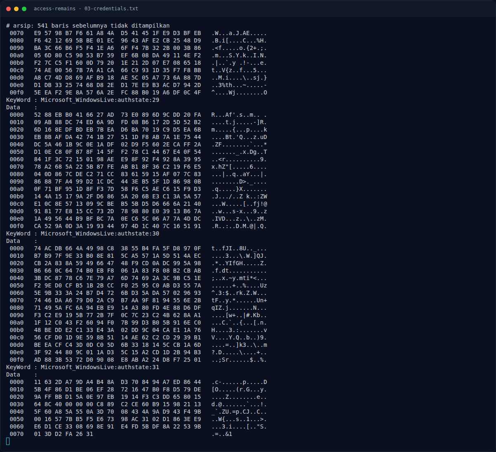</a><figcaption>term-03-credentials.png</figcaption></figure>

*Terminal evidence — `03-credentials.txt` (arsip transkrip sesi solve).*

<figure><a href="assets/access-remains/term-04-unzip.png" target="_blank" rel="noopener">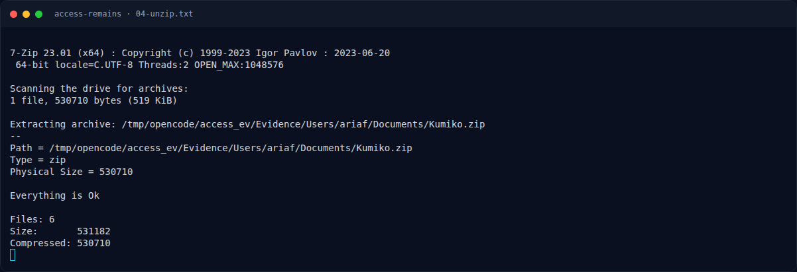</a><figcaption>term-04-unzip.png</figcaption></figure>

*Terminal evidence — `04-unzip.txt` (arsip transkrip sesi solve).*

<figure><a href="assets/access-remains/term-06-note.png" target="_blank" rel="noopener">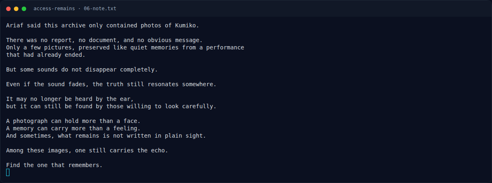</a><figcaption>term-06-note.png</figcaption></figure>

*Terminal evidence — `06-note.txt` (arsip transkrip sesi solve).*

<figure><a href="assets/access-remains/term-09-hashes.png" target="_blank" rel="noopener">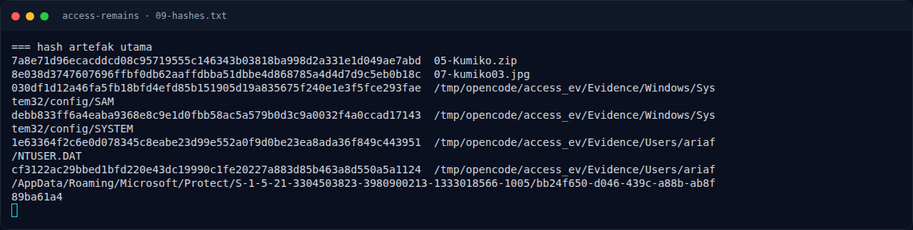</a><figcaption>term-09-hashes.png</figcaption></figure>

*Terminal evidence — `09-hashes.txt` (arsip transkrip sesi solve).*

<figure><a href="assets/access-remains/term-10-ntlm-verify.png" target="_blank" rel="noopener">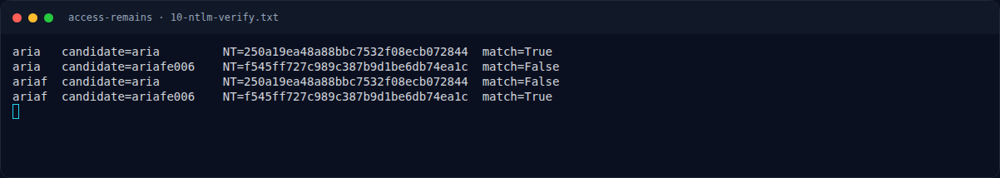</a><figcaption>term-10-ntlm-verify.png</figcaption></figure>

*Terminal evidence — `10-ntlm-verify.txt` (arsip transkrip sesi solve).*

<figure><a href="assets/access-remains/term-11-note-exiftool.png" target="_blank" rel="noopener">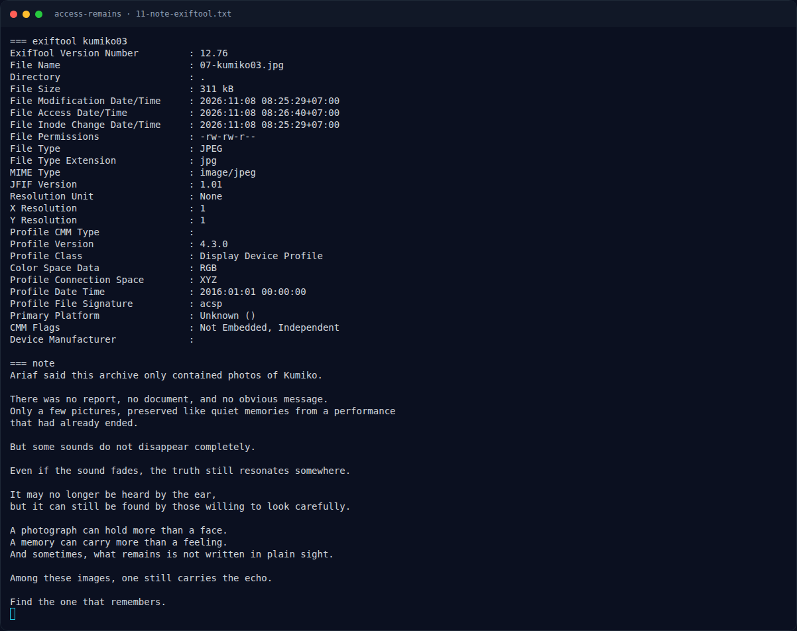</a><figcaption>term-11-note-exiftool.png</figcaption></figure>

*Terminal evidence — `11-note-exiftool.txt` (arsip transkrip sesi solve).*

### Screenshot langkah

<figure><figcaption>07-kumiko03.jpg</figcaption></figure>

*Evidence — `07-kumiko03.jpg`.*

<figure><a href="assets/access-remains/08-flag-crop.png" target="_blank" rel="noopener">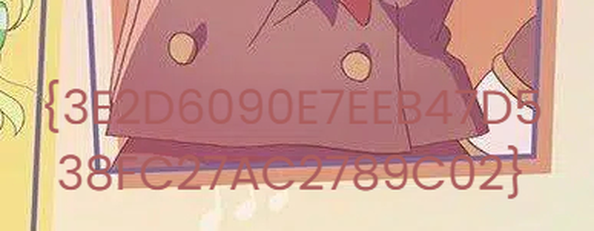</a><figcaption>08-flag-crop.png</figcaption></figure>

*Evidence — `08-flag-crop.png`.*

### Transkrip mentah & script

- [`00-file-tree.txt`](assets/access-remains/00-file-tree.txt)
- [`01-secretsdump.txt`](assets/access-remains/01-secretsdump.txt)
- [`02-masterkey.txt`](assets/access-remains/02-masterkey.txt)
- [`03-credentials.txt`](assets/access-remains/03-credentials.txt)
- [`04-unzip.txt`](assets/access-remains/04-unzip.txt)
- [`05-Kumiko.zip`](assets/access-remains/05-Kumiko.zip)
- [`06-note.txt`](assets/access-remains/06-note.txt)
- [`09-hashes.txt`](assets/access-remains/09-hashes.txt)
- [`10-ntlm-verify.txt`](assets/access-remains/10-ntlm-verify.txt)
- [`11-note-exiftool.txt`](assets/access-remains/11-note-exiftool.txt)
- [`solve_access.sh`](assets/access-remains/solve_access.sh)

## Tabel Evidence

| Bukti | File | Keterangan |
|---|---|---|
| File tree | `assets/access-remains/00-file-tree.txt` | struktur Evidence |
| SAM/SYSTEM | `assets/access-remains/01-secretsdump.txt` | bootkey + NTLM |
| Masterkey | `assets/access-remains/02-masterkey.txt` | decrypt DPAPI |
| Credential | `assets/access-remains/03-credentials.txt` | target/username/password |
| ZIP extract | `assets/access-remains/04-unzip.txt` | 7z output |
| ZIP | `assets/access-remains/05-Kumiko.zip` | arsip terenkripsi |
| Note | `assets/access-remains/06-note.txt` | petunjuk “one that remembers” |
| Gambar | `assets/access-remains/07-kumiko03.jpg` | gambar dengan overlay |
| Crop flag | `assets/access-remains/08-flag-crop.png` | teks flag diperbesar |
| Hash | `assets/access-remains/09-hashes.txt` | sha256 artefak |
| NTLM verify | `assets/access-remains/10-ntlm-verify.txt` | verifikasi kandidat |
| Script | `assets/access-remains/solve_access.sh` | reproduksi alur |