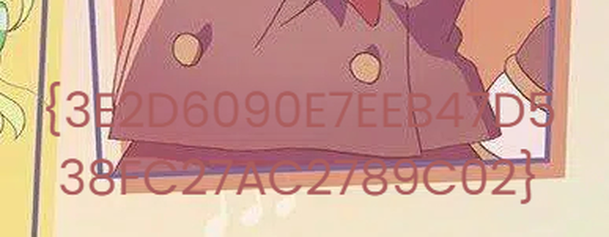

# Access Remains — Referensi

[← Overview](24-access-remains.md) · [Index](index.md)

> **Langkah 11/11 — Referensi.** Referensi
>
> **Titik penting:** —
>
> **Selesai.** Kembali ke [Overview](24-access-remains.md).

- Impacket `secretsdump`, `dpapi.py`.
- Windows DPAPI masterkey & Credential Manager format.
- ZipCrypto vs AES-256 ZIP.
- Teknik overlay teks pada JPEG.

### Evidence langkah ini

*Evidence — `08-flag-crop.png`.*
