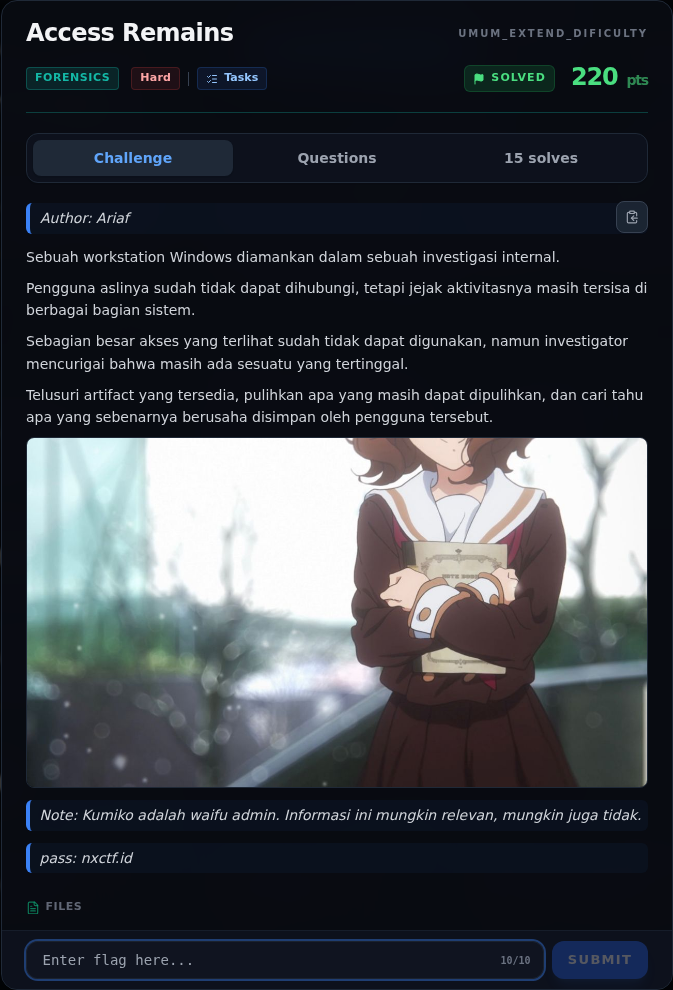
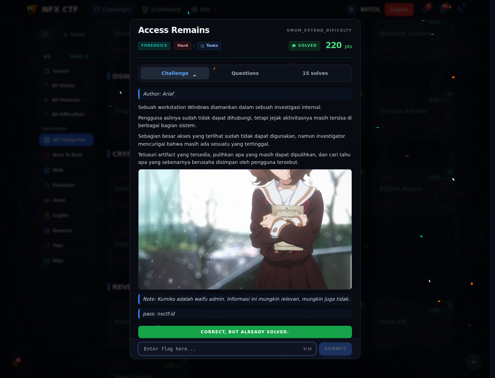

# Access Remains

Track Umum / Extend · ForensicsHard360 poinVERIFIED

| Field | Nilai |
|---|---|
| Event | `umum_Extend` |
| Kategori | `Forensics` |
| Difficulty | `Hard` |
| Poin | `360` |
| Author | `Ariaf` |
| Solves | `8` |
| Tools | python3, exiftool, sage |
| Flag | `NFX{The_Real_Access_Was_Kumiko_All_Along}` |
| Status | `VERIFIED` |

[← Kembali ke Index](index.md)

## Challenge Brief (platform)

*Challenge brief asli di platform NFX CTF 2026.*

## TL;DR

- Evidence Windows: `SAM`, `SYSTEM`, `SECURITY`, `NTUSER.DAT`, DPAPI masterkey, Credential Manager, dan `Kumiko.zip`.
- `secretsdump` menghasilkan NTLM user `aria` dan `ariaf`; NTLM di-crack menjadi `aria` dan `ariafe006`.
- Password `ariaf` membuka DPAPI masterkey `bb24f650-...`; Credential Manager menyimpan `AccessRemains:WaifuVault` dengan password `KumikoOumae2107!@`.
- Password tersebut membuka `Kumiko.zip` (ZipCrypto). Isinya foto-foto Kumiko dan `note.txt`.
- `note.txt` mengarah ke “one that remembers”; `kumiko03.jpg` memuat overlay teks 32 hex:
  `{3E2D6090E7EEB47D5` + `38FC27AC2789C02}`.
- Hex32 `3E2D6090E7EEB47D538FC27AC2789C02` adalah jawaban Q8, **bukan**
  flag akhir.
- Setelah 8/8 Q&A selesai, platform mengembalikan flag final:
  `NFX{The_Real_Access_Was_Kumiko_All_Along}`.

Pratinjau evidence. Buka halaman <a href="24-access-remains-10-bukti-evidence.html">Evidence / Bukti</a> untuk semua screenshot dan transkrip.

## Navigasi Halaman

<a class="nx-page-card" href="24-access-remains-01-deskripsi-challenge.html"><b>Deskripsi challenge</b>Baca bagian ini</a>
<a class="nx-page-card" href="24-access-remains-02-recon-artefak.html"><b>Recon Artefak</b>Enumerasi target dan bukti awal</a>
<a class="nx-page-card" href="24-access-remains-03-triage-awal.html"><b>Triage awal</b>Baca bagian ini</a>
<a class="nx-page-card" href="24-access-remains-04-sam-system-security-ntlm.html"><b>SAM + SYSTEM + SECURITY → NTLM</b>Baca bagian ini</a>
<a class="nx-page-card" href="24-access-remains-05-analisis-artefak.html"><b>Analisis Artefak</b>Membaca alur dan akar masalah</a>
<a class="nx-page-card" href="24-access-remains-06-analisis-artefak-2.html"><b>Analisis Artefak</b>Membaca alur dan akar masalah</a>
<a class="nx-page-card" href="24-access-remains-07-pemulihan-artefak.html"><b>Pemulihan Artefak</b>Baca bagian ini</a>
<a class="nx-page-card" href="24-access-remains-08-alur-8-sub-challenge-q-a-verified.html"><b>Alur 8 Sub-Challenge Q&amp;A (verified)</b>Baca bagian ini</a>
<a class="nx-page-card" href="24-access-remains-09-flag.html"><b>Flag</b>Flag dan verifikasi platform</a>
<a class="nx-page-card" href="24-access-remains-10-bukti-evidence.html"><b>Bukti / Evidence</b>Screenshot, transkrip, dan artefak</a>
<a class="nx-page-card" href="24-access-remains-11-referensi.html"><b>Referensi</b>Sumber dan bacaan lanjutan</a>

