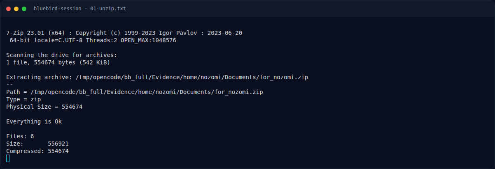

# Bluebird Session — Triage awal

[← Overview](25-bluebird-session.md) · [Index](index.md)

> **Langkah 2/11 — Triage awal.** /etc/passwd (user manusia):
>
> **Titik penting:** file for_nozomi.zip login.keyring 423261422632617826.jpg
>
> **Berikutnya:** [Identitas dua user](25-bluebird-session-03-identitas-dua-user.md)

## 1.4 Triage awal

```bash
$ file for_nozomi.zip login.keyring 423261422632617826.jpg
for_nozomi.zip:             Zip archive data, at least v2.0 to extract
login.keyring:              data
423261422632617826.jpg:     JPEG image data, 736x899
```

`/etc/hostname`:

```text
srv
```

`/etc/passwd` (user manusia):

```text
aria:x:1000:1000:aria:/home/aria:/bin/bash
mizore:x:1001:1001::/home/mizore:/bin/bash
nozomi:x:1002:1002::/home/nozomi:/bin/bash
```

### Evidence langkah ini



*Terminal evidence — `01-unzip.txt` (arsip transkrip sesi solve).*

**Berkas mentah langkah ini:**

- [`01-unzip.txt`](assets/bluebird-session/01-unzip.txt)
