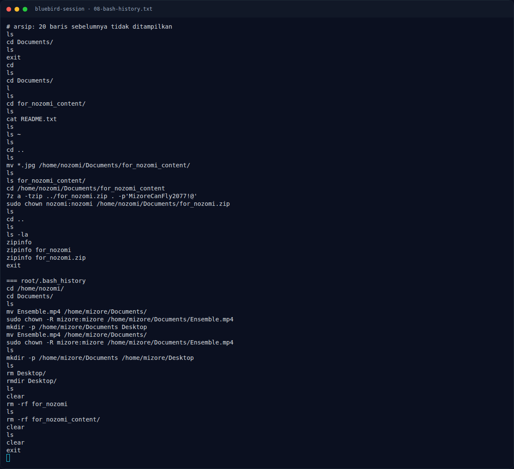

# Bluebird Session — Bash history

[← Overview](25-bluebird-session.md) · [Index](index.md)

## 2.2 Bash history

`mizore/.bash_history`:

```bash
whoami
id
ls -la /home/nozomi/Documents
secret-tool store --label="Mizore Promise Note" app bluebird target for_nozomi_note
secret-tool lookup app bluebird target for_nozomi_note
ls -la /home/nozomi/Documents/for_nozomi_content
pwd
ip addr
```

`nozomi/.bash_history`:

```bash
sudo bash -c 'cat > /home/nozomi/Documents/for_nozomi_content/README.txt' << 'EOF'
These memories were never meant to disappear.

Look through the performance, the pictures, and the sound that remains.
EOF
...
7z a -tzip ../for_nozomi.zip . -p'MizoreCanFly2077!@'
sudo chown nozomi:nozomi /home/nozomi/Documents/for_nozomi.zip
...
```

`root/.bash_history`:

```bash
cd /home/nozomi/
cd Documents/
ls
mv Ensemble.mp4 /home/mizore/Documents/
sudo chown -R mizore:mizore /home/mizore/Documents/Ensemble.mp4
...
rm -rf for_nozomi
rm -rf for_nozomi_content/
```

Root memindahkan `Ensemble.mp4` ke home mizore dan menghapus direktori kerja `for_nozomi_content`, tetapi ZIP sudah dibuat dan tertinggal.

### Evidence langkah ini



*Terminal evidence — `08-bash-history.txt` (arsip transkrip sesi solve).*

**Berkas mentah langkah ini:**

- [`08-bash-history.txt`](assets/bluebird-session/08-bash-history.txt)
