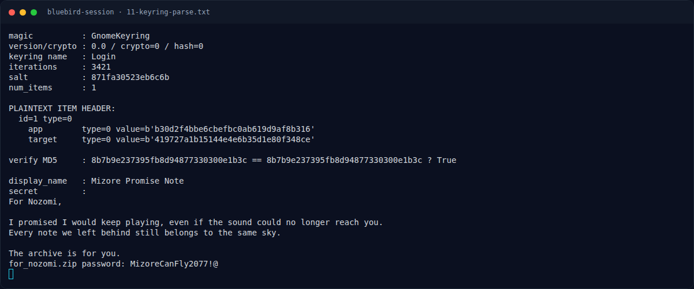

# Bluebird Session — GNOME Keyring `login.keyring`

[← Overview](25-bluebird-session.md) · [Index](index.md)

## 2.3 GNOME Keyring `login.keyring`

Header:

```text
00000000: 476e 6f6d 654b 6579 7269 6e67 0a0d 000a  GnomeKeyring....
00000010: 0000 0000 0000 0005 4c6f 6769 6e00 0000  ........Login...
...
00000030: 0000 0000 0000 000d 5d87 1fa3 0523 eb6c  ........]....#.l
```

Parse:

```text
magic          : GnomeKeyring
version/crypto : 0.0 / crypto=0 (AES) / hash=0 (MD5)
keyring name   : Login
iterations     : 3421
salt           : 871fa30523eb6c6b
num_items      : 1

PLAINTEXT ITEM HEADER:
  id=1 type=0
    app        type=0 value=b'b30d2f4bbe6cbefbc0ab619d9af8b316'
    target     type=0 value=b'419727a1b15144e4e6b35d1e80f348ce'
```

Atribut adalah MD5 dari nilai:

```text
MD5('bluebird')        = b30d2f4bbe6cbefbc0ab619d9af8b316
MD5('for_nozomi_note') = 419727a1b15144e4e6b35d1e80f348ce
```

KDF GNOME Keyring lama:

```text
digest = SHA256(password || salt)
ulangi SHA256(digest) sebanyak iterations-1
key = digest[0:16], iv = digest[16:32]
AES-128-CBC decrypt ciphertext
```

Dengan password `Bluebirds1927!`:

```text
verify MD5     : 8b7b9e237395fb8d94877330300e1b3c == 8b7b9e237395fb8d94877330300e1b3c ? True

display_name   : Mizore Promise Note
secret         :
For Nozomi,

I promised I would keep playing, even if the sound could no longer reach you.
Every note we left behind still belongs to the same sky.

The archive is for you.
for_nozomi.zip password: MizoreCanFly2077!@
```

### Evidence langkah ini



*Terminal evidence — `11-keyring-parse.txt` (arsip transkrip sesi solve).*

**Berkas mentah langkah ini:**

- [`11-keyring-parse.txt`](assets/bluebird-session/11-keyring-parse.txt)
