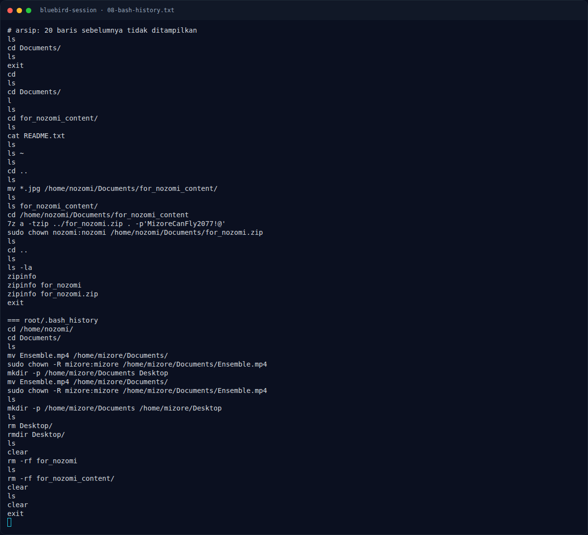

# Bluebird Session — Analisis Artefak

[← Overview](25-bluebird-session.md) · [Index](index.md)

> **Langkah 6/11 — Analisis Artefak.** Petunjuk: “performance, pictures, sound” — Ensemble.mp4 adalah performance/audio, tetapi gambar juga memuat pesan.
>
> **Titik penting:** 7z x -y -p'MizoreCanFly2077!@' for_nozomi.zip
>
> **Berikutnya:** [Pemulihan Artefak](25-bluebird-session-07-pemulihan-artefak.md)

## 2.4 Membuka `for_nozomi.zip`

```bash
$ 7z x -y -p'MizoreCanFly2077!@' for_nozomi.zip
...
Everything is Ok

Files: 6
Size:       556921
Compressed: 554674
```

Isi:

```text
323411127236637529.jpg
423261422632617826.jpg
534380312034824810.jpg
674625219173977142.jpg
723461127636657826.jpg
README.txt
```

`README.txt`:

```text
These memories were never meant to disappear.

Look through the performance, the pictures, and the sound that remains.
```

Petunjuk: “performance, pictures, sound” — `Ensemble.mp4` adalah performance/audio, tetapi gambar juga memuat pesan. Pemeriksaan metadata/strings pada `Ensemble.mp4` tidak menghasilkan tambahan yang diperlukan untuk flag; jalur utama adalah gambar.

## 2.5 Gambar dengan flag

`423261422632617826.jpg` adalah JPEG 736×899. Bagian atas gambar memuat overlay teks:

```text
{3220D64291CDFA4B
26844C90690E8F1D}
```

Penggabungan:

```text
3220D64291CDFA4B + 26844C90690E8F1D
= 3220D64291CDFA4B26844C90690E8F1D
```

32 hex, 4 grup 8:

```text
3220D642  91CDFA4B  26844C90  690E8F1D
```

### Evidence langkah ini



*Terminal evidence — `08-bash-history.txt` (arsip transkrip sesi solve).*

**Berkas mentah langkah ini:**

- [`08-bash-history.txt`](assets/bluebird-session/08-bash-history.txt)
