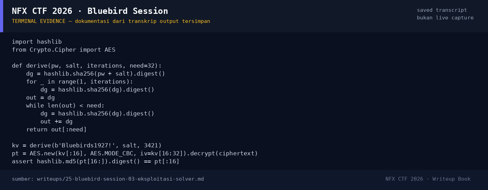

# Bluebird Session — Evidence / Bukti

3 screenshot13 transkrip / script

[← Overview](25-bluebird-session.md) · [Index](index.md)

## Arsip Evidence

> Semua file di bawah berasal dari folder `assets/bluebird-session/`. Screenshot ditempel langsung; file teks/script ditautkan.

### Screenshot

<figure><figcaption>05-flag-image.jpg</figcaption></figure>
<figure><figcaption>06-flag-crop.png</figcaption></figure>
<figure><figcaption>98-terminal-evidence.png</figcaption></figure>

### Transkrip / file pendukung

- [`00-file-tree.txt`](assets/bluebird-session/00-file-tree.txt)
- [`01-unzip.txt`](assets/bluebird-session/01-unzip.txt)
- [`02-keyring-decrypted.bin`](assets/bluebird-session/02-keyring-decrypted.bin)
- [`03-login.keyring`](assets/bluebird-session/03-login.keyring)
- [`04-README.txt`](assets/bluebird-session/04-README.txt)
- [`07-account.txt`](assets/bluebird-session/07-account.txt)
- [`08-bash-history.txt`](assets/bluebird-session/08-bash-history.txt)
- [`09-auth.log`](assets/bluebird-session/09-auth.log)
- [`10-hashes.txt`](assets/bluebird-session/10-hashes.txt)
- [`11-keyring-parse.txt`](assets/bluebird-session/11-keyring-parse.txt)
- [`12-attribute-md5.txt`](assets/bluebird-session/12-attribute-md5.txt)
- [`13-password-verify.txt`](assets/bluebird-session/13-password-verify.txt)
- [`solve_bluebird.py`](assets/bluebird-session/solve_bluebird.py)

## Tabel Evidence

| Bukti | File | Keterangan |
|---|---|---|
| File tree | `assets/bluebird-session/00-file-tree.txt` | struktur Evidence |
| Unzip | `assets/bluebird-session/01-unzip.txt` | 7z output |
| Keyring decrypt | `assets/bluebird-session/02-keyring-decrypted.bin` | plaintext 368 byte |
| Keyring asli | `assets/bluebird-session/03-login.keyring` | 566 byte |
| README | `assets/bluebird-session/04-README.txt` | petunjuk performance/pictures/sound |
| Gambar flag | `assets/bluebird-session/05-flag-image.jpg` | 736×899 |
| Crop flag | `assets/bluebird-session/06-flag-crop.png` | overlay diperbesar |
| Account | `assets/bluebird-session/07-account.txt` | passwd/shadow/group |
| History | `assets/bluebird-session/08-bash-history.txt` | mizore/nozomi/root |
| Auth log | `assets/bluebird-session/09-auth.log` | SSH mizore |
| Hash | `assets/bluebird-session/10-hashes.txt` | sha256 |
| Keyring parse | `assets/bluebird-session/11-keyring-parse.txt` | output parser |
| Attribute MD5 | `assets/bluebird-session/12-attribute-md5.txt` | verifikasi atribut |
| Password verify | `assets/bluebird-session/13-password-verify.txt` | SHA-512 crypt |
| Script | `assets/bluebird-session/solve_bluebird.py` | parser + dekripsi |