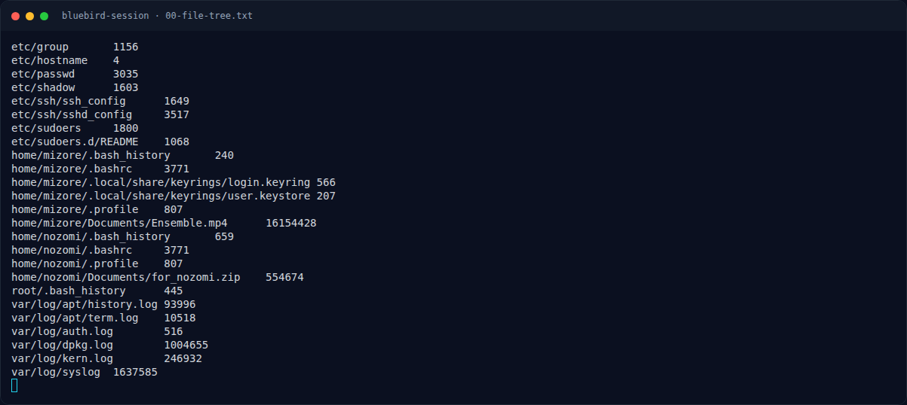
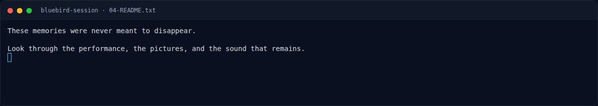
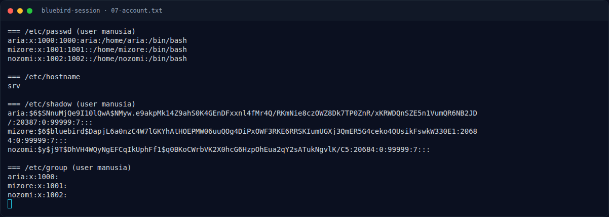
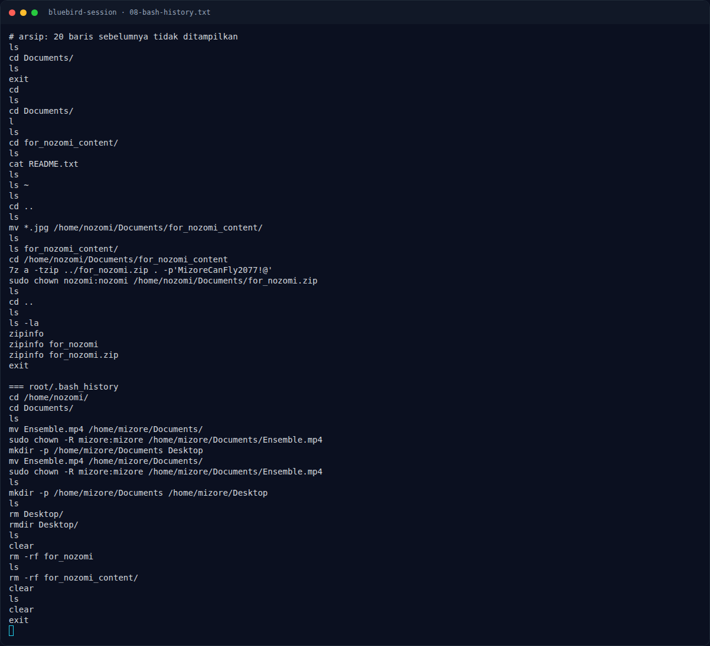
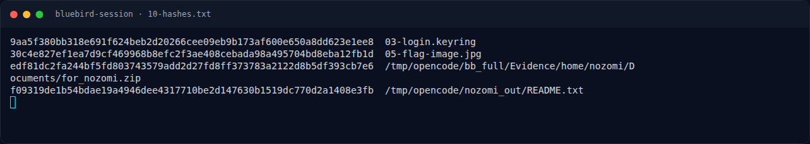
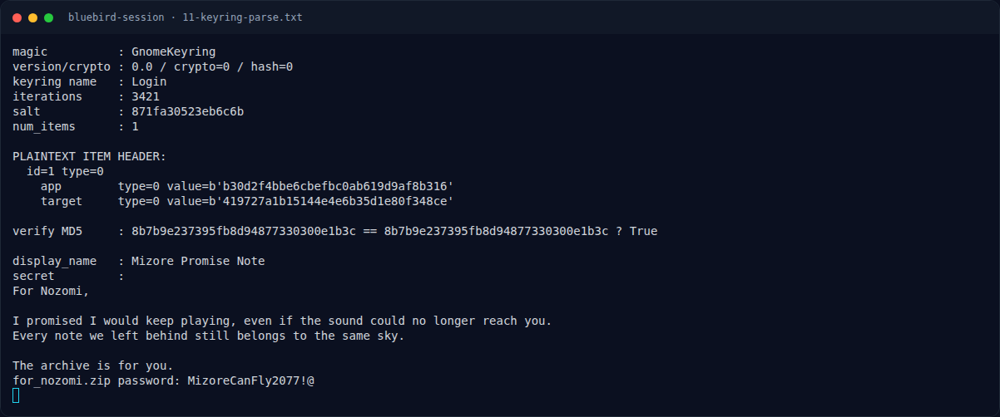
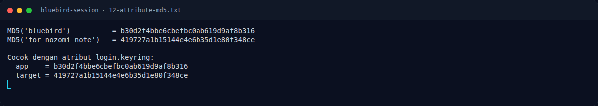
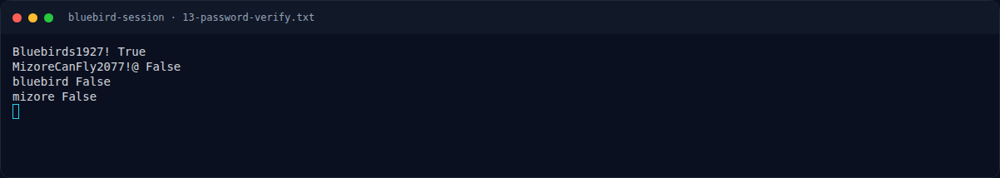

# Bluebird Session — Pemulihan Artefak

[← Overview](25-bluebird-session.md) · [Index](index.md)

### 3.1 Strategi

1. Baca passwd/shadow/group → identifikasi mizore/nozomi.
2. Verifikasi password mizore dari hash SHA-512 crypt.
3. Parse `login.keyring` dan dekripsi dengan password tersebut.
4. Ambil password ZIP dari secret keyring.
5. Ekstrak ZIP, baca README, temukan gambar dengan overlay.
6. Transkripsi 32 hex → flag.

### 3.2 Script

Parser keyring lengkap: `assets/bluebird-session/solve_bluebird.py`.

Inti KDF:

```python
import hashlib
from Crypto.Cipher import AES

def derive(pw, salt, iterations, need=32):
    dg = hashlib.sha256(pw + salt).digest()
    for _ in range(1, iterations):
        dg = hashlib.sha256(dg).digest()
    out = dg
    while len(out) < need:
        dg = hashlib.sha256(dg).digest()
        out += dg
    return out[:need]

kv = derive(b'Bluebirds1927!', salt, 3421)
pt = AES.new(kv[:16], AES.MODE_CBC, iv=kv[16:32]).decrypt(ciphertext)
assert hashlib.md5(pt[16:]).digest() == pt[:16]
```

Ekstrak ZIP:

```bash
7z x -y -p'MizoreCanFly2077!@' for_nozomi.zip
```

### 3.3 Output

```text
iterations : 3421
salt       : 871fa30523eb6c6b
app        : b30d2f4bbe6cbefbc0ab619d9af8b316  (MD5 "bluebird")
target     : 419727a1b15144e4e6b35d1e80f348ce  (MD5 "for_nozomi_note")

display_name : Mizore Promise Note
secret       : ... for_nozomi.zip password: MizoreCanFly2077!@

for_nozomi.zip -> 5 JPG + README.txt
423261422632617826.jpg -> {3220D64291CDFA4B
                           26844C90690E8F1D}
```

### Evidence langkah ini



*Terminal evidence — `00-file-tree.txt` (arsip transkrip sesi solve).*



*Terminal evidence — `04-README.txt` (arsip transkrip sesi solve).*



*Terminal evidence — `07-account.txt` (arsip transkrip sesi solve).*



*Terminal evidence — `08-bash-history.txt` (arsip transkrip sesi solve).*



*Terminal evidence — `10-hashes.txt` (arsip transkrip sesi solve).*



*Terminal evidence — `11-keyring-parse.txt` (arsip transkrip sesi solve).*



*Terminal evidence — `12-attribute-md5.txt` (arsip transkrip sesi solve).*



*Terminal evidence — `13-password-verify.txt` (arsip transkrip sesi solve).*
