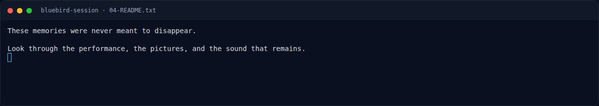
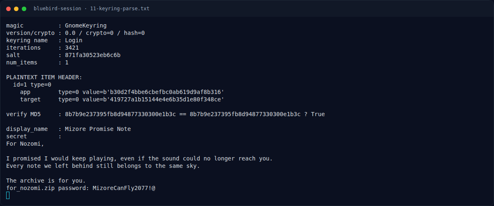

# Bluebird Session — Alur 11 Sub-Challenge Q&A (verified)

[← Overview](25-bluebird-session.md) · [Index](index.md)

> **Langkah 8/11 — Alur 11 Sub-Challenge Q&A (verified).** Platform Bluebird Session memakai 11 pertanyaan berantai.
>
> **Titik penting:** NFX{Mizore_Promise_Never_Forgotten_The_Bluebird_Still_Sings} · 192.168.56.21
>
> **Berikutnya:** [Flag](25-bluebird-session-09-flag.md)

Platform Bluebird Session memakai 11 pertanyaan berantai. Teks di bawah adalah
teks asli dari `get_sub_challenges`, dan semua jawaban sudah diverifikasi
`true` sampai `completed: true`.

| # | Pertanyaan (asli) | Jawaban | Bukti |
|---|---|---|---|
| 1 | Apa username Linux yang merepresentasikan Liz? | `mizore` | `/etc/passwd` UID 1001 |
| 2 | Apa username Linux yang merepresentasikan Blue Bird? | `nozomi` | `/etc/passwd` UID 1002 |
| 3 | Berapa UID milik user Liz? | `1001` | `/etc/passwd` |
| 4 | Berapa UID milik user Blue Bird? | `1002` | `/etc/passwd` |
| 5 | What password hash is stored for the Liz user in /etc/shadow? | `$6$bluebird$DapjL6a0nzC4W7lGKYhAtHOEPMW06uuQOg4DiPxOWF3RKE6RRSKIumUGXj3QmER5G4ceko4QUsikFswkW330E1` | `/etc/shadow` |
| 6 | Jenis hash apa yang digunakan oleh password hash milik user Liz? | `sha512crypt` | prefix `$6$` |
| 7 | Apa password Linux milik user Liz? | `Bluebirds1927!` | crack/verifikasi SHA-512 crypt |
| 8 | Dari alamat IP mana login SSH terakhir yang berhasil untuk user Liz berasal? | `192.168.56.21` | `var/log/auth.log` |
| 9 | File archive apa yang ditinggalkan di direktori Documents milik user Blue Bird? (Format: /path/to/file.zip) | `/home/nozomi/Documents/for_nozomi.zip` | file tree |
| 10 | Apa password untuk for_nozomi.zip yang berhasil dipulihkan dari promise note milik Mizore? | `MizoreCanFly2077!@` | keyring + secret note |
| 11 | Setelah protected archive berhasil dibuka, apa final flag-nya? (Format: hex32) | `3220D64291CDFA4B26844C90690E8F1D` | overlay `423261422632617826.jpg` |

Setelah Q11 benar, `get_sub_challenges` mengembalikan:

```json
{"completed": true,
 "flag": "NFX{Mizore_Promise_Never_Forgotten_The_Bluebird_Still_Sings}"}
```

Catatan:

- Hash nozomi adalah yescrypt (`$y$`), tidak di-crack karena tidak diperlukan; jalur flag sudah selesai di keyring mizore.
- `Ensemble.mp4` (4:22, 854×460, audio AAC) adalah konteks “performance/sound”; metadata dan strings tidak memuat flag. Pemeriksaan audio/spectrogram tidak mengubah hasil.
- Keyring `user.keystore` adalah format “Gnome Keyring Store 2” dan tidak diperlukan; secret yang relevan ada di `login.keyring`.

### Evidence langkah ini



*Terminal evidence — `04-README.txt` (arsip transkrip sesi solve).*



*Terminal evidence — `11-keyring-parse.txt` (arsip transkrip sesi solve).*

**Berkas mentah langkah ini:**

- [`04-README.txt`](assets/bluebird-session/04-README.txt)
- [`11-keyring-parse.txt`](assets/bluebird-session/11-keyring-parse.txt)
