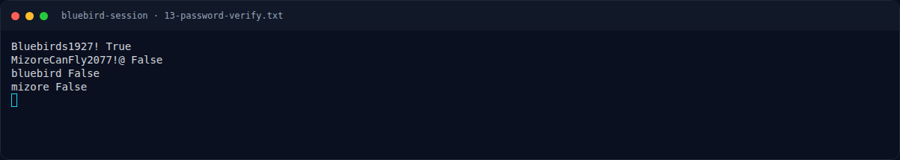

# Bluebird Session — Flag & Verifikasi

[← Overview](25-bluebird-session.md) · [Index](index.md)

> **Langkah 9/11 — Flag.** Flag
>
> **Titik penting:** NFX{Mizore_Promise_Never_Forgotten_The_Bluebird_Still_Sings}
>
> **Berikutnya:** [Bukti / Evidence](25-bluebird-session-10-bukti-evidence.md)

> **Asal flag.** Flag diperoleh dari langkah exploit/solver yang terdokumentasi, lalu disubmit ke platform.  
> **Tingkat bukti metode.** Terdokumentasi. [Buka Evidence](25-bluebird-session-10-bukti-evidence.md)

> **Flag:** `NFX{Mizore_Promise_Never_Forgotten_The_Bluebird_Still_Sings}`
> **Status:** `VERIFIED`

```text
NFX{Mizore_Promise_Never_Forgotten_The_Bluebird_Still_Sings}
```

Verifikasi/status:

```text
Sumber : get_sub_challenges (completed=true)
Q11    : 3220D64291CDFA4B26844C90690E8F1D  (hex32 overlay)
Flag   : NFX{Mizore_Promise_Never_Forgotten_The_Bluebird_Still_Sings}
Status : verified platform (challenge sudah solved)
```

### Terminal evidence (real)



*Terminal evidence (real).*

> **Bukti:** terminal evidence (real).
