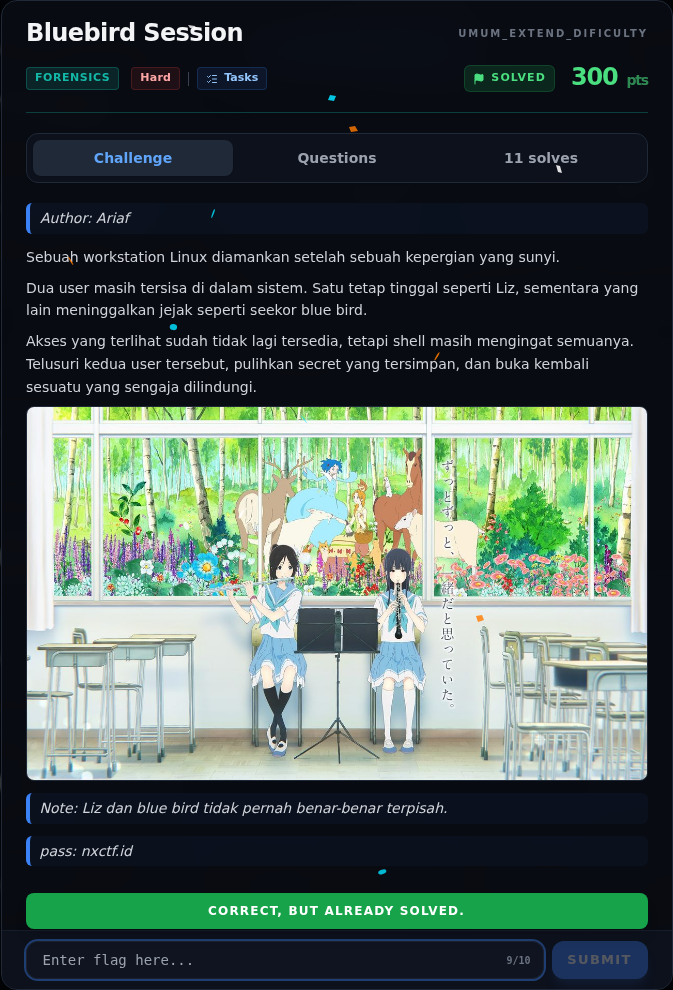
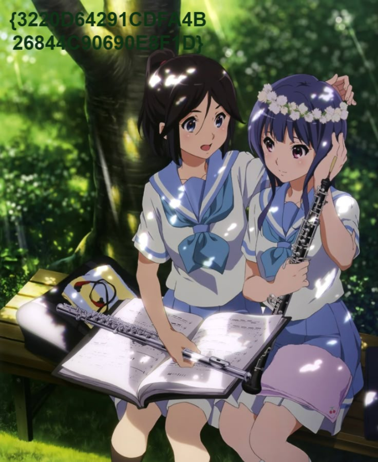
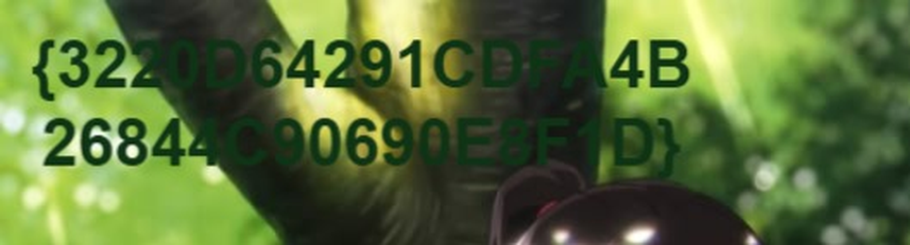

# Bluebird Session — Flag & Verifikasi

[← Overview](25-bluebird-session.md) · [Index](index.md)

> **Flag:** `NFX{Mizore_Promise_Never_Forgotten_The_Bluebird_Still_Sings}`
> **Status:** `VERIFIED`

```text
NFX{Mizore_Promise_Never_Forgotten_The_Bluebird_Still_Sings}
```

Verifikasi/status:

```text
Sumber : get_sub_challenges (completed=true)
Q11    : 3220D64291CDFA4B26844C90690E8F1D  (hex32 overlay)
Flag   : NFX{Mizore_Promise_Never_Forgotten_The_Bluebird_Still_Sings}
Status : verified platform (challenge sudah solved)
```

### Bukti submit di platform



*Submit flag di platform: `CORRECT, BUT ALREADY SOLVED.`*

### Evidence langkah ini



*Evidence — `05-flag-image.jpg`.*



*Evidence — `06-flag-crop.png`.*

> **Verifikasi platform:** flag sudah diterima. Recheck 2026-11-09 mengembalikan `Correct, but already solved.`
