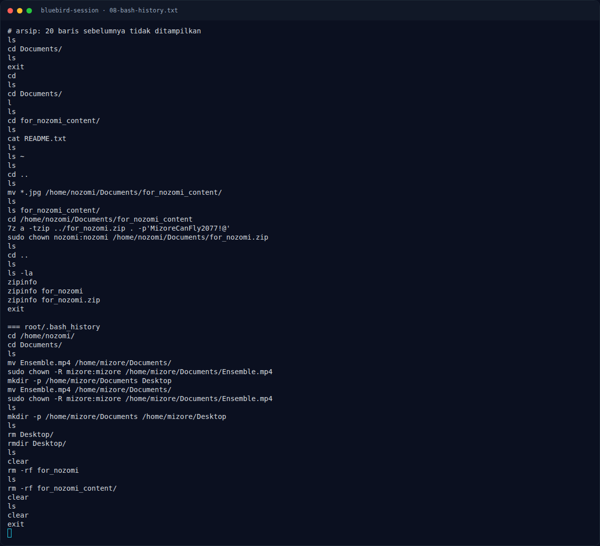

# Bluebird Session — Referensi

[← Overview](25-bluebird-session.md) · [Index](index.md)

- Format file GNOME Keyring lama (`GnomeKeyring` magic, SHA-256 iterated KDF, AES-128-CBC).
- `secret-tool` / libsecret.
- SHA-512 crypt (`$6$`) dan yescrypt (`$y$`).
- Teknik overlay teks pada JPEG.

### Evidence langkah ini

*Terminal evidence — `08-bash-history.txt` (arsip transkrip sesi solve).*
