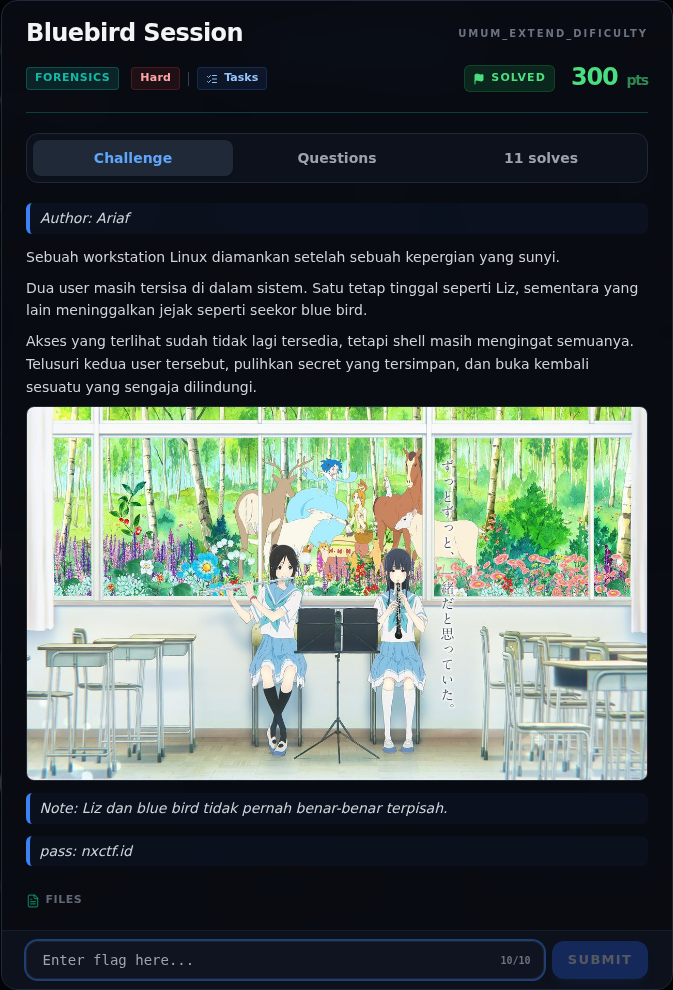
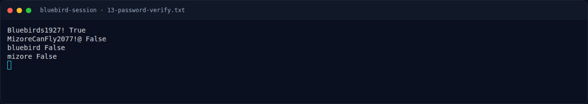

# Bluebird Session

Track Umum / Extend · ForensicsHard420 poinVERIFIED

| Field | Nilai |
|---|---|
| Event | `umum_Extend` |
| Kategori | `Forensics` |
| Difficulty | `Hard` |
| Poin (snapshot) | `420` |
| Author | `Ariaf` |
| Solves | `5` |
| Tools | strings, exiftool |
| Flag | `NFX{Mizore_Promise_Never_Forgotten_The_Bluebird_Still_Sings}` |
| Status | `VERIFIED` |
| Snapshot | 2026-11-13 |

[← Kembali ke Index](index.md)

## Challenge Brief (platform)

*Challenge brief asli di platform NFX CTF 2026.*

## Cerita singkat

Jadi ceritanya gini. evidence Linux: `/etc/passwd`, `/etc/shadow`, `/etc/group`, dua home (`mizore`, `nozomi`), keyring GNOME, `for_nozomi.zip`, `Ensemble.mp4`, dan log. Terus, dua user utama: **mizore** (UID 1001, “Liz”) dan **nozomi** (UID 1002, “blue bird”). Lalu, hash SHA-512 crypt mizore (`$6$bluebird$...`) di-crack/verifikasi menjadi **`Bluebirds1927!`**. Nah, dari situ kita bisa sampai ke flag dan bukti submit-nya.

## Alur & Titik Penting

| # | Langkah | Titik penting | Buka |
|---:|---|---|---|
| 1 | Recon Artefak | sha256sum login.keyring 423261422632617826.jpg for_nozomi.zip README.txt | [Buka](25-bluebird-session-01-recon-artefak.md) |
| 2 | Triage awal | file for_nozomi.zip login.keyring 423261422632617826.jpg | [Buka](25-bluebird-session-02-triage-awal.md) |
| 3 | Identitas dua user | Verifikasi password mizore: | [Buka](25-bluebird-session-03-identitas-dua-user.md) |
| 4 | Bash history | sudo bash -c 'cat > /home/nozomi/Documents/for_nozomi_content/README.txt' << 'EOF' | [Buka](25-bluebird-session-04-bash-history.md) |
| 5 | GNOME Keyring `login.keyring` | Atribut adalah MD5 dari nilai: | [Buka](25-bluebird-session-05-gnome-keyring-login-keyring.md) |
| 6 | Analisis Artefak | 7z x -y -p'MizoreCanFly2077!@' for_nozomi.zip | [Buka](25-bluebird-session-06-analisis-artefak.md) |
| 7 | Pemulihan Artefak | Parser keyring lengkap: assets/bluebird-session/solvebluebird.py. | [Buka](25-bluebird-session-07-pemulihan-artefak.md) |
| 8 | Alur 11 Sub-Challenge Q&A (verified) | NFX{Mizore_Promise_Never_Forgotten_The_Bluebird_Still_Sings} | [Buka](25-bluebird-session-08-alur-11-sub-challenge-q-a-verified.md) |
| 9 | Flag | NFX{Mizore_Promise_Never_Forgotten_The_Bluebird_Still_Sings} | [Buka](25-bluebird-session-09-flag.md) |
| 10 | Bukti / Evidence | arsip screenshot dan transkrip | [Buka](25-bluebird-session-10-bukti-evidence.md) |
| 11 | Referensi | — | [Buka](25-bluebird-session-11-referensi.md) |

## TL;DR

- Evidence Linux: `/etc/passwd`, `/etc/shadow`, `/etc/group`, dua home (`mizore`, `nozomi`), keyring GNOME, `for_nozomi.zip`, `Ensemble.mp4`, dan log.
- Dua user utama: **mizore** (UID 1001, “Liz”) dan **nozomi** (UID 1002, “blue bird”).
- Hash SHA-512 crypt mizore (`$6$bluebird$...`) di-crack/verifikasi menjadi **`Bluebirds1927!`**.
- Password itu membuka `login.keyring`; item “Mizore Promise Note” berisi password **`MizoreCanFly2077!@`** untuk `for_nozomi.zip`.
- ZIP berisi 5 JPG + `README.txt`; salah satu gambar, `423261422632617826.jpg`, memuat overlay 32 hex.
- Hex32 `3220D64291CDFA4B26844C90690E8F1D` adalah jawaban Q11, **bukan** flag akhir.
- Setelah 11/11 Q&A selesai, platform mengembalikan flag final:
  `NFX{Mizore_Promise_Never_Forgotten_The_Bluebird_Still_Sings}`.

Pratinjau evidence. Buka halaman <a href="25-bluebird-session-10-bukti-evidence.html">Evidence / Bukti</a> untuk semua screenshot dan transkrip.

## Navigasi Halaman

<a class="nx-page-card" href="25-bluebird-session-01-recon-artefak.html"><b>Recon Artefak</b>Enumerasi target dan bukti awal</a>
<a class="nx-page-card" href="25-bluebird-session-02-triage-awal.html"><b>Triage awal</b>Baca bagian ini</a>
<a class="nx-page-card" href="25-bluebird-session-03-identitas-dua-user.html"><b>Identitas dua user</b>Baca bagian ini</a>
<a class="nx-page-card" href="25-bluebird-session-04-bash-history.html"><b>Bash history</b>Baca bagian ini</a>
<a class="nx-page-card" href="25-bluebird-session-05-gnome-keyring-login-keyring.html"><b>GNOME Keyring `login.keyring`</b>Baca bagian ini</a>
<a class="nx-page-card" href="25-bluebird-session-06-analisis-artefak.html"><b>Analisis Artefak</b>Membaca alur dan akar masalah</a>
<a class="nx-page-card" href="25-bluebird-session-07-pemulihan-artefak.html"><b>Pemulihan Artefak</b>Baca bagian ini</a>
<a class="nx-page-card" href="25-bluebird-session-08-alur-11-sub-challenge-q-a-verified.html"><b>Alur 11 Sub-Challenge Q&amp;A (verified)</b>Baca bagian ini</a>
<a class="nx-page-card" href="25-bluebird-session-09-flag.html"><b>Flag</b>Flag dan verifikasi platform</a>
<a class="nx-page-card" href="25-bluebird-session-10-bukti-evidence.html"><b>Bukti / Evidence</b>Screenshot, transkrip, dan artefak</a>
<a class="nx-page-card" href="25-bluebird-session-11-referensi.html"><b>Referensi</b>Sumber dan bacaan lanjutan</a>

