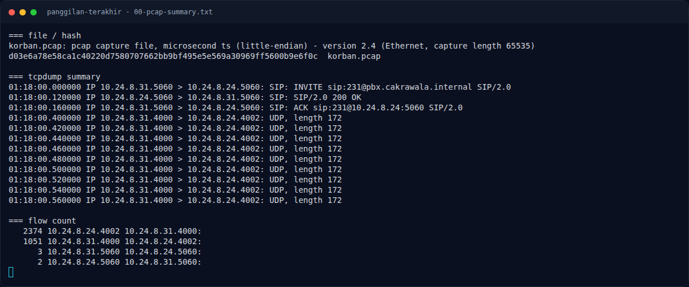
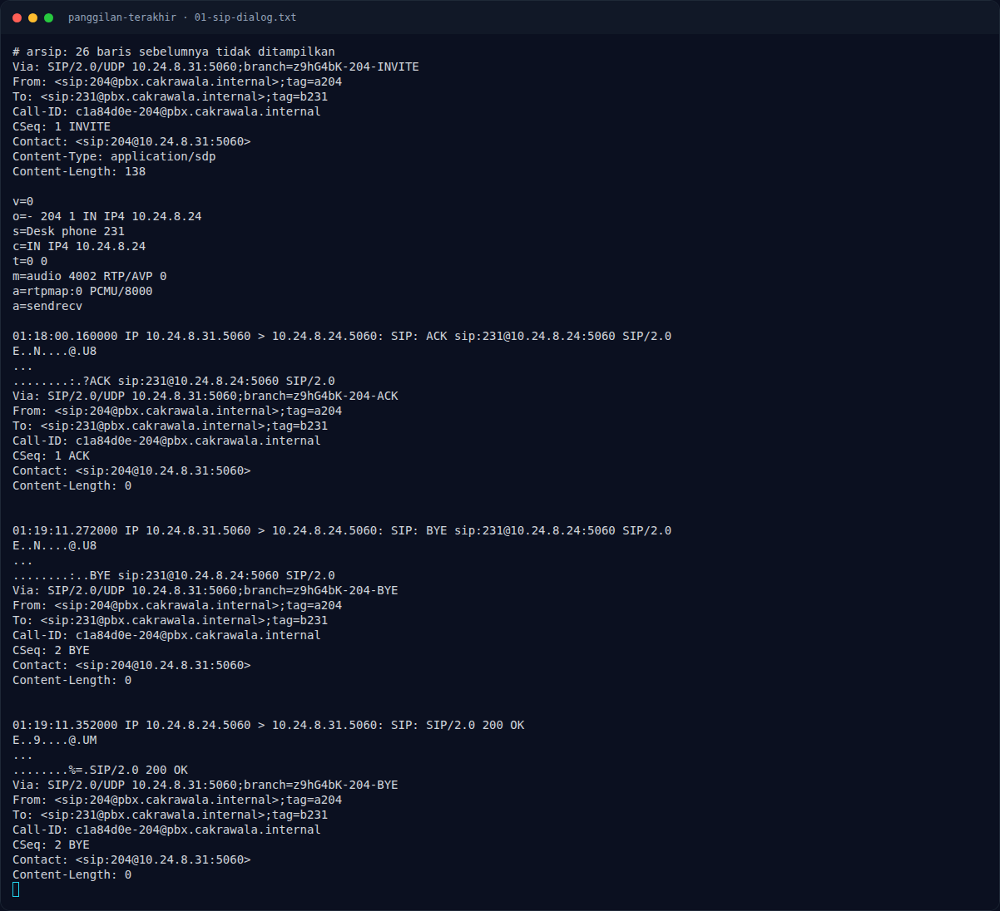

# Panggilan Terakhir — Recon Artefak

[← Overview](26-panggilan-terakhir.md) · [Index](index.md)

### 1.1 Deskripsi challenge

> Author: Candelena
>
> Pukul 01.18 WIB, Raka menelepon Dina melalui telepon meja kantor Cakrawala setelah tahu Dina menemukan kode sebuah dokumen rahasia. Tak lama setelah panggilan itu, Dina ditemukan tewas di ruang arsip. Raka menjadi tersangka, tetapi penyidik belum mengetahui apa yang sempat diucapkan Dina sebelum telepon terputus.
>
> Sistem pemantauan jaringan kantor menyimpan rekaman paket panggilan itu dalam `korban.pcap`. Dengarkan percakapan terakhir Dina dan temukan flag yang ia ucapkan.

### 1.2 File yang diberikan

| File | Ukuran | Keterangan |
|---|---:|---|
| `korban.pcap` | 789.907 byte | pcap Ethernet, 3.425 paket |

Hash:

```bash
$ sha256sum korban.pcap
d03e6a78e58ca1c40220d7580707662bb9bf495e5e569a30969ff5600b9e6f0c  korban.pcap
```

### 1.3 Environment

- Linux
- `tcpdump` (tshark tidak tersedia)
- Python 3 (`struct`, `wave`, `audioop`)
- `ffmpeg` untuk upsample/spectrogram
- `faster-whisper` (tiny, language `id`) untuk ASR

### 1.4 Triage awal

```bash
$ file korban.pcap
pcap capture file, microsecond ts (little-endian) - version 2.4 (Ethernet, capture length 65535)

$ tcpdump -nn -r korban.pcap | head
01:18:00.000000 IP 10.24.8.31.5060 > 10.24.8.24.5060: SIP: INVITE sip:231@pbx.cakrawala.internal SIP/2.0
01:18:00.120000 IP 10.24.8.24.5060 > 10.24.8.31.5060: SIP: SIP/2.0 200 OK
01:18:00.160000 IP 10.24.8.31.5060 > 10.24.8.24.5060: SIP: ACK sip:231@10.24.8.24:5060 SIP/2.0
01:18:00.400000 IP 10.24.8.31.4000 > 10.24.8.24.4002: UDP, length 172
...
01:19:11.272000 IP 10.24.8.31.5060 > 10.24.8.24.5060: SIP: BYE sip:231@10.24.8.24:5060 SIP/2.0
01:19:11.352000 IP 10.24.8.24.5060 > 10.24.8.31.5060: SIP: SIP/2.0 200 OK
```

Durasi panggilan ≈ 71 detik (01:18:00–01:19:11).

### Evidence langkah ini



*Terminal evidence — `00-pcap-summary.txt` (arsip transkrip sesi solve).*



*Terminal evidence — `01-sip-dialog.txt` (arsip transkrip sesi solve).*

**Berkas mentah langkah ini:**

- [`00-pcap-summary.txt`](assets/panggilan-terakhir/00-pcap-summary.txt)
- [`01-sip-dialog.txt`](assets/panggilan-terakhir/01-sip-dialog.txt)
