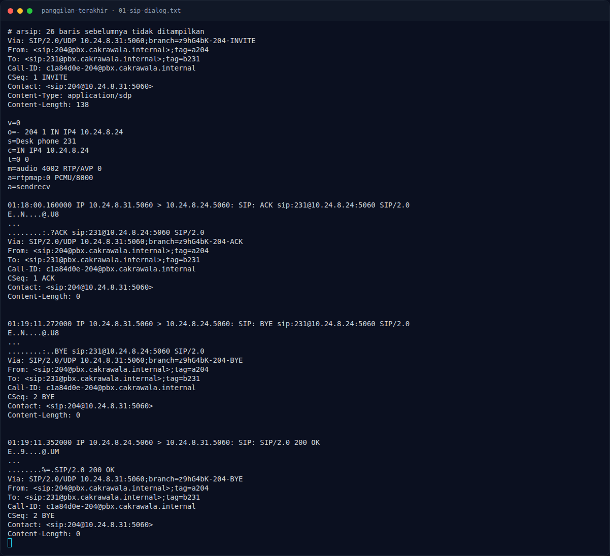

# Panggilan Terakhir — SIP INVITE dan SDP

[← Overview](26-panggilan-terakhir.md) · [Index](index.md)

## 2.1 SIP INVITE dan SDP

```bash
$ tcpdump -nn -r korban.pcap 'udp port 5060' -A
```

Potongan penting:

```text
INVITE sip:231@pbx.cakrawala.internal SIP/2.0
From: <sip:204@pbx.cakrawala.internal>;tag=a204
To: <sip:231@pbx.cakrawala.internal>
Call-ID: c1a84d0e-204@pbx.cakrawala.internal
Content-Type: application/sdp
Content-Length: 138

v=0
o=- 204 1 IN IP4 10.24.8.31
s=Desk phone 204
c=IN IP4 10.24.8.31
m=audio 4000 RTP/AVP 0
a=rtpmap:0 PCMU/8000
a=sendrecv
```

`200 OK` dari Dina:

```text
SIP/2.0 200 OK
From: <sip:204@pbx.cakrawala.internal>;tag=a204
To: <sip:231@pbx.cakrawala.internal>;tag=b231
Call-ID: c1a84d0e-204@pbx.cakrawala.internal

v=0
o=- 204 1 IN IP4 10.24.8.24
s=Desk phone 231
c=IN IP4 10.24.8.24
m=audio 4002 RTP/AVP 0
a=rtpmap:0 PCMU/8000
```

Kesimpulan:

| Arah | Endpoint | Ext | RTP |
|---|---|---|---|
| Raka → Dina | `10.24.8.31:4000` → `10.24.8.24:4002` | 204 | PCMU/8000, SDP `a=sendrecv` |
| Dina → Raka | `10.24.8.24:4002` → `10.24.8.31:4000` | 231 | PCMU/8000 |

### Evidence langkah ini



*Terminal evidence — `01-sip-dialog.txt` (arsip transkrip sesi solve).*

**Berkas mentah langkah ini:**

- [`01-sip-dialog.txt`](assets/panggilan-terakhir/01-sip-dialog.txt)
