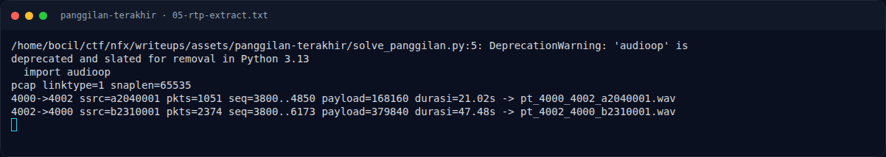

# Panggilan Terakhir — Ekstraksi RTP

[← Overview](26-panggilan-terakhir.md) · [Index](index.md)

## 2.2 Ekstraksi RTP

RTP header 12 byte, payload 160 byte (20 ms @ 8 kHz), total UDP payload 172 byte. Ekstraksi dilakukan per `(sport,dport,ssrc)`, urut sequence, lalu payload μ-law di-decode.

```python
import struct, wave, audioop

d = open('korban.pcap','rb').read()
o = 24
streams = {}
while o + 16 <= len(d):
    ts, tu, incl, orig = struct.unpack('<IIII', d[o:o+16]); o += 16
    p = d[o:o+incl]; o += incl
    ip = p[14:]
    if len(ip) < 20 or ip[0] >> 4 != 4 or ip[9] != 17:
        continue
    ihl = (ip[0] & 0xF) * 4
    udp = ip[ihl:]
    sport, dport, ulen, csum = struct.unpack('>HHHH', udp[:8])
    pay = udp[8:]
    if not (4000 <= sport <= 4002 or 4000 <= dport <= 4002) or len(pay) < 12:
        continue
    b0 = pay[0]; cc = b0 & 0xF
    seq = struct.unpack('>H', pay[2:4])[0]
    ssrc = struct.unpack('>I', pay[8:12])[0]
    off = 12 + 4 * cc
    streams.setdefault((sport, dport, ssrc), []).append((seq, pay[off:]))

for (sp, dp, ssrc), pkts in streams.items():
    pkts.sort()
    raw = b''.join(x[1] for x in pkts)
    pcm = audioop.ulaw2lin(raw, 2)
    w = wave.open(f'pt_{sp}_{dp}_{ssrc:08x}.wav', 'wb')
    w.setnchannels(1); w.setsampwidth(2); w.setframerate(8000)
    w.writeframes(pcm); w.close()
    print(sp, dp, len(pkts), len(raw)/8000, 'detik')
```

Output:

```text
4000->4002 ssrc=a2040001 pkts=1051 seq=3800..4850 payload=168160 durasi=21.02s
4002->4000 ssrc=b2310001 pkts=2374 seq=3800..6173 payload=379840 durasi=47.48s
```

Artefak audio:

- `assets/panggilan-terakhir/01-Raka-204.wav` (21,02 detik)
- `assets/panggilan-terakhir/02-Dina-231.wav` (47,48 detik)
- Spectrogram: `03-spectrogram-Dina.png`, `04-spectrogram-Raka.png`

### Evidence langkah ini



*Terminal evidence — `05-rtp-extract.txt` (arsip transkrip sesi solve).*

**Berkas mentah langkah ini:**

- [`05-rtp-extract.txt`](assets/panggilan-terakhir/05-rtp-extract.txt)
