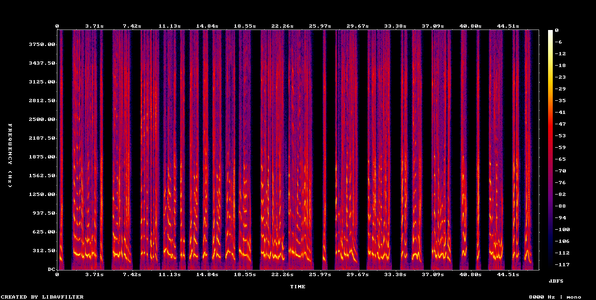
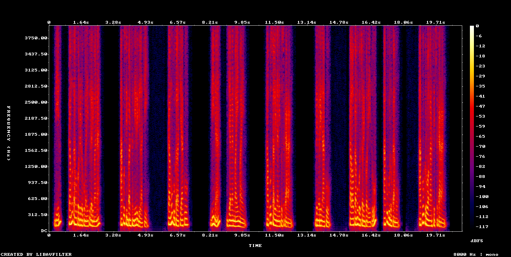

# Panggilan Terakhir — Evidence / Bukti

[← Overview](26-panggilan-terakhir.md) · [Index](index.md)

## Arsip Evidence

> Semua file di bawah berasal dari folder `assets/panggilan-terakhir/`. Screenshot ditempel langsung; file teks/script ditautkan.

### Screenshot

### Transkrip / file pendukung

- [`00-pcap-summary.txt`](assets/panggilan-terakhir/00-pcap-summary.txt)
- [`01-Raka-204.wav`](assets/panggilan-terakhir/01-Raka-204.wav)
- [`01-sip-dialog.txt`](assets/panggilan-terakhir/01-sip-dialog.txt)
- [`02-Dina-231.wav`](assets/panggilan-terakhir/02-Dina-231.wav)
- [`05-rtp-extract.txt`](assets/panggilan-terakhir/05-rtp-extract.txt)
- [`06-transcript.txt`](assets/panggilan-terakhir/06-transcript.txt)
- [`korban.pcap`](assets/panggilan-terakhir/korban.pcap)
- [`pt_4000_4002_a2040001.wav`](assets/panggilan-terakhir/pt_4000_4002_a2040001.wav)
- [`pt_4002_4000_b2310001.wav`](assets/panggilan-terakhir/pt_4002_4000_b2310001.wav)
- [`solve_panggilan.py`](assets/panggilan-terakhir/solve_panggilan.py)

## Tabel Evidence

| Bukti | File | Keterangan |
|---|---|---|
| PCAP | `assets/panggilan-terakhir/korban.pcap` | capture asli |
| Ringkasan | `assets/panggilan-terakhir/00-pcap-summary.txt` | file/hash/tcpdump/flow |
| SIP | `assets/panggilan-terakhir/01-sip-dialog.txt` | INVITE/200/ACK/BYE + SDP |
| RTP extract | `assets/panggilan-terakhir/05-rtp-extract.txt` | output script |
| Audio Raka | `assets/panggilan-terakhir/01-Raka-204.wav` | 21,02 detik |
| Audio Dina | `assets/panggilan-terakhir/02-Dina-231.wav` | 47,48 detik |
| Spectrogram Dina | `assets/panggilan-terakhir/03-spectrogram-Dina.png` | visual audio |
| Spectrogram Raka | `assets/panggilan-terakhir/04-spectrogram-Raka.png` | visual audio |
| Transkrip | `assets/panggilan-terakhir/06-transcript.txt` | ASR + interpretasi |
| Script | `assets/panggilan-terakhir/solve_panggilan.py` | ekstraksi RTP |
