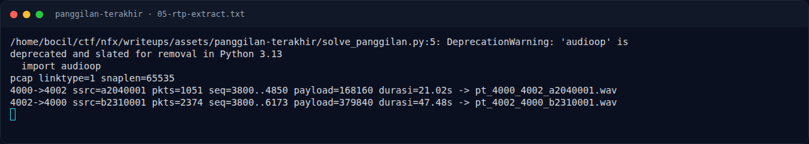
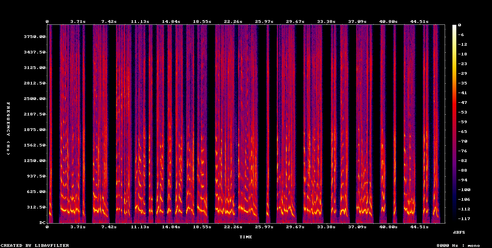

# Panggilan Terakhir — Pemulihan Artefak

[← Overview](26-panggilan-terakhir.md) · [Index](index.md)

> **Langkah 5/8 — Pemulihan Artefak.** Script lengkap: assets/panggilan-terakhir/solvepanggilan.py.
>
> **Titik penting:** python3 solve_panggilan.py
>
> **Berikutnya:** [Flag](26-panggilan-terakhir-06-flag.md)

### 3.1 Strategi

1. Baca SIP/SDP untuk mendapatkan codec dan port RTP.
2. Reassemble RTP per arah berdasarkan sequence number.
3. Decode G.711 μ-law → PCM 16-bit 8 kHz.
4. Dengarkan/transkripsi stream Dina.
5. Normalisasi kata “NFXCTF”, “kurung kurawa”, “garis bawah”, “204”.

### 3.2 Script

Script lengkap: `assets/panggilan-terakhir/solve_panggilan.py`.

```bash
python3 solve_panggilan.py
ffmpeg -y -i pt_4002_4000_b2310001.wav -ar 16000 -ac 1 dina_16k.wav
ffmpeg -y -i dina_16k.wav -lavfi showspectrumpic=s=1024x512:legend=1 spec.png
```

### 3.3 Output

```text
4000->4002 ssrc=a2040001 pkts=1051 seq=3800..4850 payload=168160 durasi=21.02s -> pt_4000_4002_a2040001.wav
4002->4000 ssrc=b2310001 pkts=2374 seq=3800..6173 payload=379840 durasi=47.48s -> pt_4002_4000_b2310001.wav
```

Transkrip lengkap: `assets/panggilan-terakhir/06-transcript.txt`.

### Evidence langkah ini



*Terminal evidence — `05-rtp-extract.txt` (arsip transkrip sesi solve).*



*Evidence — `03-spectrogram-Dina.png`.*

**Berkas mentah langkah ini:**

- [`05-rtp-extract.txt`](assets/panggilan-terakhir/05-rtp-extract.txt)
