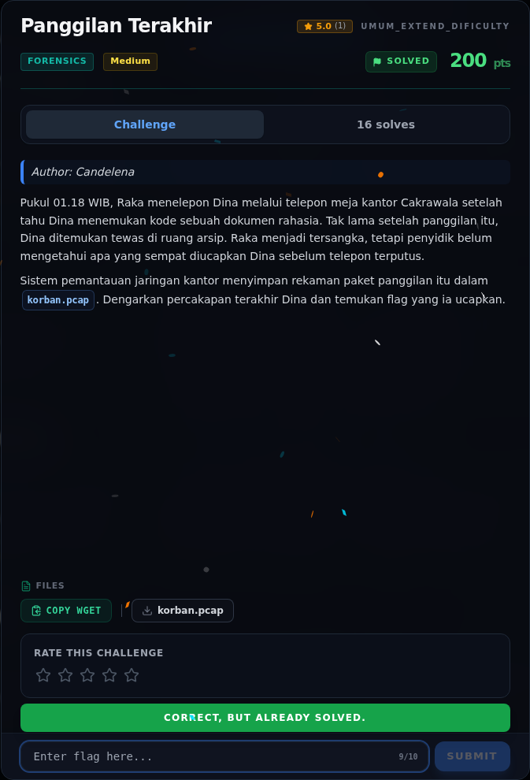

# Panggilan Terakhir — Flag & Verifikasi

[← Overview](26-panggilan-terakhir.md) · [Index](index.md)

> **Flag:** `NFXCTF{ARSIP_MERAH_204}`
> **Status:** `VERIFIED`

```text
NFXCTF{ARSIP_MERAH_204}
```

Verifikasi/status:

```text
Sumber : flags/wave2/Panggilan_Terakhir.txt
Isi    : NFXCTF{ARSIP_MERAH_204}
Status : VERIFIED platform (recheck 2026-11-09; transkrip audio + flag file cocok)
```

### Bukti submit di platform



*Submit flag di platform: `CORRECT, BUT ALREADY SOLVED.`*

> **Verifikasi platform:** flag sudah diterima. Recheck 2026-11-09 mengembalikan `Correct, but already solved.`
