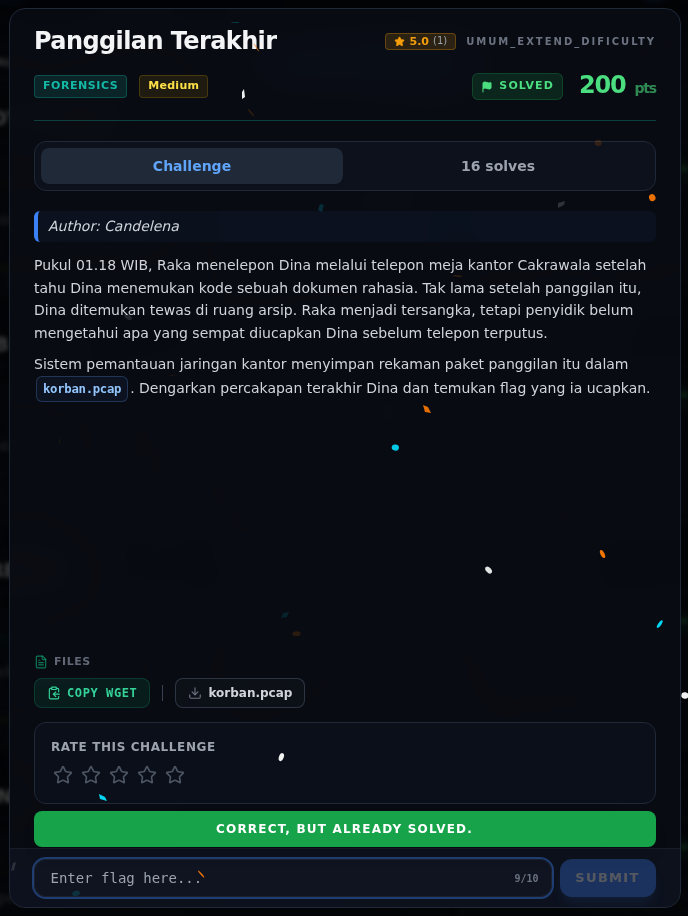

# Panggilan Terakhir — Flag & Verifikasi

[← Overview](26-panggilan-terakhir.md) · [Index](index.md)

> **Langkah 6/8 — Flag.** Flag
>
> **Titik penting:** NFXCTF{ARSIP_MERAH_204}
>
> **Berikutnya:** [Bukti / Evidence](26-panggilan-terakhir-07-bukti-evidence.md)

> **Asal flag.** Flag diperoleh dari langkah exploit/solver yang terdokumentasi, lalu disubmit ke platform.  
> **Tingkat bukti metode.** Terdokumentasi. [Buka Evidence](26-panggilan-terakhir-07-bukti-evidence.md)

> **Flag:** `NFXCTF{ARSIP_MERAH_204}`
> **Status:** `VERIFIED`

```text
NFXCTF{ARSIP_MERAH_204}
```

Verifikasi/status:

```text
Sumber : flags/wave2/Panggilan_Terakhir.txt
Isi    : NFXCTF{ARSIP_MERAH_204}
Status : VERIFIED platform (submit via web; transkrip audio + flag file cocok)
```

> **Catatan kapitalisasi.** Di transkrip audio, kata “merah” terdengar
> sebagai huruf kecil. Platform menerima bentuk kapital
> `NFXCTF{ARSIP_MERAH_204}`; flag final memakai bentuk kapital tersebut.

### Terminal evidence (real)


*Terminal evidence (real).*

> **Bukti:** terminal evidence (real).

## Validasi platform (real)



*Screenshot asli dari platform NFX CTF 2026. Platform menjawab
`CORRECT, BUT ALREADY SOLVED.` untuk flag ini.*
