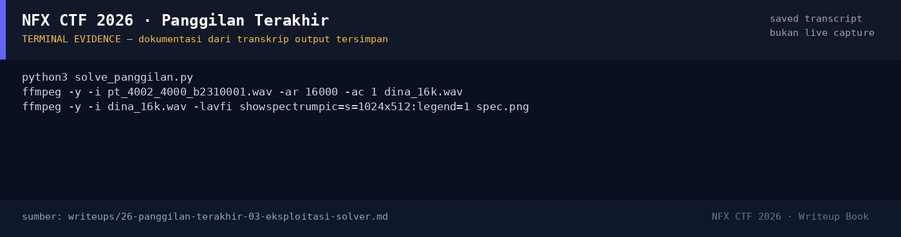

# Panggilan Terakhir

Track Umum / Extend · ForensicsMedium380 poinVERIFIED

| Field | Nilai |
|---|---|
| Event | `umum_Extend` |
| Kategori | `Forensics` |
| Difficulty | `Medium` |
| Poin | `380` |
| Author | `Candelena` |
| Solves | `7` |
| Tools | python3, tshark |
| Flag | `NFXCTF{ARSIP_MERAH_204}` |
| Status | `VERIFIED` |

[← Kembali ke Index](index.md)

## TL;DR

- `korban.pcap` berisi satu panggilan SIP antara Raka (ext 204, `10.24.8.31`) dan Dina (ext 231, `10.24.8.24`).
- SDP menegosiasikan `RTP/AVP 0` = **PCMU/8000** (G.711 μ-law), RTP port 4000 ↔ 4002.
- RTP diekstrak per arah, di-decode μ-law menjadi WAV 8 kHz.
- Dina (stream 4002 → 4000) mengucapkan flag secara lisan: “NFXCTF, kurung kurawa buka, garis bawah, merah, garis bawah, 2 0 4, kurung kurawa tutup”.
- Flag: `NFXCTF{ARSIP_MERAH_204}`.

Pratinjau evidence. Buka halaman <a href="26-panggilan-terakhir-05-bukti-evidence.html">Evidence / Bukti</a> untuk semua screenshot dan transkrip.

## Navigasi Halaman

<a class="nx-page-card" href="26-panggilan-terakhir-01-recon.html"><b>Recon</b>Enumerasi target dan bukti awal</a>
<a class="nx-page-card" href="26-panggilan-terakhir-02-analisis.html"><b>Analisis</b>Membaca alur dan akar masalah</a>
<a class="nx-page-card" href="26-panggilan-terakhir-03-eksploitasi-solver.html"><b>Eksploitasi / Solver</b>Langkah exploit dan solver</a>
<a class="nx-page-card" href="26-panggilan-terakhir-04-flag.html"><b>Flag</b>Flag dan verifikasi platform</a>
<a class="nx-page-card" href="26-panggilan-terakhir-05-bukti-evidence.html"><b>Bukti / Evidence</b>Screenshot, transkrip, dan artefak</a>
<a class="nx-page-card" href="26-panggilan-terakhir-06-referensi.html"><b>Referensi</b>Sumber dan bacaan lanjutan</a>

