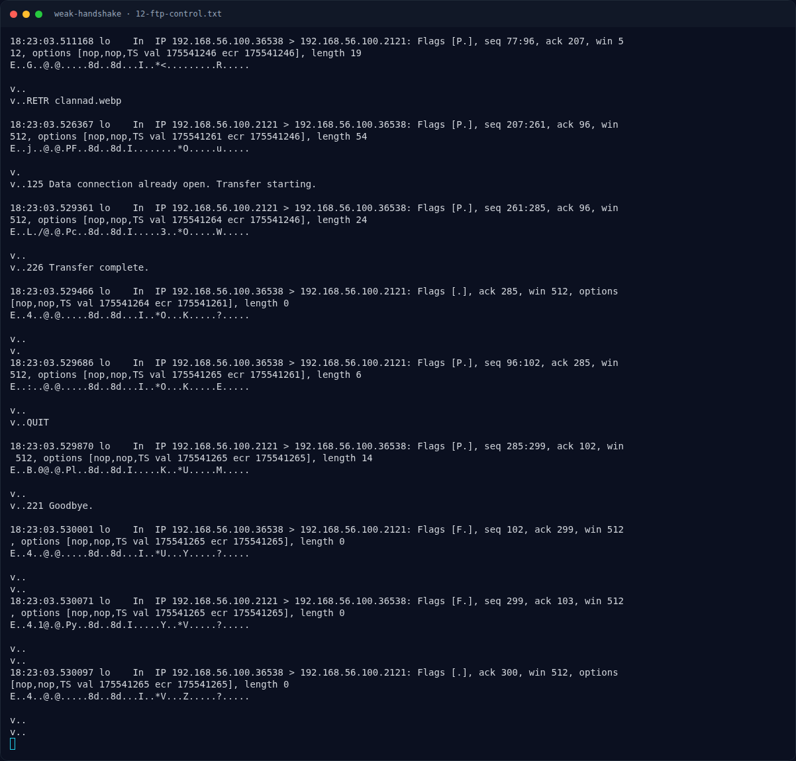

# Weak Handshake — Analisis Artefak

[← Overview](27-weak-handshake.md) · [Index](index.md)

> **Langkah 2/10 — Analisis Artefak.** Data stream port 42345 di-reassemble menjadi clannad.webp:
>
> **Titik penting:** file clannad.webp · sha256sum clannad.webp
>
> **Berikutnya:** [Analisis Artefak](27-weak-handshake-03-analisis-artefak-2.md)

## 2.1 FTP: “kenangan yang mudah terlihat”

FTP control:

```text
220 pyftpdlib 2.2.0 ready.
USER anonymous
331 Username ok, send password.
PASS ftp@example.com
230 Login successful.
257 "/" is the current directory.
229 Entering extended passive mode (|||42345|.)
TYPE I
200 Type set to: Binary.
SIZE clannad.webp
213 262796
RETR clannad.webp
125 Data connection already open; Transfer starting.
```

Data stream port 42345 di-reassemble menjadi `clannad.webp`:

```bash
$ file clannad.webp
RIFF (little-endian) data, Web/P image

$ sha256sum clannad.webp
bf90425076e330c58a11c997f814172dd31b599534533a2bfd81d3fb4a2652a5  clannad.webp
```

`exiftool`:

```text
File Type      : Extended WEBP
WebP Flags     : EXIF
Image Width    : 1920
Image Height   : 1080
Warning        : [minor] Improper EXIF header
```

Gambar Clannad adalah **decoy/awal cerita**. Flag tidak ada di gambar ini.

## 2.2 TLS handshake

ClientHello (record pertama, port 56410):

```text
16 03 01 00 97
01 00 00 93 03 03
1e ff 90 57 cd 9c b0 06 9a c8 f8 67 66 55 2b ab
ca 7b 97 b0 ce 08 ac 2c a9 1b c3 f9 62 c4 6c 3b
...
00 02 00 2f
```

- Client version: TLS 1.2 (`03 03`)
- Cipher suite: hanya `0x002f` = `TLS_RSA_WITH_AES_128_CBC_SHA`
- Extension `0x0017` = `extended_master_secret`
- Server name: `tomoyo.local`

ServerHello (port 8443):

```text
16 03 03 00 59
02 00 00 55 03 03
76 45 7c 9f e0 81 a3 cb c1 d6 52 a5 5c 0a ea 30
22 be e6 99 b4 a6 df 0f b6 80 be 57 1e 4f 16 e3
...
00 2f
...
00 17 00 00
```

Server memilih `0x002f` dan mengaktifkan `extended_master_secret` (`00 17 00 00`).

### Evidence langkah ini



*Terminal evidence — `12-ftp-control.txt` (arsip transkrip sesi solve).*

**Berkas mentah langkah ini:**

- [`12-ftp-control.txt`](assets/weak-handshake/12-ftp-control.txt)
