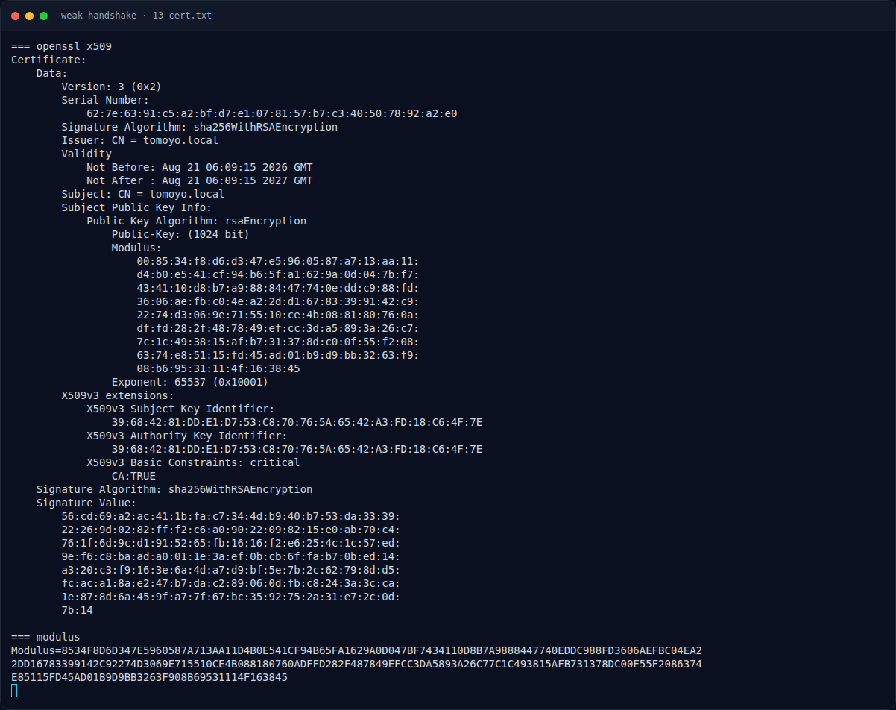

# Weak Handshake — Analisis Artefak

[← Overview](27-weak-handshake.md) · [Index](index.md)

## 2.3 Sertifikat RSA 1024-bit

Ambil Certificate handshake:

```bash
$ openssl x509 -inform DER -in tomoyo_cert.der -noout -text
Certificate:
    Data:
        Version: 3 (0x2)
        Serial Number:
            62:7e:63:91:c5:a2:bf:d7:e1:07:81:57:b7:c3:40:50:78:92:a2:e0
        Signature Algorithm: sha256WithRSAEncryption
        Issuer: CN = tomoyo.local
        Validity
            Not Before: Aug 21 06:09:15 2026 GMT
            Not After : Aug 21 06:09:15 2027 GMT
        Subject: CN = tomoyo.local
        Subject Public Key Info:
            Public Key Algorithm: rsaEncryption
                Public-Key: (1024 bit)
                Modulus:
                    00:85:34:f8:d6:d3:47:e5:96:05:87:a7:13:aa:11:
                    d4:b0:e5:41:cf:94:b6:5f:a1:62:9a:0d:04:7b:f7:
                    ...
                    08:b6:95:31:11:4f:16:38:45
                Exponent: 65537 (0x10001)
```

Modulus 1024-bit. Ini sudah “lemah” untuk standar modern, tetapi masih terlalu besar untuk factoring umum. Namun key ini punya cacat: **p dan q sangat berdekatan**.

## 2.4 Fermat factorization

```python
import math
n = int('8534F8D6...163845', 16)
a = math.isqrt(n)
if a*a < n: a += 1
for i in range(2_000_000):
    b2 = a*a - n
    b = math.isqrt(b2)
    if b*b == b2:
        p, q = a-b, a+b
        print(i, q-p, p, q)
        break
    a += 1
```

Output:

```text
Fermat factor i=0: p-q=236
p = 9671663854061757801267503507385555068467793967854600233585619689920384829606622498532429734086689244075916698567447356461587231266615301209335653115679383
q = 9671663854061757801267503507385555068467793967854600233585619689920384829606622498532429734086689244075916698567447356461587231266615301209335653115679619
```

Karena `n = p*q`, private exponent:

```python
d = pow(65537, -1, (p-1)*(q-1))
key = RSA.construct((n, 65537, d, p, q))
```

Private key tersimpan di `assets/weak-handshake/04-tomoyo_priv.pem`.

### Evidence langkah ini



*Terminal evidence — `13-cert.txt` (arsip transkrip sesi solve).*

**Berkas mentah langkah ini:**

- [`13-cert.txt`](assets/weak-handshake/13-cert.txt)
