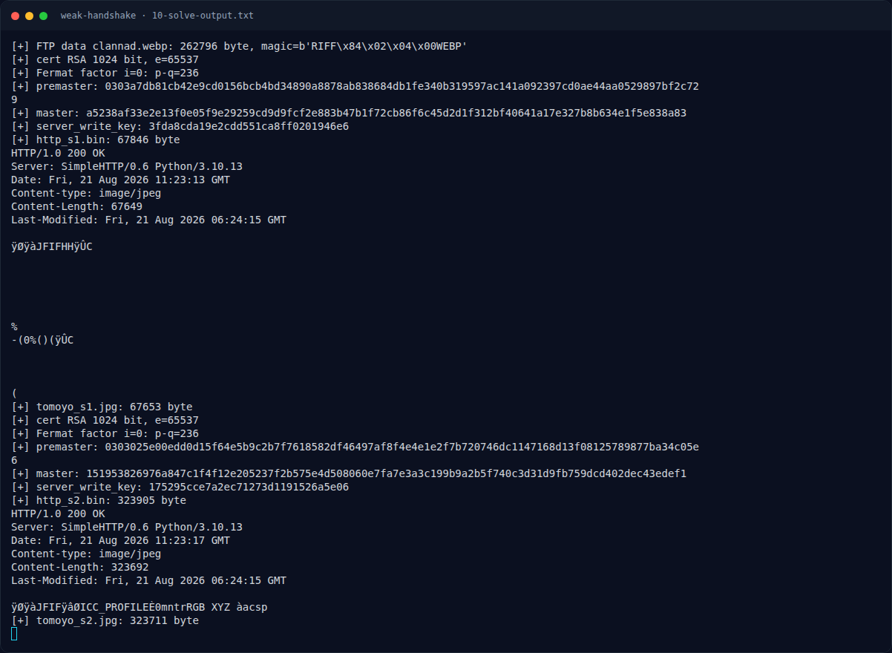
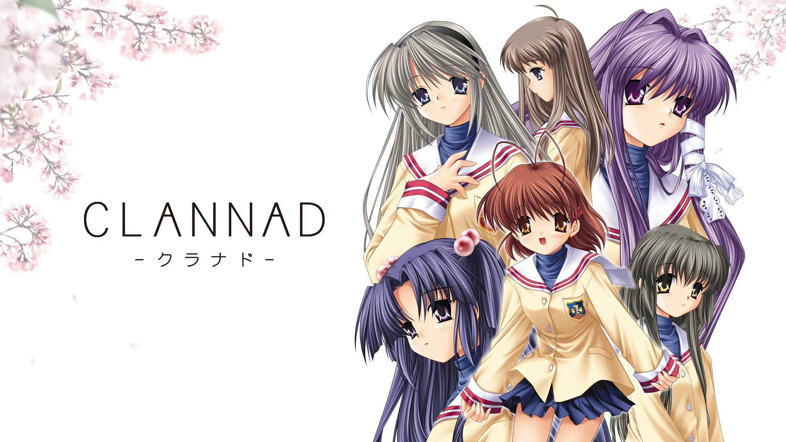

# Weak Handshake — Analisis Artefak

[← Overview](27-weak-handshake.md) · [Index](index.md)

> **Langkah 5/10 — Analisis Artefak.** Setiap record setelah ChangeCipherSpec memiliki bentuk:
>
> **Titik penting:** Setiap record setelah ChangeCipherSpec memiliki bentuk:
>
> **Berikutnya:** [Pemulihan Artefak](27-weak-handshake-06-pemulihan-artefak.md)

## 2.7 Format record ciphertext

Setiap record setelah ChangeCipherSpec memiliki bentuk:

```text
body = IV (16 byte) || ciphertext (kelipatan 16) || MAC (20 byte, di luar ciphertext)
```

Ini bukan format TLS standar (TLS biasanya menaruh MAC di dalam enkripsi), tetapi konsisten untuk semua record dan berhasil didekripsi dengan:

```python
iv = body[:16]
ct = body[16:-20]
pt = AES.new(server_key, AES.MODE_CBC, iv=iv).decrypt(ct)
# hapus PKCS#7 padding
```

Record pertama setelah CCS adalah Finished (`14 00 00 0c` + verify_data 12 byte). Record berikutnya adalah application data HTTP.

## 2.8 HTTP response

Sesi 1:

```text
HTTP/1.0 200 OK
Server: SimpleHTTP/0.6 Python/3.10.13
Date: Fri, 21 Aug 2026 11:23:13 GMT
Content-type: image/jpeg
Content-Length: 67649
Last-Modified: Fri, 21 Aug 2026 06:24:15 GMT
```

Sesi 2:

```text
HTTP/1.0 200 OK
Server: SimpleHTTP/0.6 Python/3.10.13
Date: Fri, 21 Aug 2026 11:23:17 GMT
Content-type: image/jpeg
Content-Length: 323692
Last-Modified: Fri, 21 Aug 2026 06:24:15 GMT
```

Keduanya mengirim JPEG. JPEG pertama adalah Tomoyo di koridor sekolah (decoy/awal). JPEG kedua adalah Tomoyo dengan overlay teks:

```text
{D36A64128F80788B60C677EF94FA7157}
```

### Evidence langkah ini



*Terminal evidence — `10-solve-output.txt` (arsip transkrip sesi solve).*



*Evidence — `02-clannad.png`.*

**Berkas mentah langkah ini:**

- [`10-solve-output.txt`](assets/weak-handshake/10-solve-output.txt)
