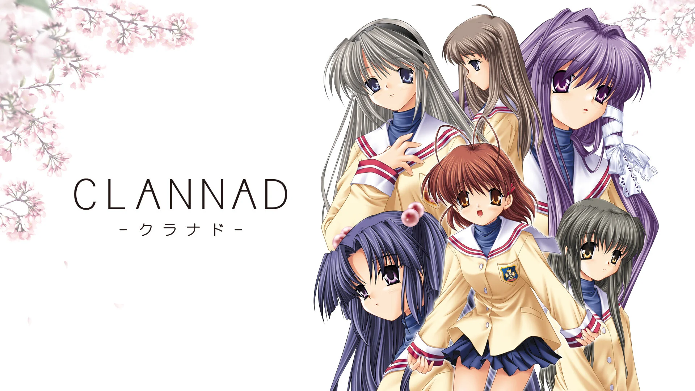
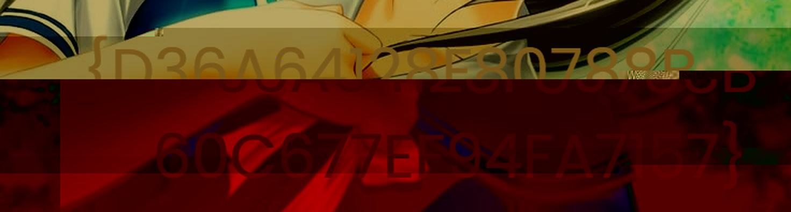

# Weak Handshake — Evidence / Bukti

[← Overview](27-weak-handshake.md) · [Index](index.md)

## Arsip Evidence

> Semua file di bawah berasal dari folder `assets/weak-handshake/`. Screenshot ditempel langsung; file teks/script ditautkan.

### Screenshot

### Transkrip / file pendukung

- [`00-recon.txt`](assets/weak-handshake/00-recon.txt)
- [`03-tomoyo_cert.der`](assets/weak-handshake/03-tomoyo_cert.der)
- [`04-tomoyo_priv.pem`](assets/weak-handshake/04-tomoyo_priv.pem)
- [`08-http-plain.bin`](assets/weak-handshake/08-http-plain.bin)
- [`10-solve-output.txt`](assets/weak-handshake/10-solve-output.txt)
- [`11-http-response.txt`](assets/weak-handshake/11-http-response.txt)
- [`12-ftp-control.txt`](assets/weak-handshake/12-ftp-control.txt)
- [`13-cert.txt`](assets/weak-handshake/13-cert.txt)
- [`14-key-schedule.txt`](assets/weak-handshake/14-key-schedule.txt)
- [`capture.pcapng`](assets/weak-handshake/capture.pcapng)
- [`http_s1.bin`](assets/weak-handshake/http_s1.bin)
- [`http_s2.bin`](assets/weak-handshake/http_s2.bin)
- [`solve_weak.py`](assets/weak-handshake/solve_weak.py)
- [`tomoyo_cert.der`](assets/weak-handshake/tomoyo_cert.der)
- [`tomoyo_priv.pem`](assets/weak-handshake/tomoyo_priv.pem)
- [`wh.pcap`](assets/weak-handshake/wh.pcap)

## Tabel Evidence

| Bukti | File | Keterangan |
|---|---|---|
| Capture | `assets/weak-handshake/capture.pcapng` | pcapng asli |
| Pcap konversi | `assets/weak-handshake/wh.pcap` | untuk parser Python |
| Recon | `assets/weak-handshake/00-recon.txt` | file/hash/tcpdump/flow |
| Clannad WEBP | `assets/weak-handshake/01-clannad.webp` | decoy awal |
| Clannad PNG | `assets/weak-handshake/02-clannad.png` | hasil konversi |
| Sertifikat | `assets/weak-handshake/03-tomoyo_cert.der` | X.509 DER |
| Private key | `assets/weak-handshake/04-tomoyo_priv.pem` | hasil Fermat |
| JPEG 1 | `assets/weak-handshake/05-decrypted-tomoyo1.jpg` | decoy/awal |
| JPEG 2 | `assets/weak-handshake/06-decrypted-tomoyo2.jpg` | berisi flag |
| PNG 2 | `assets/weak-handshake/07-decrypted-tomoyo2.png` | render |
| HTTP plain | `assets/weak-handshake/08-http-plain.bin` | hasil dekripsi |
| Crop flag | `assets/weak-handshake/09-flag-crop.png` | overlay diperbesar |
| Solver | `assets/weak-handshake/solve_weak.py` | FTP + TLS decrypt |
| Solve log | `assets/weak-handshake/10-solve-output.txt` | output lengkap |
| HTTP headers | `assets/weak-handshake/11-http-response.txt` | dua response |
| FTP control | `assets/weak-handshake/12-ftp-control.txt` | sesi FTP |
| Cert info | `assets/weak-handshake/13-cert.txt` | openssl x509 |
| Key schedule | `assets/weak-handshake/14-key-schedule.txt` | master/key |
