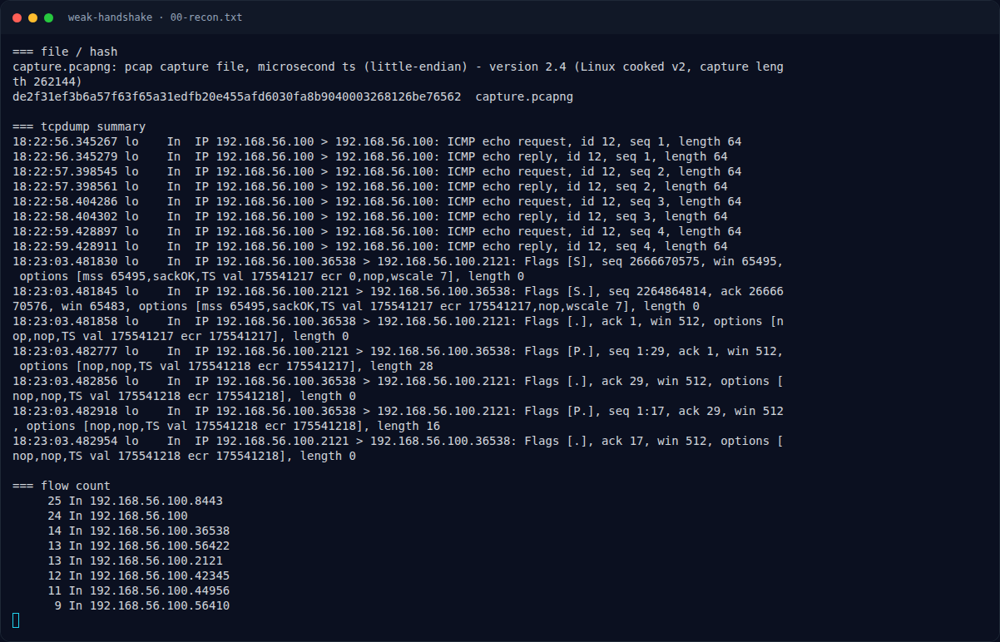
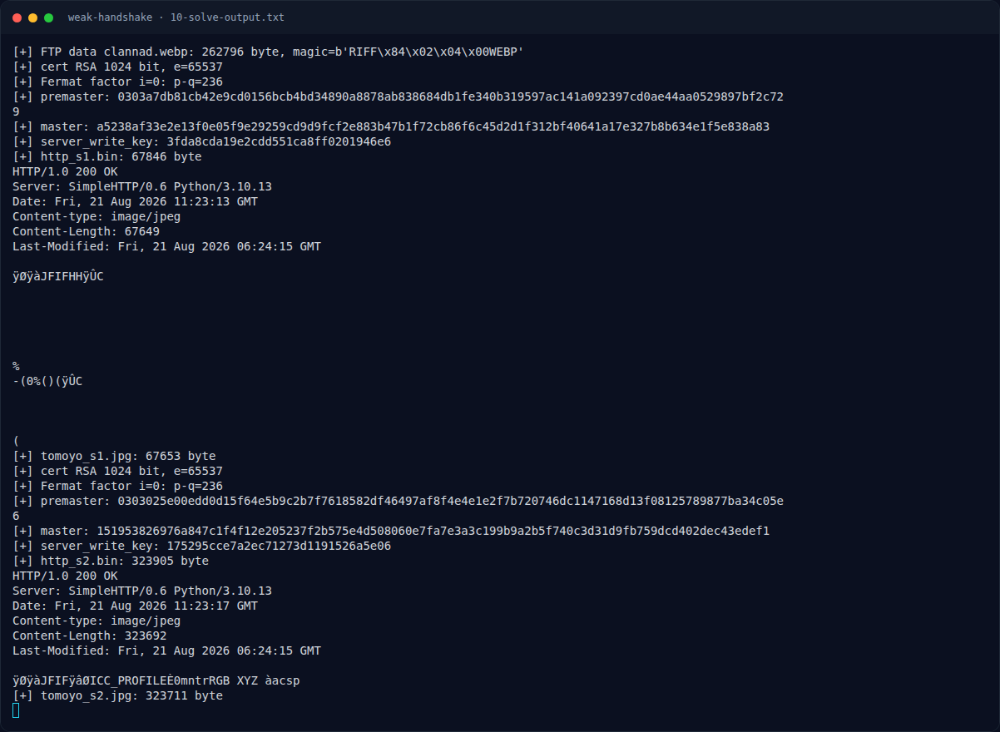
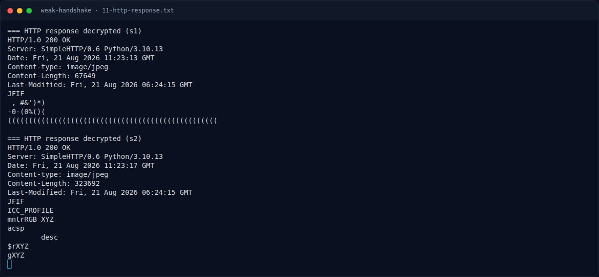
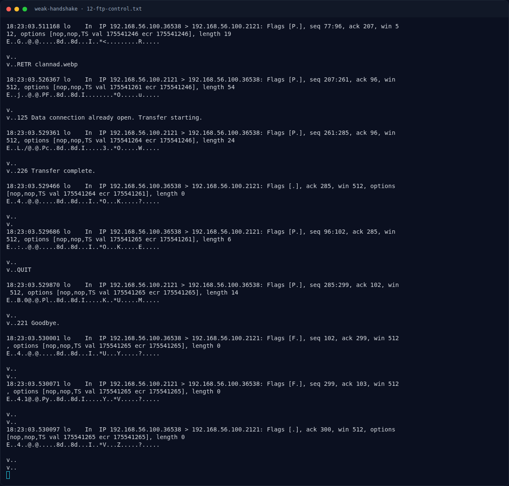
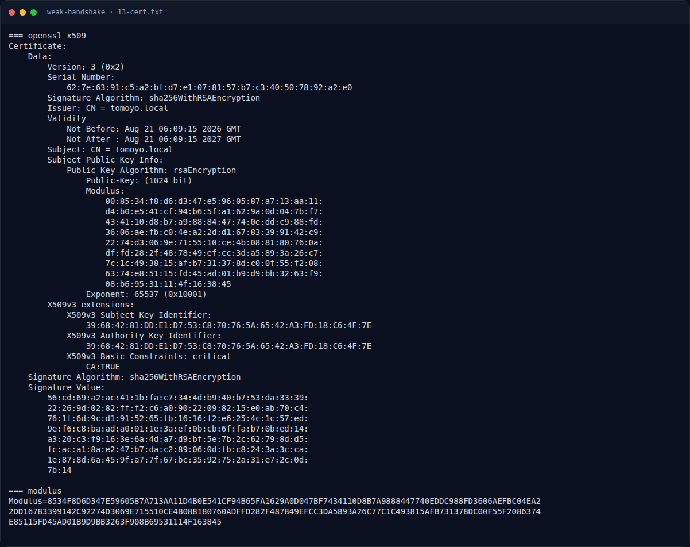
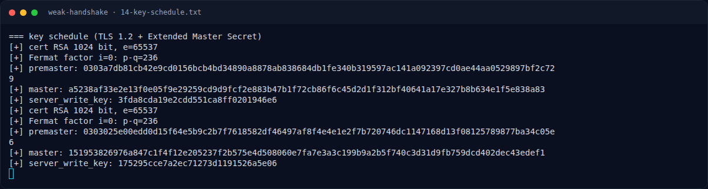
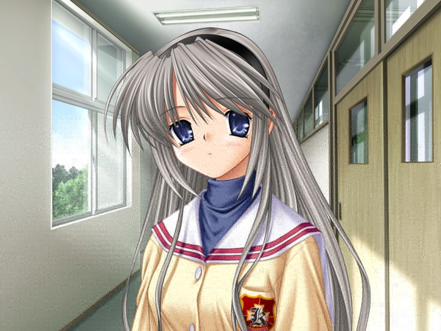
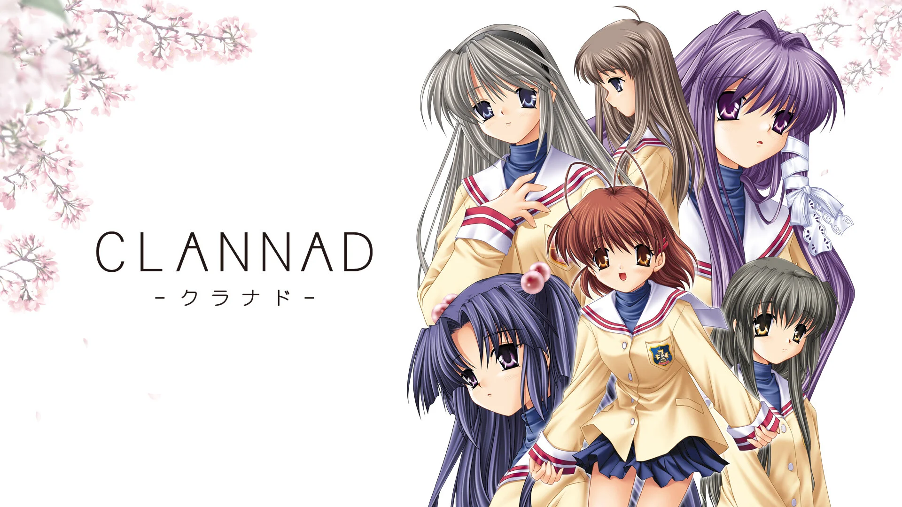

# Weak Handshake — Pemulihan Artefak

[← Overview](27-weak-handshake.md) · [Index](index.md)

## 3.1 Strategi

1. Reassemble TCP streams dari pcap (linktype Linux SLL2).
2. Ambil `clannad.webp` dari FTP data (decoy).
3. Parse TLS ServerHello + Certificate; ambil modulus RSA.
4. Fermat factorization → p, q, d, private key.
5. Decrypt ClientKeyExchange → premaster.
6. Hitung master secret dengan **Extended Master Secret**.
7. Decrypt record AES-128-CBC (IV 16 + ciphertext + MAC 20).
8. Rekonstruksi HTTP response → JPEG → overlay flag.

## 3.2 Script

Script lengkap: `assets/weak-handshake/solve_weak.py`.

Bagian inti:

```python
# Fermat
a = math.isqrt(n)
if a*a < n: a += 1
for i in range(2_000_000):
    b2 = a*a - n
    b = math.isqrt(b2)
    if b*b == b2:
        p, q = a-b, a+b
        break
    a += 1

d = pow(65537, -1, (p-1)*(q-1))
key = RSA.construct((n, 65537, d, p, q))
pre = PKCS1_v1_5.new(key).decrypt(enc, None)

# Extended Master Secret
transcript = client_hello + server_hello + certificate + server_hello_done + client_key_exchange
session_hash = hashlib.sha256(transcript).digest()
master = prf(pre, b'extended master secret', session_hash, 48)
key_block = prf(master, b'key expansion', server_random + client_random, 104)
server_key = key_block[56:72]

# decrypt record
iv = body[:16]
ct = body[16:-20]
pt = AES.new(server_key, AES.MODE_CBC, iv=iv).decrypt(ct)
```

### Evidence langkah ini



*Terminal evidence — `00-recon.txt` (arsip transkrip sesi solve).*



*Terminal evidence — `10-solve-output.txt` (arsip transkrip sesi solve).*



*Terminal evidence — `11-http-response.txt` (arsip transkrip sesi solve).*



*Terminal evidence — `12-ftp-control.txt` (arsip transkrip sesi solve).*



*Terminal evidence — `13-cert.txt` (arsip transkrip sesi solve).*



*Terminal evidence — `14-key-schedule.txt` (arsip transkrip sesi solve).*



*Evidence — `05-decrypted-tomoyo1.jpg`.*


*Evidence — `06-decrypted-tomoyo2.jpg`.*


*Evidence — `07-decrypted-tomoyo2.png`.*



*Evidence — `clannad.webp`.*


*Evidence — `tomoyo_s1.jpg`.*


*Evidence — `tomoyo_s2.jpg`.*
