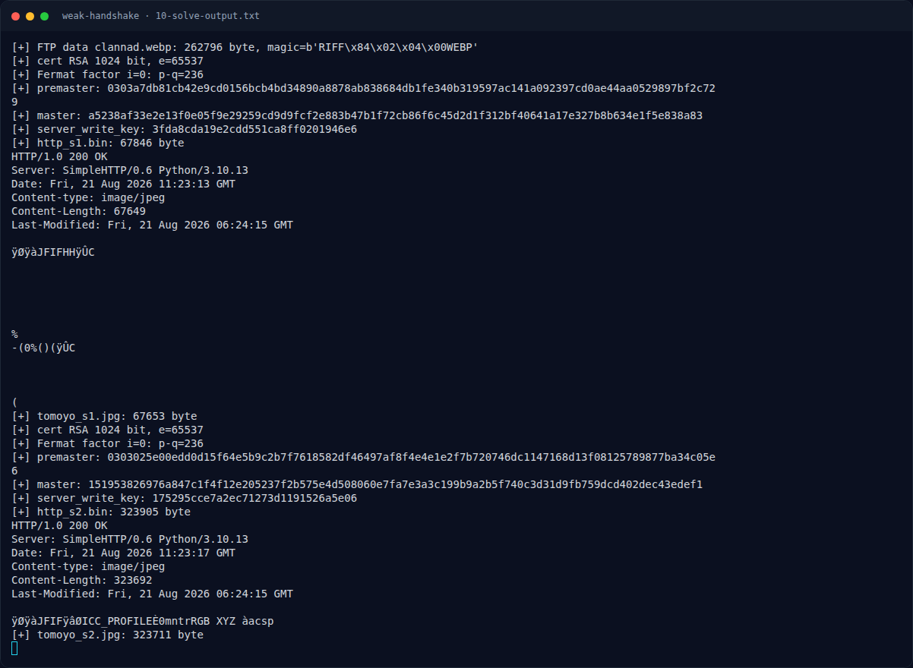

# Weak Handshake — Output

[← Overview](27-weak-handshake.md) · [Index](index.md)

## 3.3 Output

```text
[+] FTP data clannad.webp: 262796 byte, magic=b'RIFF\x84\x02\x04\x00WEBP'
[+] cert RSA 1024 bit, e=65537
[+] Fermat factor i=0: p-q=236
[+] premaster: 0303a7db81cb42e9cd0156bcb4bd34890a8878ab838684db1fe340b319597ac14
               1a092397cd0ae44aa0529897bf2c729
[+] master: a5238af33e2e13f0e05f9e29259cd9d9fcf2e883b47b1f72cb86f6c45d2d1f31
            2bf40641a17e327b8b634e1f5e838a83
[+] server_write_key: 3fda8cda19e2cdd551ca8ff0201946e6
[+] http_s1.bin: 67846 byte
HTTP/1.0 200 OK
...
[+] tomoyo_s1.jpg: 67653 byte
[+] cert RSA 1024 bit, e=65537
[+] Fermat factor i=0: p-q=236
[+] premaster: 0303025e00edd0d15f64e5b9c2b7f7618582df46497af8f4e4e1e2f7b720746d...
[+] master: 151953826976a847c1f4f12e205237f2b575e4d508060e7fa7e3a3c199b9a2b5...
[+] server_write_key: 175295cce7a2ec71273d1191526a5e06
[+] http_s2.bin: 324224 byte
[+] tomoyo_s2.jpg: 323711 byte
```

### Evidence langkah ini



*Terminal evidence — `10-solve-output.txt` (arsip transkrip sesi solve).*

**Berkas mentah langkah ini:**

- [`10-solve-output.txt`](assets/weak-handshake/10-solve-output.txt)
