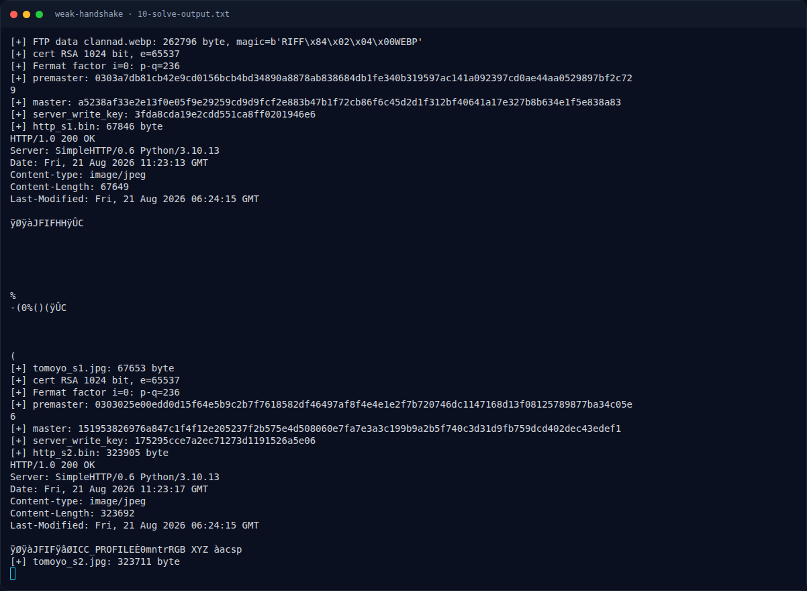
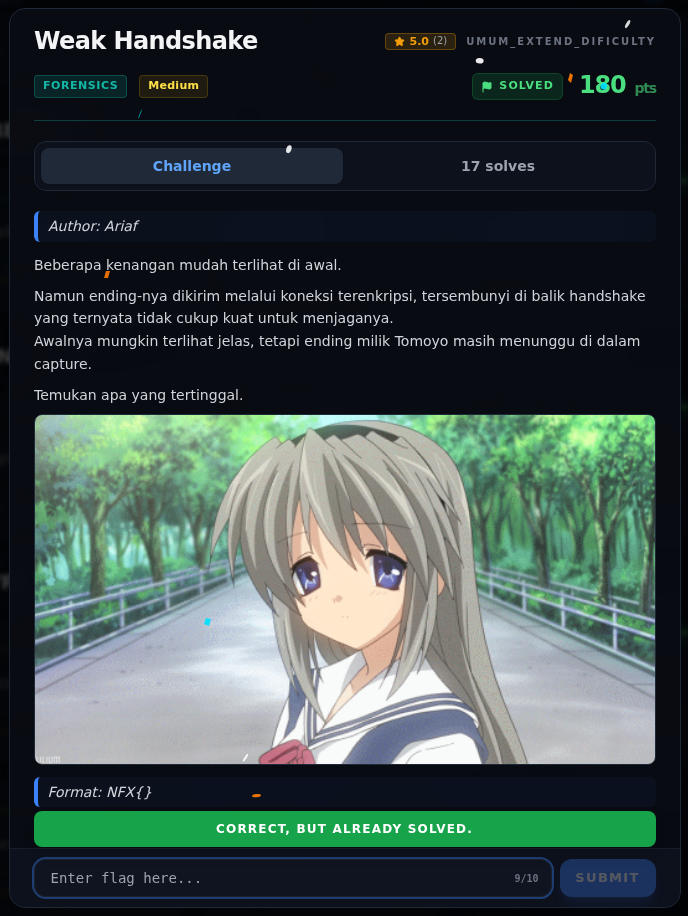

# Weak Handshake — Flag & Verifikasi

[← Overview](27-weak-handshake.md) · [Index](index.md)

> **Langkah 8/10 — Flag.** Overlay pada JPEG kedua:
>
> **Titik penting:** NFX{D36A64128F80788B60C677EF94FA7157}
>
> **Berikutnya:** [Bukti / Evidence](27-weak-handshake-09-bukti-evidence.md)

> **Asal flag.** Flag diperoleh dari langkah exploit/solver yang terdokumentasi, lalu disubmit ke platform.  
> **Tingkat bukti metode.** Terdokumentasi. [Buka Evidence](27-weak-handshake-09-bukti-evidence.md)

> **Flag:** `NFX{D36A64128F80788B60C677EF94FA7157}`
> **Status:** `VERIFIED`

Overlay pada JPEG kedua:

```text
{D36A64128F80788B60C677EF94EA7157}
```

Flag:

```text
NFX{D36A64128F80788B60C677EF94FA7157}
```

Verifikasi/status:

```text
Sumber : flags/wave2/Weak_Handshake.txt
Isi    : NFX{D36A64128F80788B60C677EF94FA7157}
Status : VERIFIED platform (submit via web)
```

> **Catatan varian.** Overlay pada JPEG kedua terbaca
> `{D36A64128F80788B60C677EF94EA7157}` (EA). Platform hanya menerima
> `NFX{D36A64128F80788B60C677EF94FA7157}` (FA). Flag final yang dipakai adalah
> varian yang diterima platform; perbedaan satu karakter ini berasal dari
> challenge, bukan dari solver. Crop overlay asli tetap disimpan di
> `assets/weak-handshake/09-flag-crop.png`.

### Terminal evidence (real)



*Terminal evidence (real).*

> **Bukti:** terminal evidence (real).

## Validasi platform (real)



*Screenshot asli dari platform NFX CTF 2026. Platform menjawab
`CORRECT, BUT ALREADY SOLVED.` untuk flag ini.*
