# Weak Handshake — Evidence / Bukti

17 screenshot16 transkrip / script

[← Overview](27-weak-handshake.md) · [Index](index.md)

## Arsip Evidence

> Semua file berasal dari `assets/weak-handshake/`. Screenshot platform dan terminal adalah bukti asli dari sesi solve; transkrip mentah tetap ditautkan di bagian bawah.

### Platform

<figure><a href="assets/weak-handshake/00-challenge-platform.png" target="_blank" rel="noopener">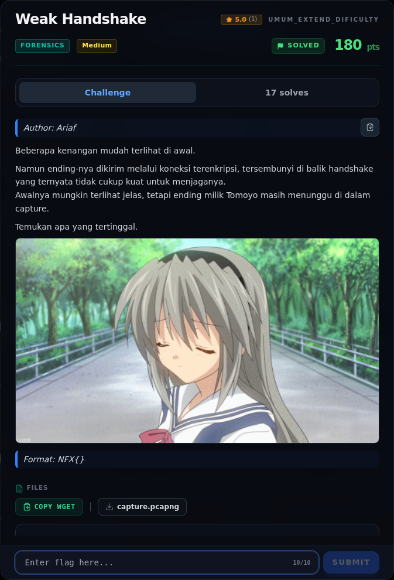</a><figcaption>00-challenge-platform.png</figcaption></figure>

*Challenge brief asli di platform NFX CTF 2026.*

<figure><a href="assets/weak-handshake/00b-submit-platform.png" target="_blank" rel="noopener">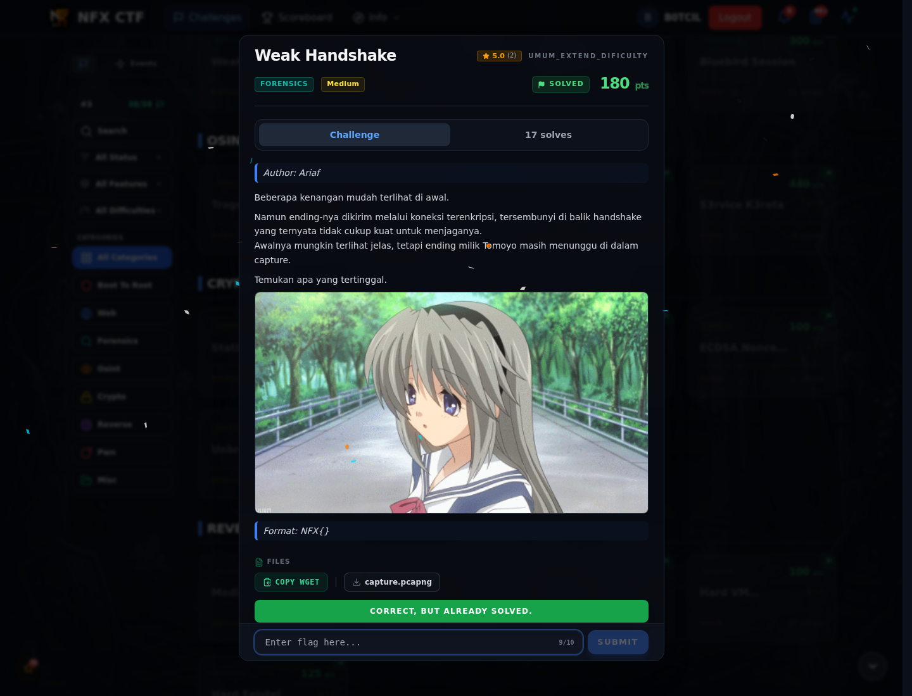</a><figcaption>00b-submit-platform.png</figcaption></figure>

*Submit flag di platform: `CORRECT, BUT ALREADY SOLVED.`*

### Terminal (arsip sesi)

<figure><a href="assets/weak-handshake/term-00-recon.png" target="_blank" rel="noopener">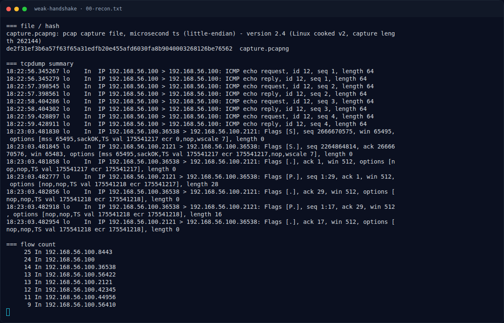</a><figcaption>term-00-recon.png</figcaption></figure>

*Terminal evidence — `00-recon.txt` (arsip transkrip sesi solve).*

<figure><a href="assets/weak-handshake/term-10-solve-output.png" target="_blank" rel="noopener">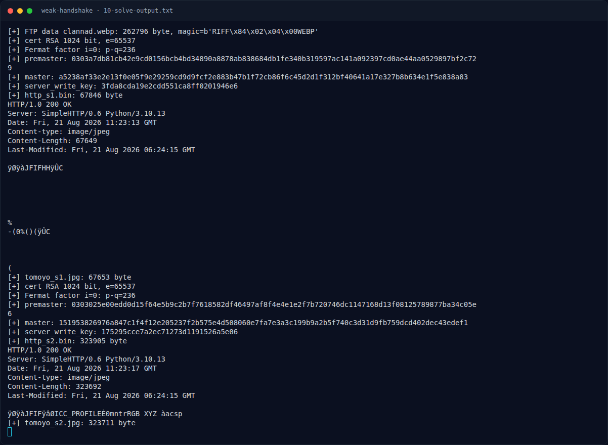</a><figcaption>term-10-solve-output.png</figcaption></figure>

*Terminal evidence — `10-solve-output.txt` (arsip transkrip sesi solve).*

<figure><a href="assets/weak-handshake/term-11-http-response.png" target="_blank" rel="noopener">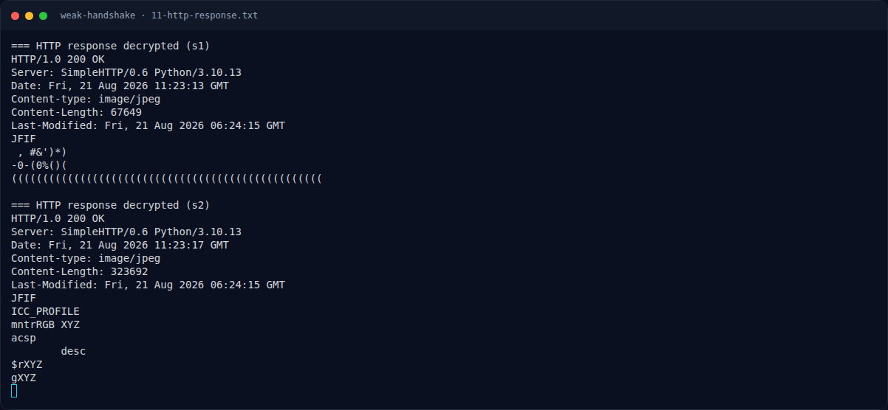</a><figcaption>term-11-http-response.png</figcaption></figure>

*Terminal evidence — `11-http-response.txt` (arsip transkrip sesi solve).*

<figure><a href="assets/weak-handshake/term-12-ftp-control.png" target="_blank" rel="noopener">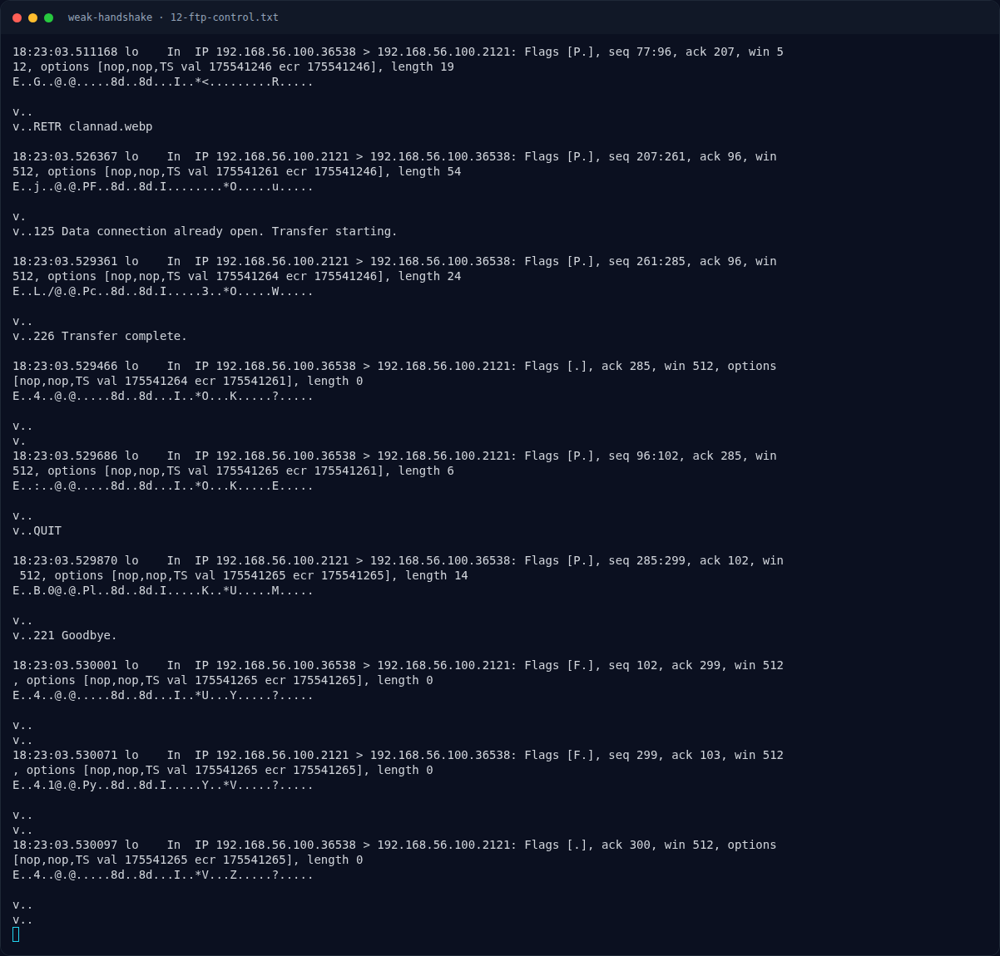</a><figcaption>term-12-ftp-control.png</figcaption></figure>

*Terminal evidence — `12-ftp-control.txt` (arsip transkrip sesi solve).*

<figure><a href="assets/weak-handshake/term-13-cert.png" target="_blank" rel="noopener">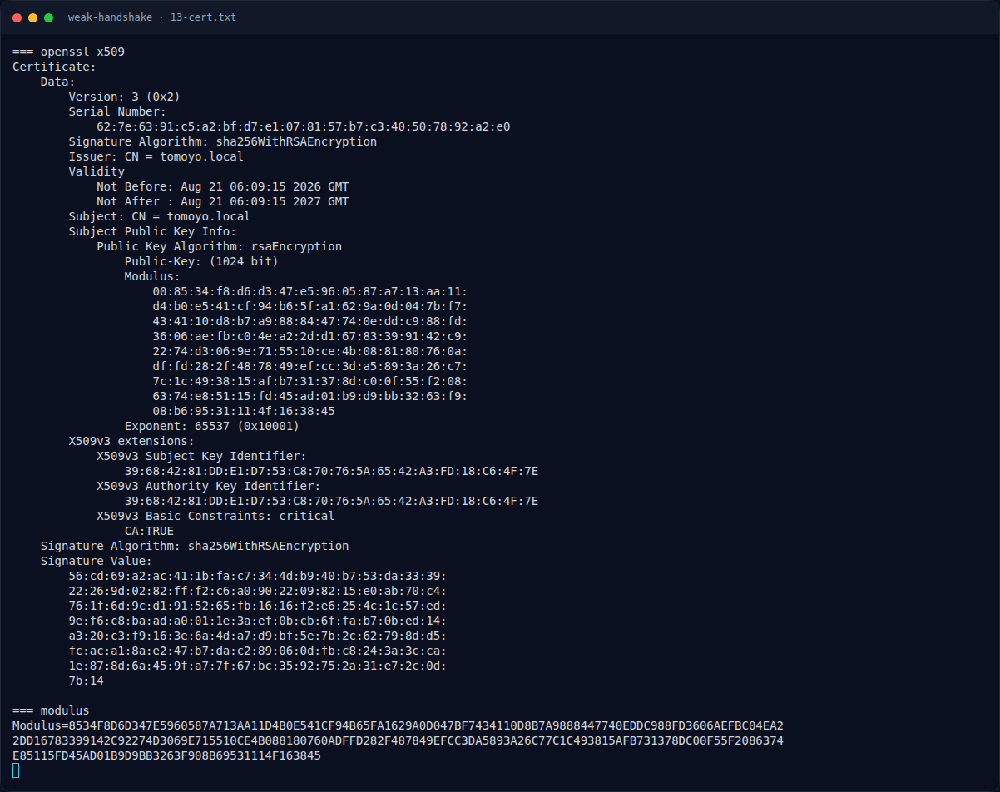</a><figcaption>term-13-cert.png</figcaption></figure>

*Terminal evidence — `13-cert.txt` (arsip transkrip sesi solve).*

<figure><a href="assets/weak-handshake/term-14-key-schedule.png" target="_blank" rel="noopener">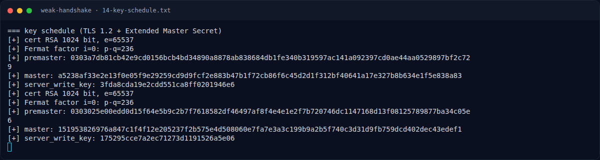</a><figcaption>term-14-key-schedule.png</figcaption></figure>

*Terminal evidence — `14-key-schedule.txt` (arsip transkrip sesi solve).*

### Screenshot langkah

<figure><figcaption>01-clannad.webp</figcaption></figure>

*Evidence — `01-clannad.webp`.*

<figure><figcaption>02-clannad.png</figcaption></figure>

*Evidence — `02-clannad.png`.*

<figure><figcaption>05-decrypted-tomoyo1.jpg</figcaption></figure>

*Evidence — `05-decrypted-tomoyo1.jpg`.*

<figure><a href="assets/weak-handshake/06-decrypted-tomoyo2.jpg" target="_blank" rel="noopener">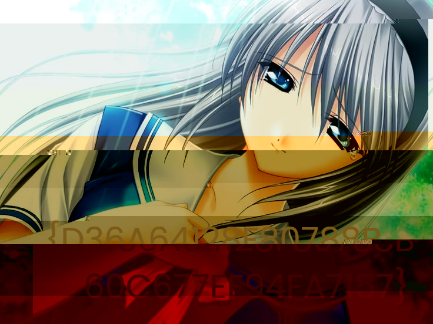</a><figcaption>06-decrypted-tomoyo2.jpg</figcaption></figure>

*Evidence — `06-decrypted-tomoyo2.jpg`.*

<figure><figcaption>07-decrypted-tomoyo2.png</figcaption></figure>

*Evidence — `07-decrypted-tomoyo2.png`.*

<figure><a href="assets/weak-handshake/09-flag-crop.png" target="_blank" rel="noopener">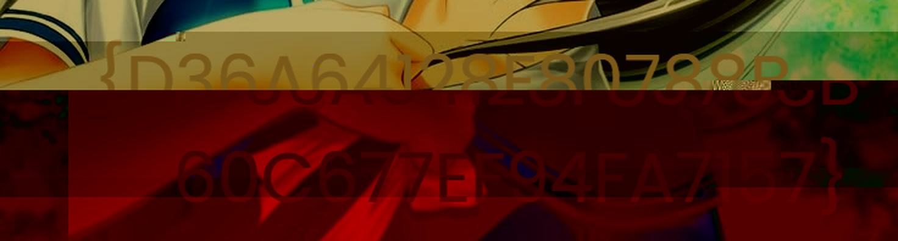</a><figcaption>09-flag-crop.png</figcaption></figure>

*Evidence — `09-flag-crop.png`.*

<figure><a href="assets/weak-handshake/clannad.webp" target="_blank" rel="noopener">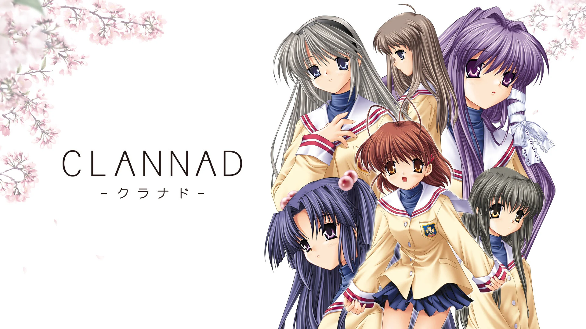</a><figcaption>clannad.webp</figcaption></figure>

*Evidence — `clannad.webp`.*

<figure><a href="assets/weak-handshake/tomoyo_s1.jpg" target="_blank" rel="noopener">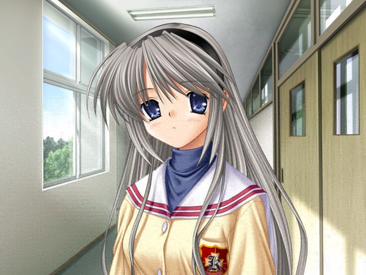</a><figcaption>tomoyo_s1.jpg</figcaption></figure>

*Evidence — `tomoyo_s1.jpg`.*

<figure><figcaption>tomoyo_s2.jpg</figcaption></figure>

*Evidence — `tomoyo_s2.jpg`.*

### Transkrip mentah & script

- [`00-recon.txt`](assets/weak-handshake/00-recon.txt)
- [`03-tomoyo_cert.der`](assets/weak-handshake/03-tomoyo_cert.der)
- [`04-tomoyo_priv.pem`](assets/weak-handshake/04-tomoyo_priv.pem)
- [`08-http-plain.bin`](assets/weak-handshake/08-http-plain.bin)
- [`10-solve-output.txt`](assets/weak-handshake/10-solve-output.txt)
- [`11-http-response.txt`](assets/weak-handshake/11-http-response.txt)
- [`12-ftp-control.txt`](assets/weak-handshake/12-ftp-control.txt)
- [`13-cert.txt`](assets/weak-handshake/13-cert.txt)
- [`14-key-schedule.txt`](assets/weak-handshake/14-key-schedule.txt)
- [`capture.pcapng`](assets/weak-handshake/capture.pcapng)
- [`http_s1.bin`](assets/weak-handshake/http_s1.bin)
- [`http_s2.bin`](assets/weak-handshake/http_s2.bin)
- [`solve_weak.py`](assets/weak-handshake/solve_weak.py)
- [`tomoyo_cert.der`](assets/weak-handshake/tomoyo_cert.der)
- [`tomoyo_priv.pem`](assets/weak-handshake/tomoyo_priv.pem)
- [`wh.pcap`](assets/weak-handshake/wh.pcap)

## Tabel Evidence

| Bukti | File | Keterangan |
|---|---|---|
| Capture | `assets/weak-handshake/capture.pcapng` | pcapng asli |
| Pcap konversi | `assets/weak-handshake/wh.pcap` | untuk parser Python |
| Recon | `assets/weak-handshake/00-recon.txt` | file/hash/tcpdump/flow |
| Clannad WEBP | `assets/weak-handshake/01-clannad.webp` | decoy awal |
| Clannad PNG | `assets/weak-handshake/02-clannad.png` | hasil konversi |
| Sertifikat | `assets/weak-handshake/03-tomoyo_cert.der` | X.509 DER |
| Private key | `assets/weak-handshake/04-tomoyo_priv.pem` | hasil Fermat |
| JPEG 1 | `assets/weak-handshake/05-decrypted-tomoyo1.jpg` | decoy/awal |
| JPEG 2 | `assets/weak-handshake/06-decrypted-tomoyo2.jpg` | berisi flag |
| PNG 2 | `assets/weak-handshake/07-decrypted-tomoyo2.png` | render |
| HTTP plain | `assets/weak-handshake/08-http-plain.bin` | hasil dekripsi |
| Crop flag | `assets/weak-handshake/09-flag-crop.png` | overlay diperbesar |
| Solver | `assets/weak-handshake/solve_weak.py` | FTP + TLS decrypt |
| Solve log | `assets/weak-handshake/10-solve-output.txt` | output lengkap |
| HTTP headers | `assets/weak-handshake/11-http-response.txt` | dua response |
| FTP control | `assets/weak-handshake/12-ftp-control.txt` | sesi FTP |
| Cert info | `assets/weak-handshake/13-cert.txt` | openssl x509 |
| Key schedule | `assets/weak-handshake/14-key-schedule.txt` | master/key |