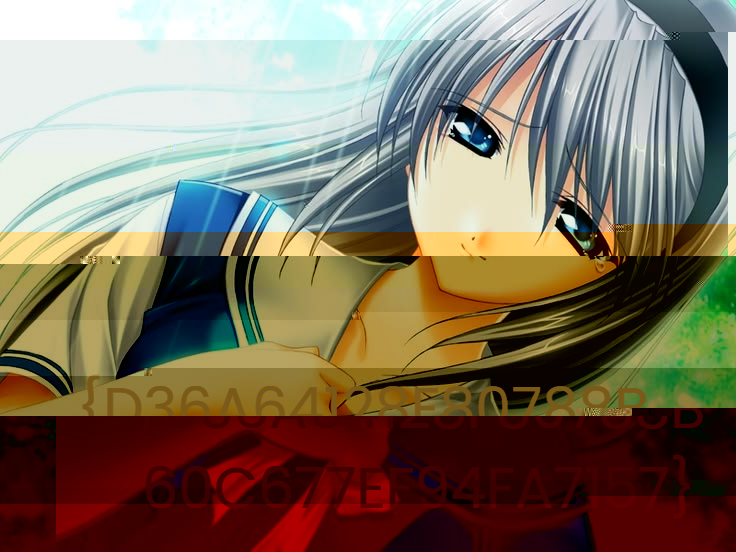

# Weak Handshake — Referensi

[← Overview](27-weak-handshake.md) · [Index](index.md)

> **Langkah 10/10 — Referensi.** Referensi
>
> **Titik penting:** —
>
> **Selesai.** Kembali ke [Overview](27-weak-handshake.md).

- TLS 1.2 (RFC 5246), cipher suite `TLS_RSA_WITH_AES_128_CBC_SHA`.
- Extended Master Secret (RFC 7627).
- Fermat factorization.
- PKCS#1 v1.5 RSA encryption.
- Wireshark TLS decryption dengan RSA private key.

### Evidence langkah ini

*Evidence — `07-decrypted-tomoyo2.png`.*
