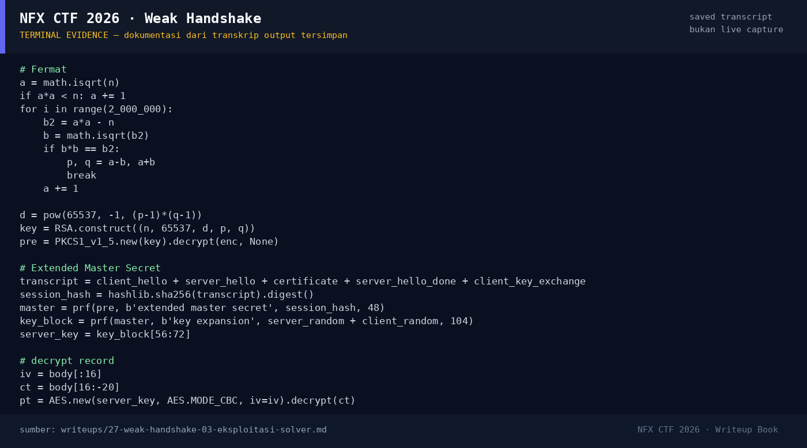

# Weak Handshake

Track Umum / Extend · ForensicsMedium360 poinVERIFIED

| Field | Nilai |
|---|---|
| Event | `umum_Extend` |
| Kategori | `Forensics` |
| Difficulty | `Medium` |
| Poin | `360` |
| Author | `Ariaf` |
| Solves | `8` |
| Tools | exiftool, tshark, Wireshark, openssl |
| Flag | `NFX{D36A64128F80788B60C677EF94FA7157}` |
| Status | `VERIFIED` |

[← Kembali ke Index](index.md)

## TL;DR

- `capture.pcapng` adalah capture loopback dengan FTP (port 2121/42345) dan dua sesi HTTPS ke port 8443.
- FTP mentransfer `clannad.webp` — “kenangan yang mudah terlihat di awal”; ini bukan flag.
- HTTPS memakai **TLS_RSA_WITH_AES_128_CBC_SHA (0x002f)** dengan sertifikat RSA **1024-bit** `CN=tomoyo.local`.
- Modulus RSA difaktorkan dengan **Fermat** karena `p` dan `q` hanya berselisih **236**; private key dipulihkan.
- Sesi memakai **Extended Master Secret** (extension `0x0017`), sehingga master secret dihitung dari `session_hash`, bukan `client_random+server_random`.
- Dua respons HTTPS didekripsi menjadi dua JPEG; JPEG kedua memuat overlay flag `{D36A64128F80788B60C677EF94FA7157}`.
- Flag: `NFX{D36A64128F80788B60C677EF94FA7157}`.

Pratinjau evidence. Buka halaman <a href="27-weak-handshake-05-bukti-evidence.html">Evidence / Bukti</a> untuk semua screenshot dan transkrip.

## Navigasi Halaman

<a class="nx-page-card" href="27-weak-handshake-01-recon.html"><b>Recon</b>Enumerasi target dan bukti awal</a>
<a class="nx-page-card" href="27-weak-handshake-02-analisis.html"><b>Analisis</b>Membaca alur dan akar masalah</a>
<a class="nx-page-card" href="27-weak-handshake-03-eksploitasi-solver.html"><b>Eksploitasi / Solver</b>Langkah exploit dan solver</a>
<a class="nx-page-card" href="27-weak-handshake-04-flag.html"><b>Flag</b>Flag dan verifikasi platform</a>
<a class="nx-page-card" href="27-weak-handshake-05-bukti-evidence.html"><b>Bukti / Evidence</b>Screenshot, transkrip, dan artefak</a>
<a class="nx-page-card" href="27-weak-handshake-06-referensi.html"><b>Referensi</b>Sumber dan bacaan lanjutan</a>

