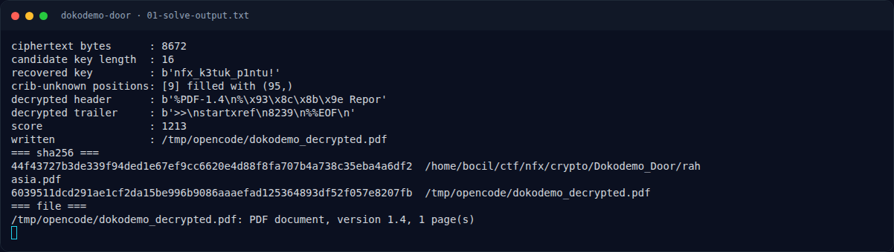

# Dokodemo Door — Recon

[← Overview](28-dokodemo-door.md) · [Index](index.md)

### 1.1 Deskripsi challenge

> **Author: Kada**
>
> Sebuah dokumen PDF rahasia yang berisi jalur penyusupan ke sektor barat
> berhasil dicegat, namun file tersebut tidak dapat dibuka akibat byte-byte
> di dalamnya telah diacak menggunakan metode enkripsi repeating-key XOR
> (kunci berulang). Tugas Anda adalah menganalisis struktur file, memecahkan
> enkripsi byte tersebut untuk mengembalikan dokumen PDF ke bentuk aslinya,
> lalu temukan flag rahasia yang tersembunyi di dalamnya.
>
> Format: `NFX{your_flag_here}`

### 1.2 File yang diberikan

| File | Ukuran | SHA-256 |
|---|---|---|
| `crypto/Dokodemo_Door/rahasia.pdf` | 8.672 byte | `44f43727b3de339f94ded1e67ef9cc6620e4d88f8fa707b4a738c35eba4a6df2` |

Tidak ada service, source, atau hint tambahan. Seluruh challenge ada di satu
file.

### 1.3 Environment

- OS: Linux x86-64.
- Tools: `file`, `xxd`, `strings`, Python 3, `base64`, `zlib`.
- Parser PDF eksternal (`pdftotext`) tidak terpasang; teks diekstrak manual
  dari content stream PDF (ASCII85 + Flate).

### 1.4 Triage awal

```bash
$ file rahasia.pdf
rahasia.pdf: data

$ ls -l rahasia.pdf
-rw-r--r-- 1 bocil bocil 8672 Nov  7 12:32 rahasia.pdf

$ xxd rahasia.pdf | head -4
00000000: 4b36 3c19 4602 5a41 617a e3bd e5ea 5573  K6<.F.ZAaz....Us
00000010: 0b16 172d 1f7f 1517 4b18 155f 0b06 1455  ...-....K.._...U
00000020: 0b02 580f 2f75 5411 043c 055c 0b1a 0101  ..X./uT..<.\....
00000030: 4609 083a 0540 1b00 193c 1518 6445 5511  F..:.@..dEU...

$ strings -n 4 rahasia.pdf | head -5
ZAaz
99JKa:
+\FH
DNI>nK
```

`file` menyebut `data`, bukan PDF, dan tidak ada string `%PDF` di awal.
Namun distribusi byte terlihat seperti teks PDF yang di-XOR: banyak byte
rendah dan pola berulang.

### Evidence langkah ini



*Terminal evidence — `01-solve-output.txt` (arsip transkrip sesi solve).*
