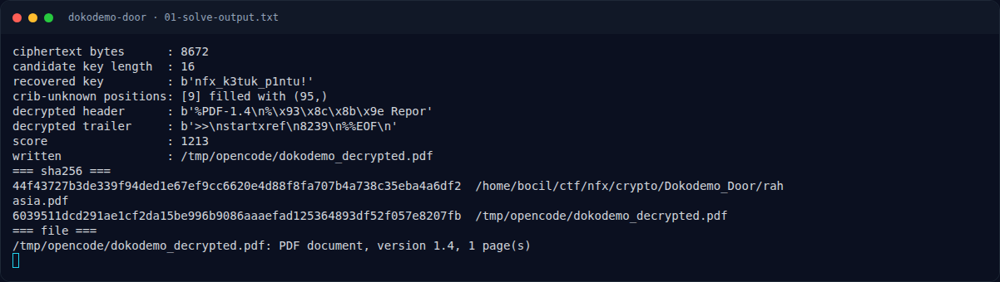

# Dokodemo Door — Solver

[← Overview](28-dokodemo-door.md) · [Index](index.md)

> **Langkah 5/9 — Solver.** Solver
>
> **Titik penting:** —
>
> **Berikutnya:** [Output asli](28-dokodemo-door-06-output-asli.md)

## 3.2 Solver

```python
#!/usr/bin/env python3
# assets/dokodemo-door/solve_dokodemo.py (ringkas)
from pathlib import Path
import itertools

SRC = Path("/home/bocil/ctf/nfx/crypto/Dokodemo_Door/rahasia.pdf")
HEAD = b"%PDF-1.4\n"
TAIL = b"%%EOF\n"

def score(data):
    markers = [b"%PDF", b"%%EOF", b" obj", b"endobj", b"stream",
               b"/Type", b"xref", b"trailer"]
    return sum(data.count(m)*20 for m in markers) + \
           sum(32 <= b < 127 or b in (9,10,13) for b in data)//20

c = SRC.read_bytes()
n = len(c)
best = None

for kl in range(1, 65):
    key = [None]*kl
    ok = True
    for i, p in enumerate(HEAD):                 # known plaintext header
        j = i % kl
        v = c[i] ^ p
        if key[j] is None: key[j] = v
        elif key[j] != v: ok = False; break
    if not ok: continue
    off = n - len(TAIL)
    for i, p in enumerate(TAIL):                 # known plaintext trailer
        j = (off+i) % kl
        v = c[off+i] ^ p
        if key[j] is None: key[j] = v
        elif key[j] != v: ok = False; break
    if not ok: continue

    unknown = [i for i,v in enumerate(key) if v is None]
    if len(unknown) > 2: continue
    for fill in itertools.product(range(256), repeat=len(unknown)):
        kk = key[:]
        for idx,val in zip(unknown, fill): kk[idx] = val
        dec = bytes(b ^ kk[i % kl] for i,b in enumerate(c))
        sc = score(dec)
        if best is None or sc > best[0]:
            best = (sc, kl, bytes(kk), dec)

sc, kl, key, dec = best
print("key length:", kl)
print("key       :", key)
print("header    :", dec[:20])
print("trailer   :", dec[-24:])
Path("/tmp/opencode/dokodemo_decrypted.pdf").write_bytes(dec)
```

### Evidence langkah ini



*Terminal evidence — `01-solve-output.txt` (arsip transkrip sesi solve).*


*Terminal evidence — `02-extracted-text.txt` (arsip transkrip sesi solve).*

**Berkas mentah langkah ini:**

- [`01-solve-output.txt`](assets/dokodemo-door/01-solve-output.txt)
- [`02-extracted-text.txt`](assets/dokodemo-door/02-extracted-text.txt)
