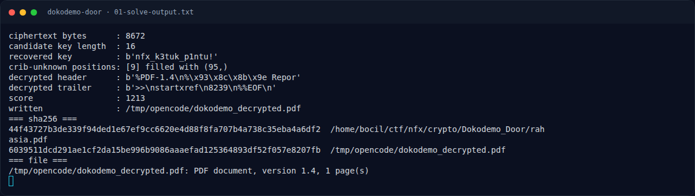
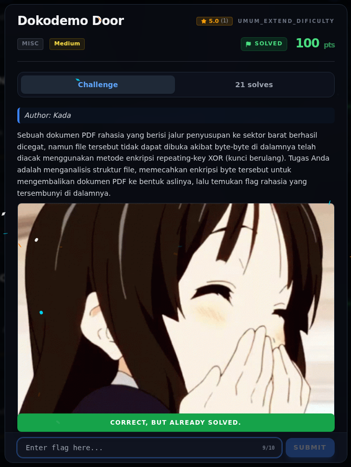

# Dokodemo Door — Flag & Verifikasi

[← Overview](28-dokodemo-door.md) · [Index](index.md)

> **Langkah 7/9 — Flag.** Flag
>
> **Titik penting:** NFX{k3tuk_p1ntu_bUk4_d0kum3n_x0r}
>
> **Berikutnya:** [Bukti / Evidence](28-dokodemo-door-08-bukti-evidence.md)

> **Asal flag.** Flag diperoleh dari langkah exploit/solver yang terdokumentasi, lalu disubmit ke platform.  
> **Tingkat bukti metode.** Terdokumentasi. [Buka Evidence](28-dokodemo-door-08-bukti-evidence.md)

> **Status metode:** **FULL** — metode utama berhasil direproduksi.  
> **Flag:** `NFX{k3tuk_p1ntu_bUk4_d0kum3n_x0r}`
> **Status:** `VERIFIED`

```text
NFX{k3tuk_p1ntu_bUk4_d0kum3n_x0r}
```

Verifikasi:

- Flag terbaca langsung dari teks PDF hasil dekripsi.
- Flag sama persis dengan `flags/crypto/Dokodemo_Door.txt`.
- PDF hasil dekripsi valid menurut `file` (`PDF document, version 1.4`).

### Terminal evidence (real)



*Terminal evidence (real).*

> **Bukti:** terminal evidence (real).

## Validasi platform (real)



*Screenshot asli dari platform NFX CTF 2026. Platform menjawab
`CORRECT, BUT ALREADY SOLVED.` untuk flag ini.*
