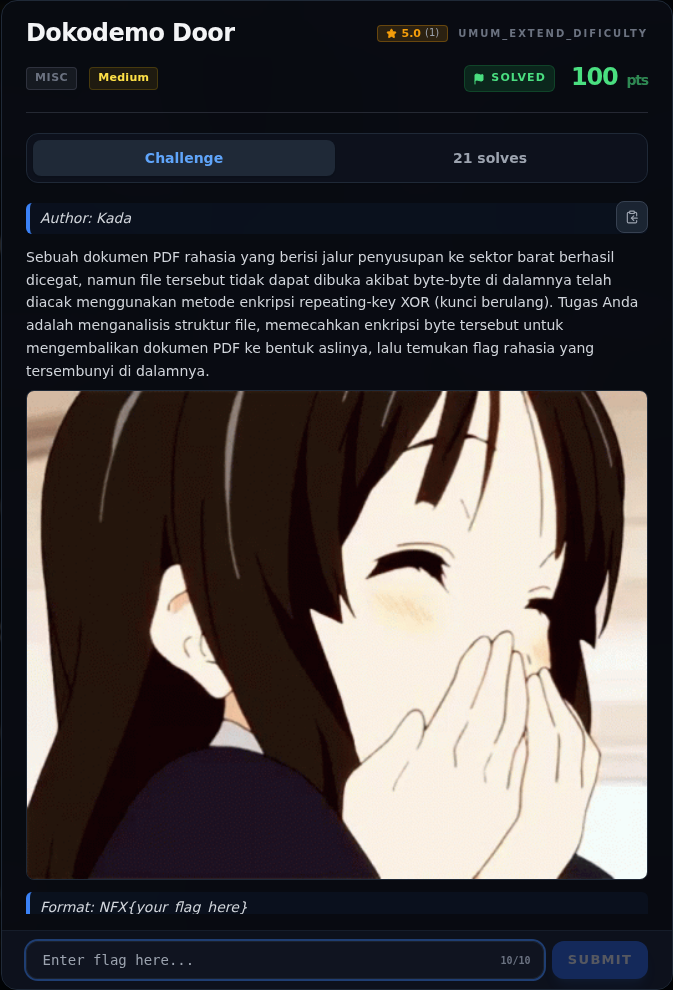
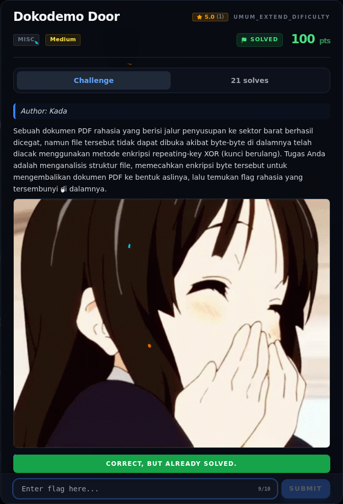
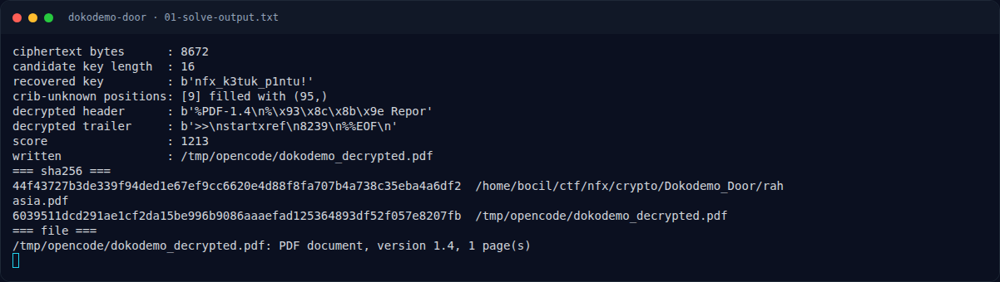
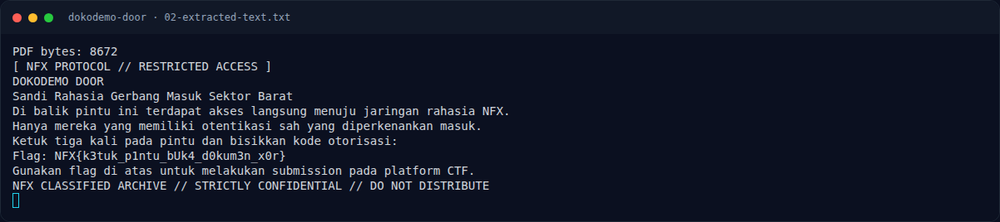

# Dokodemo Door — Evidence / Bukti

5 screenshot5 transkrip / script

[← Overview](28-dokodemo-door.md) · [Index](index.md)

> **Langkah 8/9 — Bukti / Evidence.** Semua bukti berada di writeups/assets/dokodemo-door/.
>
> **Titik penting:** arsip screenshot dan transkrip
>
> **Berikutnya:** [Referensi](28-dokodemo-door-09-referensi.md)

## Arsip Evidence

> Semua file berasal dari `assets/dokodemo-door/`. Screenshot platform dan terminal adalah bukti asli dari sesi solve; transkrip mentah tetap ditautkan di bagian bawah.

### Platform

<figure><figcaption>00-challenge-platform.png</figcaption></figure>

*Challenge brief asli di platform NFX CTF 2026.*

<figure><figcaption>00b-submit-platform.png</figcaption></figure>

*Submit flag di platform: `CORRECT, BUT ALREADY SOLVED.`*

### Terminal (arsip sesi)

<figure><figcaption>term-01-solve-output.png</figcaption></figure>

*Terminal evidence — `01-solve-output.txt` (arsip transkrip sesi solve).*

<figure><figcaption>term-02-extracted-text.png</figcaption></figure>

*Terminal evidence — `02-extracted-text.txt` (arsip transkrip sesi solve).*

### Screenshot langkah

<figure><figcaption>04-page-image.jpg</figcaption></figure>

*Evidence — `04-page-image.jpg`.*

### Transkrip mentah & script

- [`01-solve-output.txt`](assets/dokodemo-door/01-solve-output.txt)
- [`02-extracted-text.txt`](assets/dokodemo-door/02-extracted-text.txt)
- [`03-decrypted.pdf`](assets/dokodemo-door/03-decrypted.pdf)
- [`extract_text.py`](assets/dokodemo-door/extract_text.py)
- [`solve_dokodemo.py`](assets/dokodemo-door/solve_dokodemo.py)

## Tabel Evidence

Semua bukti berada di `writeups/assets/dokodemo-door/`.

| Bukti | File | Keterangan |
|---|---|---|
| Output solver | `01-solve-output.txt` | Panjang key, key, header/trailer, hash |
| Teks PDF | `02-extracted-text.txt` | Hasil decode content stream, termasuk flag |
| PDF terdekripsi | `03-decrypted.pdf` | File asli setelah XOR |
| Gambar halaman | `04-page-image.jpg` | Gambar yang tertanam di PDF |
| Solver | `solve_dokodemo.py` | Script crib-drag yang dijalankan |
| Ekstraktor teks | `extract_text.py` | Decoder ASCII85 + Flate + operator `Tj` |