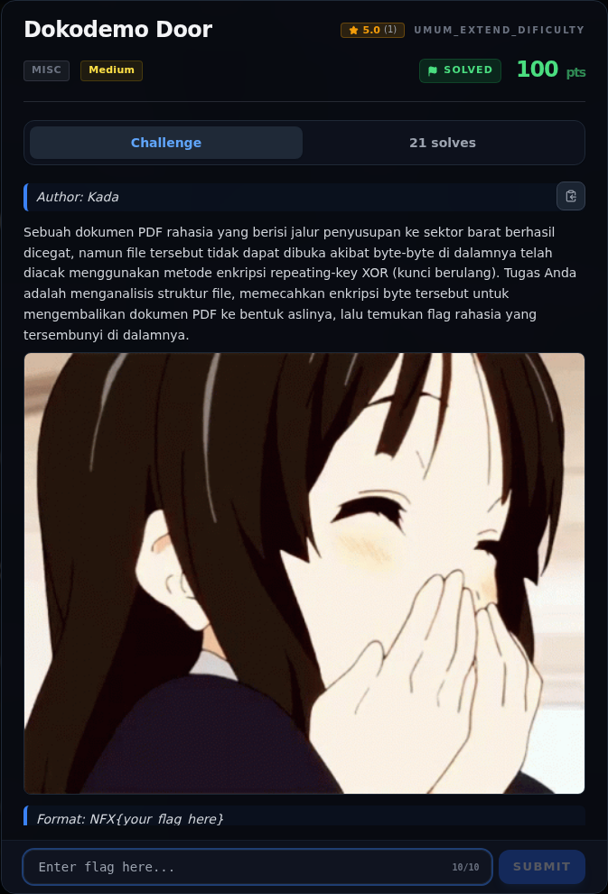

# Dokodemo Door — Referensi

[← Overview](28-dokodemo-door.md) · [Index](index.md)

> **Langkah 9/9 — Referensi.** ASCII85Decode + FlateDecode.
>
> **Titik penting:** ASCII85Decode + FlateDecode.
>
> **Selesai.** Kembali ke [Overview](28-dokodemo-door.md).

- `crypto/Dokodemo_Door/rahasia.pdf` — ciphertext asli.
- `flags/crypto/Dokodemo_Door.txt` — flag terverifikasi.
- Teknik: repeating-key XOR, crib-drag, known-plaintext attack, PDF
  `ASCII85Decode` + `FlateDecode`.

### Evidence langkah ini

*Challenge brief asli di platform NFX CTF 2026.*
