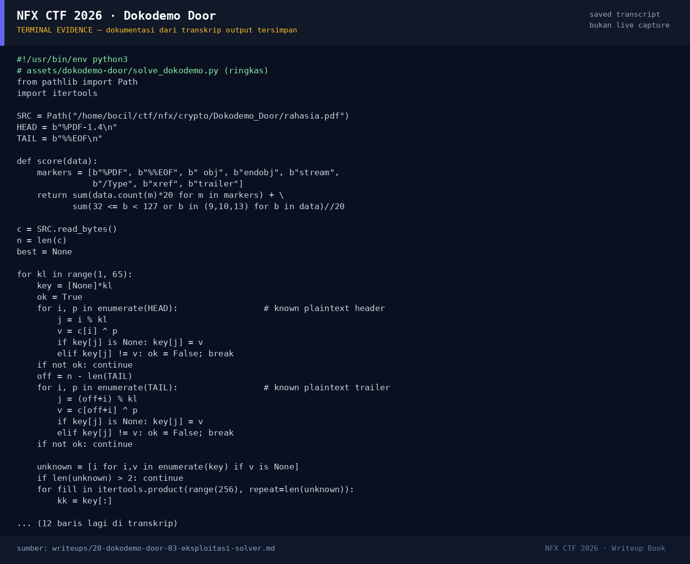

# Dokodemo Door

Track Umum / Extend · MiscMedium160 poinVERIFIED

| Field | Nilai |
|---|---|
| Event | `umum_Extend` |
| Kategori | `Misc` |
| Difficulty | `Medium` |
| Poin | `160` |
| Author | `Kada` |
| Solves | `18` |
| Tools | python3, strings |
| Flag | `NFX{k3tuk_p1ntu_bUk4_d0kum3n_x0r}` |
| Status | `VERIFIED` |

[← Kembali ke Index](index.md)

## TL;DR

- `rahasia.pdf` bukan PDF lagi: seluruh byte di-XOR dengan **repeating key**
  sepanjang 16 byte.
- Karena PDF punya magic header `%PDF-1.4\n` dan trailer `%%EOF\n`, keduanya
  bisa dipakai sebagai *known plaintext* untuk menurunkan key.
- Key yang diperoleh: `nfx_k3tuk_p1ntu!`.
- Setelah didekripsi, file valid sebagai PDF 1.4; teks di halaman pertama
  memuat flag `NFX{k3tuk_p1ntu_bUk4_d0kum3n_x0r}`.

Pratinjau evidence. Buka halaman <a href="28-dokodemo-door-05-bukti-evidence.html">Evidence / Bukti</a> untuk semua screenshot dan transkrip.

## Navigasi Halaman

<a class="nx-page-card" href="28-dokodemo-door-01-recon.html"><b>Recon</b>Enumerasi target dan bukti awal</a>
<a class="nx-page-card" href="28-dokodemo-door-02-analisis.html"><b>Analisis</b>Membaca alur dan akar masalah</a>
<a class="nx-page-card" href="28-dokodemo-door-03-eksploitasi-solver.html"><b>Eksploitasi / Solver</b>Langkah exploit dan solver</a>
<a class="nx-page-card" href="28-dokodemo-door-04-flag.html"><b>Flag</b>Flag dan verifikasi platform</a>
<a class="nx-page-card" href="28-dokodemo-door-05-bukti-evidence.html"><b>Bukti / Evidence</b>Screenshot, transkrip, dan artefak</a>
<a class="nx-page-card" href="28-dokodemo-door-06-referensi.html"><b>Referensi</b>Sumber dan bacaan lanjutan</a>

