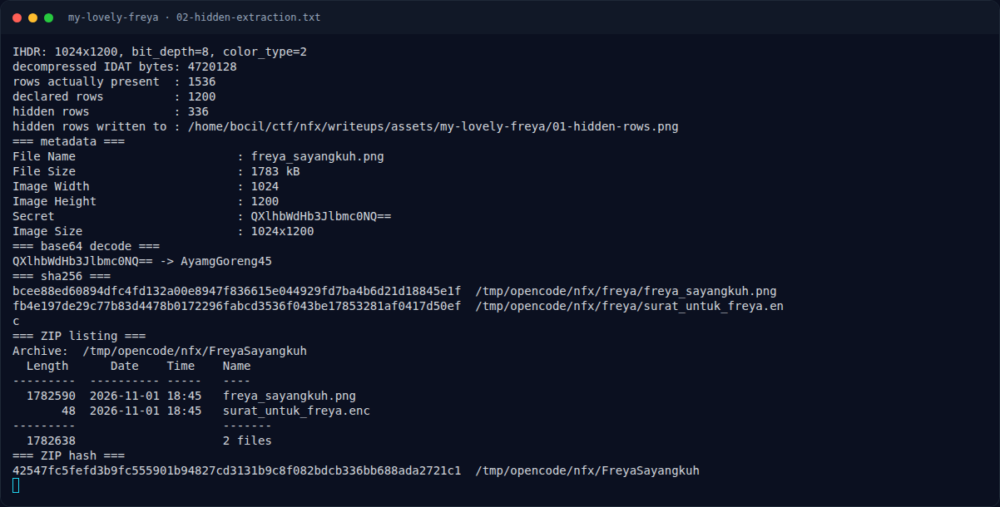

# My Lovely Freya — Recon

[← Overview](29-my-lovely-freya.md) · [Index](index.md)

## 1.1 Deskripsi challenge

> **Author: salep88**
>
> Ada satu foto Freya yang selalu kusimpan, dan bersamanya kutitipkan
> sebuah surat. Belum pernah kukirim, belum pernah dibaca.
>
> Setiap malam aku menyebut namanya, seratus ribu kali tanpa jeda. Dua ratus
> lima puluh enam alasan untuk tetap menunggunya.
>
> Mereka bilang ada rahasia di balik foto itu. Mungkin benar, mungkin juga
> tidak.
>
> Untuk Freya, yang tak pernah tahu.
>
> Format Flag: `NFX{your_flag_here}`

Petunjuk angka penting:

- "seratus ribu kali tanpa jeda" → **100.000 iterasi** KDF.
- "dua ratus lima puluh enam alasan" → **AES-256** (256-bit).
- "rahasia di balik foto" → data di luar area gambar yang terlihat.

## 1.2 File yang diberikan

| File | Ukuran | SHA-256 | Keterangan |
|---|---|---|---|
| `/tmp/opencode/nfx/FreyaSayangkuh` | 1.674.025 byte | `42547fc5fefd3b9fc555901b94827cd3131b9c8f082bdcb336bb688ada2721c1` | ZIP attachment asli |
| `freya_sayangkuh.png` | 1.782.590 byte | `bcee88ed60894dfc4fd132a00e8947f836615e044929fd7ba4b6d21d18845e1f` | PNG hasil ekstraksi ZIP |
| `surat_untuk_freya.enc` | 48 byte | `fb4e197de29c77b83d4478b0172296fabcd3536f043be17853281af0417d50ef` | Surat terenkripsi |

Isi ZIP:

```text
$ unzip -l FreyaSayangkuh
Archive:  FreyaSayangkuh
  Length      Date    Time    Name
---------  ---------- -----   ----
  1782590  2026-11-01 18:45   freya_sayangkuh.png
       48  2026-11-01 18:45   surat_untuk_freya.enc
---------                     -------
  1782638                     2 files
```

## 1.3 Environment

- OS: Linux x86-64.
- Tools: `unzip`, `file`, `exiftool`, Python 3, `zlib`, Pillow,
  `openssl` 3.x.
- Tidak ada service; semuanya offline.

### Evidence langkah ini



*Terminal evidence — `02-hidden-extraction.txt` (arsip transkrip sesi solve).*

**Berkas mentah langkah ini:**

- [`02-hidden-extraction.txt`](assets/my-lovely-freya/02-hidden-extraction.txt)
