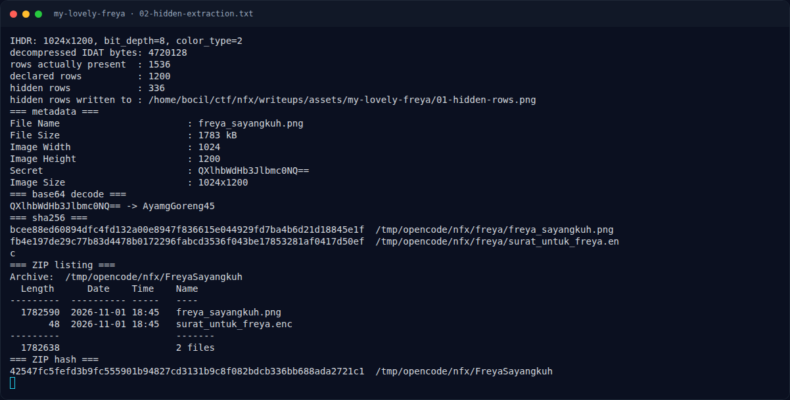

# My Lovely Freya — Analisis

[← Overview](29-my-lovely-freya.md) · [Index](index.md)

## 2.1 Struktur PNG: tinggi deklarasi vs tinggi nyata

PNG menyimpan tinggi gambar di chunk `IHDR`. Viewer normal berhenti di
tinggi itu. Jika IDAT berisi lebih banyak baris, baris sisanya tidak pernah
ditampilkan.

```text
$ python3 extract_hidden.py
IHDR: 1024x1200, bit_depth=8, color_type=2
decompressed IDAT bytes: 4720128
rows actually present  : 1536
declared rows          : 1200
hidden rows            : 336
```

Perhitungan:

```text
1024 piksel x 3 byte (RGB) + 1 byte filter = 3073 byte per baris
4.720.128 / 3073 = 1536 baris
1536 - 1200 = 336 baris tersembunyi
```

Baris 1200–1535 kemudian di-unfilter dan dirender sebagai PNG terpisah.
Hasilnya adalah potongan gambar yang berisi teks:

```text
<!HayamGoreng45@/>
```

## 2.2 Membaca password asli

Password yang benar adalah string lengkap di gambar, termasuk pembungkus
`<!` dan `/>`:

```text
<!HayamGoreng45@/>
```

Ini menjelaskan mengapa metadata `AyamgGoreng45` gagal: karakter `H`, `@`,
dan simbol pembungkus tidak ada di metadata.

## 2.3 Format file surat

```bash
$ xxd surat_untuk_freya.enc
00000000: 5361 6c74 6564 5f5f d4be 860a 4bb7 cf3a  Salted__....K..:
00000010: 92c5 4dc0 d0ee 5cf0 aeef 80a8 3e7a e8ce  ..M...\.....>z..
00000020: 5a7d 8114 d186 319a 95f4 41f3 5c21 cb0f  Z}....1...A.\!..
```

`salted__` adalah header format `openssl enc`:

- 8 byte `Salted__`
- 8 byte salt
- sisa 32 byte ciphertext

Plaintext 24 byte (23 karakter flag + newline) + 8 byte padding PKCS#7 =
32 byte, sehingga total file 48 byte. Parameter yang cocok dengan hint:

```text
cipher : AES-256-CBC   (256 alasan)
KDF    : PBKDF2        (openssl -pbkdf2)
iter   : 100000        (seratus ribu kali)
digest : SHA-256       (default openssl 3.x untuk -md)
pass   : <!HayamGoreng45@/>
```

### Evidence langkah ini



*Terminal evidence — `02-hidden-extraction.txt` (arsip transkrip sesi solve).*
