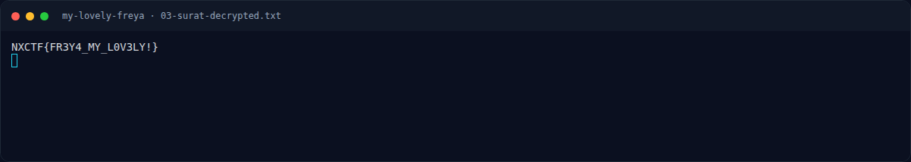

# My Lovely Freya — Penyelesaian

[← Overview](29-my-lovely-freya.md) · [Index](index.md)

## 3.1 Strategi

1. Ekstrak ZIP.
2. Baca `IHDR` dan `IDAT`; hitung jumlah baris nyata.
3. Unfilter 336 baris ekstra dan render sebagai gambar.
4. Baca password dari gambar.
5. Dekripsi `surat_untuk_freya.enc` dengan AES-256-CBC + PBKDF2
   100.000 iterasi.
6. Normalisasi prefix `NXCTF` → `NFX` sesuai flag platform.

## 3.2 Ekstraksi baris tersembunyi

```bash
unzip FreyaSayangkuh -d freya/
# -> freya/freya_sayangkuh.png
# -> freya/surat_untuk_freya.enc
```

```python
#!/usr/bin/env python3
# assets/my-lovely-freya/extract_hidden.py (ringkas)
import struct, zlib
from PIL import Image

data = open("freya_sayangkuh.png", "rb").read()
i, idat, width, height = 8, b"", None, None
while i < len(data):
    length = struct.unpack(">I", data[i:i+4])[0]
    ctype = data[i+4:i+8]
    chunk = data[i+8:i+8+length]
    if ctype == b"IHDR":
        width, height, depth, color = struct.unpack(">IIBB", chunk[:10])
    elif ctype == b"IDAT":
        idat += chunk
    i += 12 + length

raw = zlib.decompress(idat)
stride = width * 3 + 1
actual_h = len(raw) // stride
print("declared", height, "actual", actual_h, "hidden", actual_h - height)

full = unfilter(raw, width, actual_h)          # filter 0..4 per baris
extra = full[height * width * 3:]             # 336 baris terakhir
Image.frombytes("RGB", (width, actual_h - height), extra).save("hidden.png")
```

`unfilter()` mengimplementasikan lima tipe filter PNG (None, Sub, Up,
Average, Paeth), sama seperti decoder PNG standar.

## 3.3 Dekripsi surat

```bash
openssl enc -d -aes-256-cbc -md sha256 -pbkdf2 -iter 100000 \
  -in surat_untuk_freya.enc \
  -pass 'pass:<!HayamGoreng45@/>' \
  -out surat-decrypted.txt
```

### Evidence langkah ini



*Terminal evidence — `03-surat-decrypted.txt` (arsip transkrip sesi solve).*
