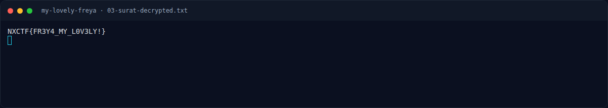
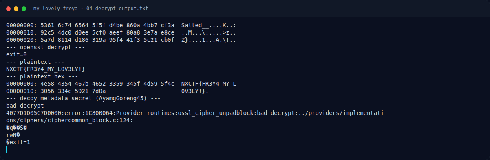

# My Lovely Freya — Output asli

[← Overview](29-my-lovely-freya.md) · [Index](index.md)

## 3.4 Output asli

```text
$ python3 extract_hidden.py
IHDR: 1024x1200, bit_depth=8, color_type=2
decompressed IDAT bytes: 4720128
rows actually present  : 1536
declared rows          : 1200
hidden rows            : 336
hidden rows written to : .../01-hidden-rows.png
```

```text
$ ./decrypt_surat.sh
00000000: 5361 6c74 6564 5f5f d4be 860a 4bb7 cf3a  Salted__....K..:
00000010: 92c5 4dc0 d0ee 5cf0 aeef 80a8 3e7a e8ce  ..M...\.....>z..
00000020: 5a7d 8114 d186 319a 95f4 41f3 5c21 cb0f  Z}....1...A.\!..
--- openssl decrypt ---
exit=0
--- plaintext ---
NXCTF{FR3Y4_MY_L0V3LY!}
--- plaintext hex ---
00000000: 4e58 4354 467b 4652 3359 345f 4d59 5f4c  NXCTF{FR3Y4_MY_L
00000010: 3056 334c 5921 7d0a                      0V3LY!}.
```

### Evidence langkah ini



*Terminal evidence — `03-surat-decrypted.txt` (arsip transkrip sesi solve).*



*Terminal evidence — `04-decrypt-output.txt` (arsip transkrip sesi solve).*

**Berkas mentah langkah ini:**

- [`03-surat-decrypted.txt`](assets/my-lovely-freya/03-surat-decrypted.txt)
- [`04-decrypt-output.txt`](assets/my-lovely-freya/04-decrypt-output.txt)
