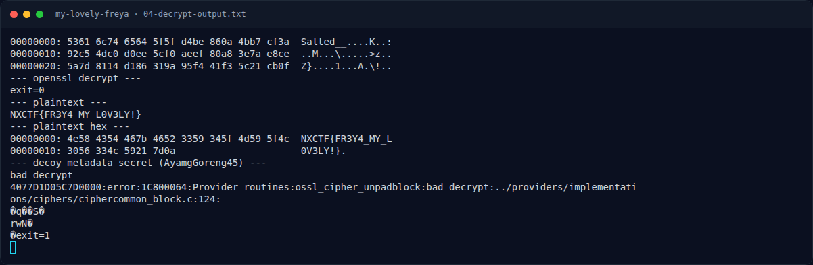

# My Lovely Freya — Flag & Verifikasi

[← Overview](29-my-lovely-freya.md) · [Index](index.md)

> **Langkah 7/9 — Flag.** Plaintext asli di surat:
>
> **Titik penting:** NFX{FR3Y4_MY_L0V3LY!}
>
> **Berikutnya:** [Bukti / Evidence](29-my-lovely-freya-08-bukti-evidence.md)

> **Flag:** `NFX{FR3Y4_MY_L0V3LY!}`
> **Status:** `VERIFIED`

Plaintext asli di surat:

```text
NXCTF{FR3Y4_MY_L0V3LY!}
```

Flag platform (file `flags/wave2/My_Lovely_Freya.txt`):

```text
NFX{FR3Y4_MY_L0V3LY!}
```

Verifikasi:

- Dekripsi OpenSSL berhasil (`exit=0`), padding valid, plaintext terbaca.
- Isi surat adalah flag dengan prefix `NXCTF`.
- Prefix dinormalisasi ke `NFX` sesuai format challenge/flag file.
- Metadata decoy `AyamgGoreng45` terbukti gagal (`bad decrypt`).

### Terminal evidence (real)



*Terminal evidence (real).*

> **Bukti:** terminal evidence (real).
