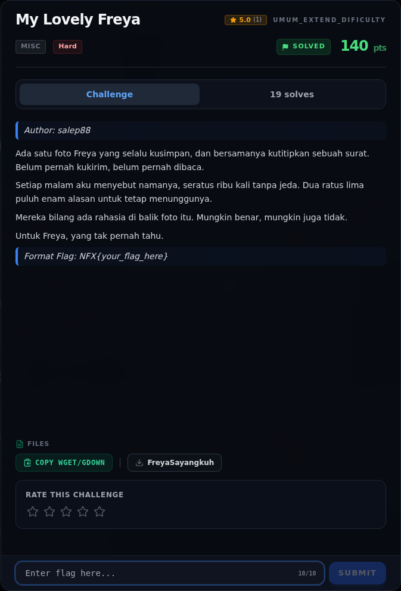
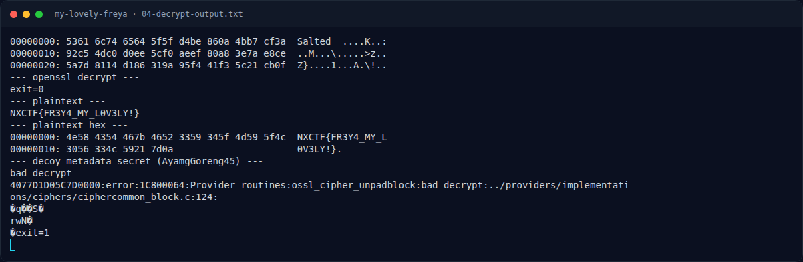
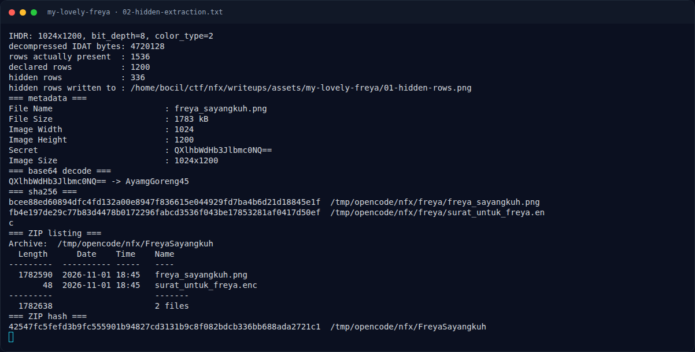
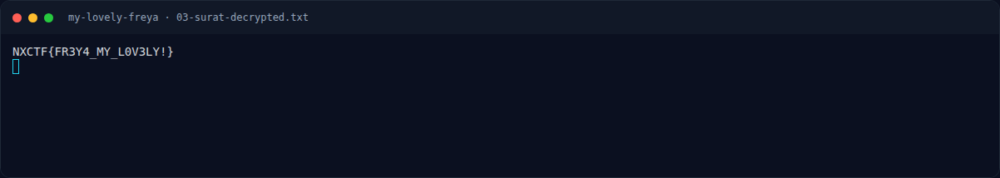
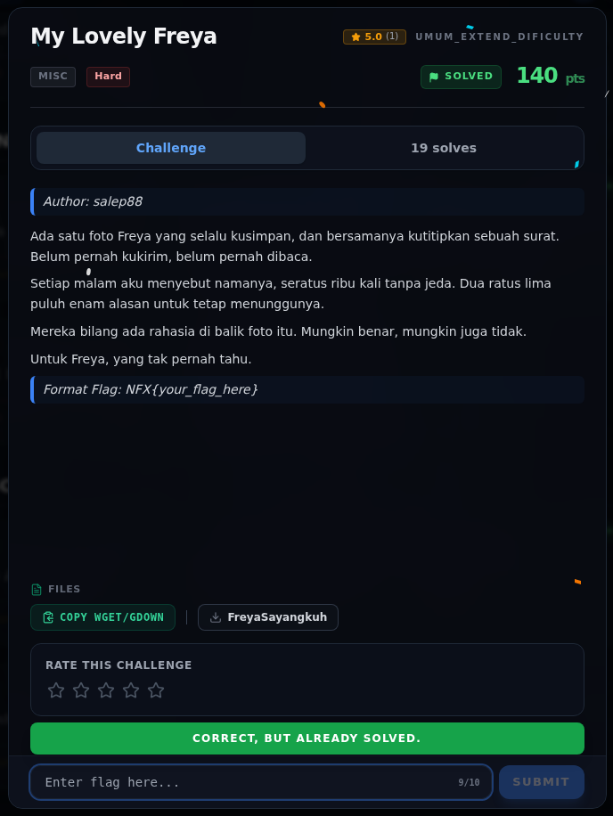

# My Lovely Freya — Evidence / Bukti

6 screenshot5 transkrip / script

[← Overview](29-my-lovely-freya.md) · [Index](index.md)

> **Langkah 8/9 — Bukti / Evidence.** Semua bukti berada di docs/assets/my-lovely-freya/.
>
> **Titik penting:** arsip screenshot dan transkrip
>
> **Berikutnya:** [Referensi](29-my-lovely-freya-09-referensi.md)

## Arsip Evidence

> Semua file berasal dari `assets/my-lovely-freya/`. Screenshot platform dan terminal adalah bukti asli dari sesi solve; transkrip mentah tetap ditautkan di bagian bawah.

### Platform

<figure><figcaption>00-challenge-platform.png</figcaption></figure>

*Challenge brief asli di platform NFX CTF 2026.*

<figure><figcaption>Terminal evidence (real)</figcaption></figure>

*Terminal evidence (real).*

### Terminal (arsip sesi)

<figure><figcaption>term-02-hidden-extraction.png</figcaption></figure>

*Terminal evidence — `02-hidden-extraction.txt` (arsip transkrip sesi solve).*

<figure><figcaption>term-03-surat-decrypted.png</figcaption></figure>

*Terminal evidence — `03-surat-decrypted.txt` (arsip transkrip sesi solve).*

<figure><figcaption>term-04-decrypt-output.png</figcaption></figure>

*Terminal evidence — `04-decrypt-output.txt` (arsip transkrip sesi solve).*

### Screenshot langkah

<figure><figcaption>01-hidden-rows.png</figcaption></figure>

*Evidence — `01-hidden-rows.png`.*

### Transkrip mentah & script

- [`02-hidden-extraction.txt`](assets/my-lovely-freya/02-hidden-extraction.txt)
- [`03-surat-decrypted.txt`](assets/my-lovely-freya/03-surat-decrypted.txt)
- [`04-decrypt-output.txt`](assets/my-lovely-freya/04-decrypt-output.txt)
- [`decrypt_surat.sh`](assets/my-lovely-freya/decrypt_surat.sh)
- [`extract_hidden.py`](assets/my-lovely-freya/extract_hidden.py)

## Validasi platform (real)

*Screenshot asli dari platform NFX CTF 2026. Platform menjawab
`CORRECT, BUT ALREADY SOLVED.` untuk flag ini.*

## Tabel Evidence

Semua bukti berada di `docs/assets/my-lovely-freya/`.

| Bukti | File | Keterangan |
|---|---|---|
| Baris tersembunyi | `01-hidden-rows.png` | 1024x336 gambar hasil baris 1200–1535 |
| Analisis PNG | `02-hidden-extraction.txt` | IHDR, jumlah baris, hash, metadata, base64 decode |
| Surat terdekripsi | `03-surat-decrypted.txt` | Plaintext `NXCTF{...}` |
| Log dekripsi | `04-decrypt-output.txt` | `xxd`, openssl, plaintext, decoy gagal |
| Ekstraktor | `extract_hidden.py` | Decoder PNG + unfilter + render baris ekstra |
| Dekriptor | `decrypt_surat.sh` | Command openssl yang dipakai |