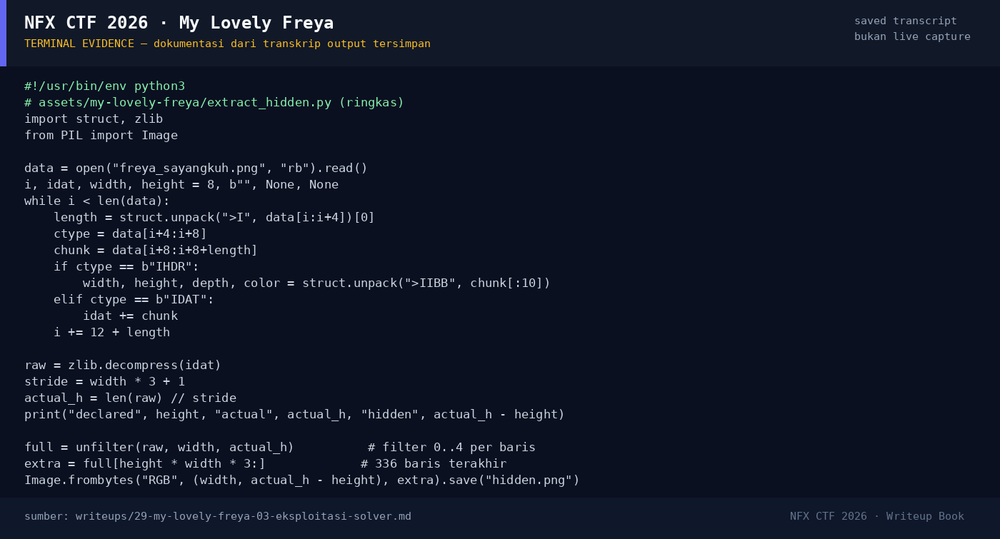

# My Lovely Freya

Track Umum / Extend · MiscHard320 poinVERIFIED

| Field | Nilai |
|---|---|
| Event | `umum_Extend` |
| Kategori | `Misc` |
| Difficulty | `Hard` |
| Poin | `320` |
| Author | `salep88` |
| Solves | `10` |
| Tools | python3, exiftool, openssl |
| Flag | `NFX{FR3Y4_MY_L0V3LY!}` |
| Status | `VERIFIED` |

[← Kembali ke Index](index.md)

## TL;DR

- Attachment `FreyaSayangkuh` adalah **ZIP** berisi `freya_sayangkuh.png`
  dan `surat_untuk_freya.enc`.
- PNG mendeklarasikan tinggi **1200** baris, tetapi IDAT sebenarnya berisi
  **1536** baris. Ada **336 baris tersembunyi** di bawah gambar yang tidak
  pernah ditampilkan viewer PNG normal.
- Baris tersembunyi berisi gambar teks password:
  `<!HayamGoreng45@/>`.
- Metadata PNG `Secret: QXlhbWdHb3Jlbmc0NQ==` adalah **decoy**; decode-nya
  `AyamgGoreng45` dan gagal dipakai untuk dekripsi.
- `surat_untuk_freya.enc` adalah format OpenSSL `Salted__`; dekripsi dengan
  **AES-256-CBC, PBKDF2, 100.000 iterasi, digest SHA-256**, password
  `<!HayamGoreng45@/>` menghasilkan surat:
  `NXCTF{FR3Y4_MY_L0V3LY!}`.
- Flag platform: `NFX{FR3Y4_MY_L0V3LY!}`.

Pratinjau evidence. Buka halaman <a href="29-my-lovely-freya-05-bukti-evidence.html">Evidence / Bukti</a> untuk semua screenshot dan transkrip.

## Navigasi Halaman

<a class="nx-page-card" href="29-my-lovely-freya-01-recon.html"><b>Recon</b>Enumerasi target dan bukti awal</a>
<a class="nx-page-card" href="29-my-lovely-freya-02-analisis.html"><b>Analisis</b>Membaca alur dan akar masalah</a>
<a class="nx-page-card" href="29-my-lovely-freya-03-eksploitasi-solver.html"><b>Eksploitasi / Solver</b>Langkah exploit dan solver</a>
<a class="nx-page-card" href="29-my-lovely-freya-04-flag.html"><b>Flag</b>Flag dan verifikasi platform</a>
<a class="nx-page-card" href="29-my-lovely-freya-05-bukti-evidence.html"><b>Bukti / Evidence</b>Screenshot, transkrip, dan artefak</a>
<a class="nx-page-card" href="29-my-lovely-freya-06-referensi.html"><b>Referensi</b>Sumber dan bacaan lanjutan</a>

