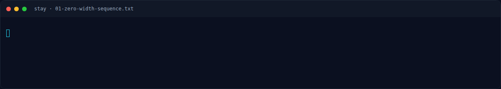

# Stay — Recon

[← Overview](30-stay.md) · [Index](index.md)

> **Langkah 1/6 — Recon.** Tidak ada attachment file.
>
> **Titik penting:** cat -v stay_zw_raw.txt \| head -2 · NFX{your_flag_here}
>
> **Berikutnya:** [Analisis](30-stay-02-analisis.md)

### 1.1 Deskripsi challenge

> **Author: Kesatria Baja Ringan**
>
> Seseorang menulis lirik lagu yang isinya seperti ini:
>
> ```text
> So⁠‌​‍⁠‌⁠ stay,‌⁠​​‍⁠‍ stay⁠​⁠‌‍‍⁠ with‌‌‍‌‍​‌ me⁠⁠⁠​⁠‌⁠ tonight,​⁠‌‌​⁠‌
> Let​​⁠⁠⁠​⁠ the‌⁠​⁠⁠⁠‌ world⁠‌‍⁠⁠​⁠ fall⁠⁠⁠​‌⁠‍ out​‌⁠‌‍⁠⁠ of‌‍‍⁠⁠‌‌ sight.⁠​⁠‍⁠‌⁠
> Your​⁠​⁠​⁠‌ hand‍​⁠​‍‌‌ in‍​‌⁠‌​​ mine,⁠‌‍‍⁠⁠‌ my​⁠⁠⁠⁠⁠‌ heart⁠⁠⁠⁠​‌⁠ in‍​​⁠⁠​⁠ two,⁠‌​‍⁠⁠⁠
> I’m⁠⁠‍​‌⁠⁠ falling‌⁠⁠‌​‍⁠ slow,‌⁠⁠⁠⁠‌⁠ but‌‍‍⁠‌‍‍ I’m⁠ falling for you.
> ```
>
> Temukan makna yang tidak diungkapkan pada lirik tersebut.
>
> Format Flag: `NFX{your_flag_here}`

### 1.2 File / input

| Input | Ukuran | Keterangan |
|---|---|---|
| Payload zero-width di deskripsi | 528 byte (176 karakter) | Disimpan lokal sebagai `/tmp/opencode/nfx/stay.desc.txt` |
| `stay_zw_raw.txt` | 528 byte (176 karakter) | Ekstraksi zero-width dari deskripsi |
| `stay_zw_seq.txt` | 176 byte ASCII | Representasi `a/b/c/d` dari empat code point |

Tidak ada attachment file. Seluruh payload ada di teks challenge.

### 1.3 Environment

- OS: Linux x86-64.
- Tools: Python 3, `base64`, editor/hex viewer.
- Tidak ada service jaringan.

### 1.4 Triage awal

Teks terlihat seperti lirik biasa. Namun `cat -v` menunjukkan banyak karakter
aneh:

```text
$ cat -v stay_zw_raw.txt | head -2
M-bM-^@M-^L M-bM-^@M-^L M-bM-^@M-^K ...
```

Empat code point yang muncul:

| Karakter | Nama | Bit |
|---|---|---|
| `U+200C` | ZERO WIDTH NON-JOINER | `00` |
| `U+2060` | WORD JOINER | `01` |
| `U+200B` | ZERO WIDTH SPACE | `10` |
| `U+200D` | ZERO WIDTH JOINER | `11` |

Karakter-karakter ini tidak terlihat di browser, tetapi tetap tersimpan
dalam UTF-8 dan bisa diekstrak dengan Python.

### Evidence langkah ini



*Terminal evidence — `01-zero-width-sequence.txt` (arsip transkrip sesi solve).*

**Berkas mentah langkah ini:**

- [`01-zero-width-sequence.txt`](assets/stay/01-zero-width-sequence.txt)
