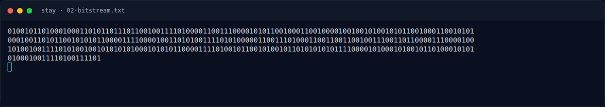

# Stay — Analisis

[← Overview](30-stay.md) · [Index](index.md)

### 2.1 Ekstraksi bitstream

Kita hanya mengambil karakter yang ada di tabel mapping, sesuai urutan
kemunculannya di teks. Huruf lirik biasa diabaikan.

```python
from pathlib import Path
import re

text = Path("/tmp/opencode/nfx/stay.desc.txt").read_text(encoding="utf-8")
block = re.search(r"```\n(.*?)\n```", text, re.S).group(1)
mapping = {
    "\u200c": "00",
    "\u2060": "01",
    "\u200b": "10",
    "\u200d": "11",
}
hidden = [c for c in block if c in mapping]
bits = "".join(mapping[c] for c in hidden)
```

Hasil:

```text
zero-width characters : 176
  '\u200c' -> 00 : 39
  '\u2060' -> 01 : 79
  '\u200b' -> 10 : 32
  '\u200d' -> 11 : 26
bit length            : 352
```

176 karakter × 2 bit = 352 bit, habis dibagi 8 → 44 byte.

### 2.2 Byte → Base64

```python
encoded = bytes(int(bits[i:i+8], 2) for i in range(0, len(bits), 8))
print(encoded.decode("ascii"))
```

```text
KDkvOC8VFBJVFTMeXxMOPgFfNl8JORUEXzYKUxQKEQ==
```

String ini valid sebagai Base64 (panjang kelipatan 4, padding `==`).
Decode menghasilkan 33 byte:

```text
28392f382f1514125515331e5f130e3e015f365f093915045f360a53140a11
```

### 2.3 XOR dengan key `falling`

33 byte hasil Base64 masih tampak acak. Karena temanya lagu dan liriknya
mengandung kata "falling", key `falling` diuji:

```python
key = b"falling"
plain = bytes(v ^ key[i % len(key)] for i, v in enumerate(raw))
print(plain.decode("ascii"))
```

```text
NXCTF{st4y_w1th_m3_1n_th3_d4rk}
```

Plaintext dapat dibaca dan berformat flag. Tidak perlu brute-force key:
petunjuk lirik ("falling") langsung mengarah ke key tersebut.

### Evidence langkah ini



*Terminal evidence — `02-bitstream.txt` (arsip transkrip sesi solve).*
